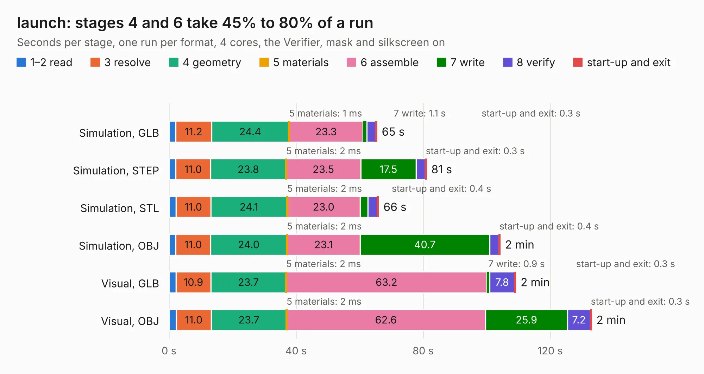

# 2739. launch

Board 2,739 of the 3,127 of [Corpus Testing](../Corpus-Testing.md), on [Corpus Page 26](../CorpusTestingPages/Corpus-Testing-26.md#2739-launch).

| Mode and format | 1–2 read | 3 resolve | 4 geometry | 5 materials | 6 assemble | 7 write | 8 verify | start-up and exit | Total |
|---|---:|---:|---:|---:|---:|---:|---:|---:|---:|
| Simulation, GLB | 2.1 | 11.2 | 24.4 | 1&nbsp;ms | 23.3 | 1.1 | 2.8 | 0.3 | 65.4 |
| Simulation, STEP | 2.1 | 11.0 | 23.8 | 2&nbsp;ms | 23.5 | 17.5 | 2.9 | 0.3 | 81.0 |
| Simulation, STL | 2.2 | 11.0 | 24.1 | 2&nbsp;ms | 23.0 | 2.5 | 2.9 | 0.4 | 65.9 |
| Simulation, OBJ | 2.1 | 11.0 | 24.0 | 2&nbsp;ms | 23.1 | 40.7 | 2.9 | 0.4 | 104.2 |
| Visual, GLB | 2.2 | 10.9 | 23.7 | 2&nbsp;ms | 63.2 | 0.9 | 7.8 | 0.3 | 109.1 |
| Visual, OBJ | 2.3 | 11.0 | 23.7 | 2&nbsp;ms | 62.6 | 25.9 | 7.2 | 0.3 | 133.0 |

<table align="center"><tr><td valign="top">

| Board | Repo: [system76/launch](https://github.com/system76/launch) Board: `launch.kicad_pcb` |
|---|---|
| Folder | pcb |
| Complexity | 393&nbsp;/&nbsp;1000 (size&nbsp;288, features&nbsp;105) |
| KESE&nbsp;features | through vias, slotted holes, rounded, trapezoid or chamfered pads, filled zones, copper text, curved board outline, stack-up, dielectric εr and tanδ |
| Tested | 9th November 2026 |
| Copper&nbsp;layers | 4 |
| File&nbsp;format | KiCad 7 (20221018) |
| Parts,&nbsp;tracks,&nbsp;vias | 371, 3,494, 959 |
| Triangles,&nbsp;simulation | 7,010,812 in 414 parts |
| Verifier | PASS in all six runs |

</td><td valign="top">

<table>
<tr><th>File type</th><th>File size</th><th>Peak memory used</th></tr>
<tr><th colspan="3" align="left">Simulation</th></tr>
<tr><td>GLB</td><td align="right">239&nbsp;MB</td><td align="right">2.4&nbsp;GB</td></tr>
<tr><td>STEP</td><td align="right">1.0&nbsp;GB</td><td align="right">2.8&nbsp;GB</td></tr>
<tr><td>STL</td><td align="right">351&nbsp;MB</td><td align="right">2.3&nbsp;GB</td></tr>
<tr><td>OBJ</td><td align="right">758&nbsp;MB</td><td align="right">4.5&nbsp;GB</td></tr>
<tr><th colspan="3" align="left">Visual</th></tr>
<tr><td>GLB</td><td align="right">160&nbsp;MB</td><td align="right">2.6&nbsp;GB</td></tr>
<tr><td>OBJ</td><td align="right">511&nbsp;MB</td><td align="right">3.3&nbsp;GB</td></tr>
</table>

</td></tr></table>

| Previous | Next |
|:---|---:|
| [2738. launch-lite](b2738b_launch_launch-lite.md) | [2740. nebula-io](b2740b_thelio-io-hardware_nebula-io.md) |
