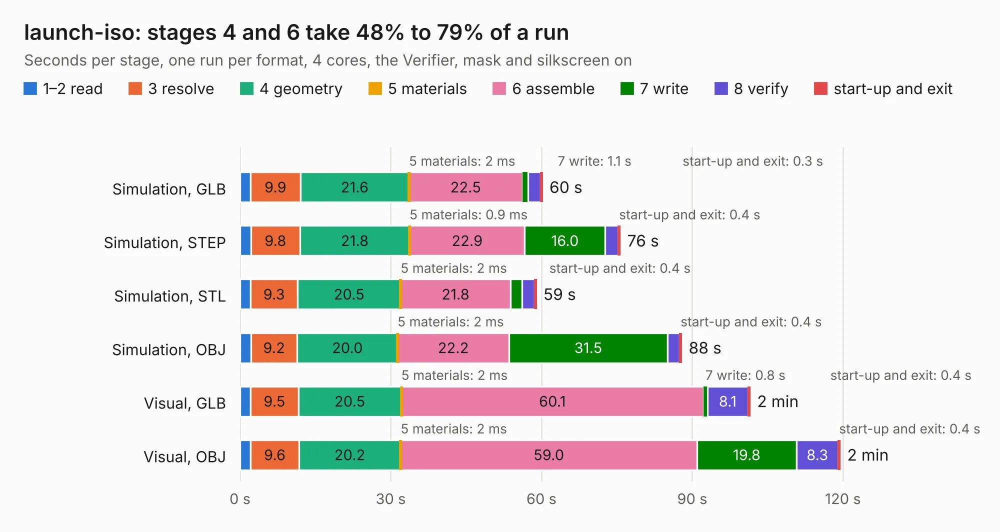

# 2740. launch-iso

Board 2,740 of the 3,132 of [Corpus Testing](../Corpus-Testing.md), on [Corpus Page 26](../CorpusTestingPages/Corpus-Testing-26.md#2740-launch-iso).

| Mode and format | 1–2 read | 3 resolve | 4 geometry | 5 materials | 6 assemble | 7 write | 8 verify | start-up and exit | Total |
|---|---:|---:|---:|---:|---:|---:|---:|---:|---:|
| Simulation, GLB | 2.1 | 9.9 | 21.6 | 2&nbsp;ms | 22.5 | 1.1 | 2.5 | 0.3 | 60.2 |
| Simulation, STEP | 2.2 | 9.8 | 21.8 | 0.9&nbsp;ms | 22.9 | 16.0 | 2.6 | 0.4 | 75.6 |
| Simulation, STL | 2.1 | 9.3 | 20.5 | 2&nbsp;ms | 21.8 | 2.3 | 2.5 | 0.4 | 58.9 |
| Simulation, OBJ | 2.2 | 9.2 | 20.0 | 2&nbsp;ms | 22.2 | 31.5 | 2.4 | 0.4 | 87.9 |
| Visual, GLB | 2.1 | 9.5 | 20.5 | 2&nbsp;ms | 60.1 | 0.8 | 8.1 | 0.4 | 101.5 |
| Visual, OBJ | 2.1 | 9.6 | 20.2 | 2&nbsp;ms | 59.0 | 19.8 | 8.3 | 0.4 | 119.4 |

<table align="center"><tr><td valign="top">

| Board | Repo: [system76/launch](https://github.com/system76/launch) Board: `launch-iso.kicad_pcb` |
|---|---|
| Folder | pcb-iso |
| Complexity | 430&nbsp;/&nbsp;1000 (size&nbsp;285, features&nbsp;145) |
| KESE&nbsp;features | through vias, slotted holes, custom pads, rounded, trapezoid or chamfered pads, arc tracks, filled zones, copper drawings, copper text, curved board outline, stack-up, dielectric εr and tanδ |
| Tested | 9th November 2026 |
| Copper&nbsp;layers | 4 |
| File&nbsp;format | KiCad 6 (20211014) |
| Parts,&nbsp;tracks,&nbsp;vias | 361, 3,521, 723 |
| Triangles,&nbsp;simulation | 5,928,940 in 419 parts |
| Verifier | PASS in all six runs |

</td><td valign="top">

<table>
<tr><th>File type</th><th>File size</th><th>Peak memory used</th></tr>
<tr><th colspan="3" align="left">Simulation</th></tr>
<tr><td>GLB</td><td align="right">204&nbsp;MB</td><td align="right">1.8&nbsp;GB</td></tr>
<tr><td>STEP</td><td align="right">984&nbsp;MB</td><td align="right">2.3&nbsp;GB</td></tr>
<tr><td>STL</td><td align="right">296&nbsp;MB</td><td align="right">1.9&nbsp;GB</td></tr>
<tr><td>OBJ</td><td align="right">644&nbsp;MB</td><td align="right">3.9&nbsp;GB</td></tr>
<tr><th colspan="3" align="left">Visual</th></tr>
<tr><td>GLB</td><td align="right">134&nbsp;MB</td><td align="right">2.1&nbsp;GB</td></tr>
<tr><td>OBJ</td><td align="right">426&nbsp;MB</td><td align="right">2.9&nbsp;GB</td></tr>
</table>

</td></tr></table>

| Previous | Next |
|:---|---:|
| [2739. launch-heavy](b2739b_launch_launch-heavy.md) | [2741. launch-lite-iso](b2741b_launch_launch-lite-iso.md) |
