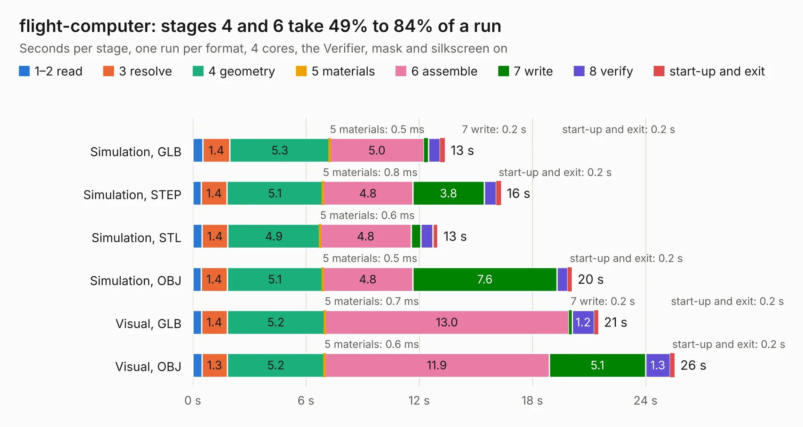

# 2740. flight-computer

Board 2,740 of the 3,108 of [Corpus Testing](../Corpus-Testing.md), on [Corpus Page 26](../CorpusTestingPages/Corpus-Testing-26.md#2740-flight-computer).

| Mode and format | 1–2 read | 3 resolve | 4 geometry | 5 materials | 6 assemble | 7 write | 8 verify | start-up and exit | Total |
|---|---:|---:|---:|---:|---:|---:|---:|---:|---:|
| Simulation, GLB | 0.5 | 1.4 | 5.3 | 0.5&nbsp;ms | 5.0 | 0.2 | 0.6 | 0.2 | 13.4 |
| Simulation, STEP | 0.4 | 1.4 | 5.1 | 0.8&nbsp;ms | 4.8 | 3.8 | 0.7 | 0.2 | 16.3 |
| Simulation, STL | 0.5 | 1.4 | 4.9 | 0.6&nbsp;ms | 4.8 | 0.5 | 0.6 | 0.3 | 13.0 |
| Simulation, OBJ | 0.4 | 1.4 | 5.1 | 0.5&nbsp;ms | 4.8 | 7.6 | 0.6 | 0.2 | 20.1 |
| Visual, GLB | 0.5 | 1.4 | 5.2 | 0.7&nbsp;ms | 13.0 | 0.2 | 1.2 | 0.2 | 21.5 |
| Visual, OBJ | 0.5 | 1.3 | 5.2 | 0.6&nbsp;ms | 11.9 | 5.1 | 1.3 | 0.2 | 25.5 |

<table align="center"><tr><td valign="top">

| Board | Repo: [terrapin-rocket-team/srad-avionics](https://github.com/terrapin-rocket-team/srad-avionics) Board: `flight-computer.kicad_pcb` |
|---|---|
| Folder | Spaceport / PCBs / flight-computer / flight-computer-2025-2026 |
| Complexity | 376&nbsp;/&nbsp;1000 (size&nbsp;256, features&nbsp;120) |
| KESE&nbsp;features | through vias, slotted holes, custom pads, rounded, trapezoid or chamfered pads, filled zones, copper drawings, curved board outline, stack-up, dielectric εr and tanδ |
| Tested | 9th November 2026 |
| Copper&nbsp;layers | 4 |
| File&nbsp;format | KiCad 9 (20241229) |
| Parts,&nbsp;tracks,&nbsp;vias | 117, 937, 169 |
| Triangles,&nbsp;simulation | 1,443,250 in 215 parts |
| Verifier | PASS in all six runs |

</td><td valign="top">

<table>
<tr><th>File type</th><th>File size</th><th>Peak memory used</th></tr>
<tr><th colspan="3" align="left">Simulation</th></tr>
<tr><td>GLB</td><td align="right">50&nbsp;MB</td><td align="right">546&nbsp;MB</td></tr>
<tr><td>STEP</td><td align="right">213&nbsp;MB</td><td align="right">626&nbsp;MB</td></tr>
<tr><td>STL</td><td align="right">72&nbsp;MB</td><td align="right">544&nbsp;MB</td></tr>
<tr><td>OBJ</td><td align="right">149&nbsp;MB</td><td align="right">992&nbsp;MB</td></tr>
<tr><th colspan="3" align="left">Visual</th></tr>
<tr><td>GLB</td><td align="right">32&nbsp;MB</td><td align="right">691&nbsp;MB</td></tr>
<tr><td>OBJ</td><td align="right">97&nbsp;MB</td><td align="right">753&nbsp;MB</td></tr>
</table>

</td></tr></table>

| Previous | Next |
|:---|---:|
| [2739. flight-computer](b2739b_srad-avionics_Spaceport-PCBs-flight-computer-Alternate-layout-2025-2026_flight-computer.md) | [2741. mcu-board v2](b2741b_srad-avionics_mcu-board-v2.md) |
