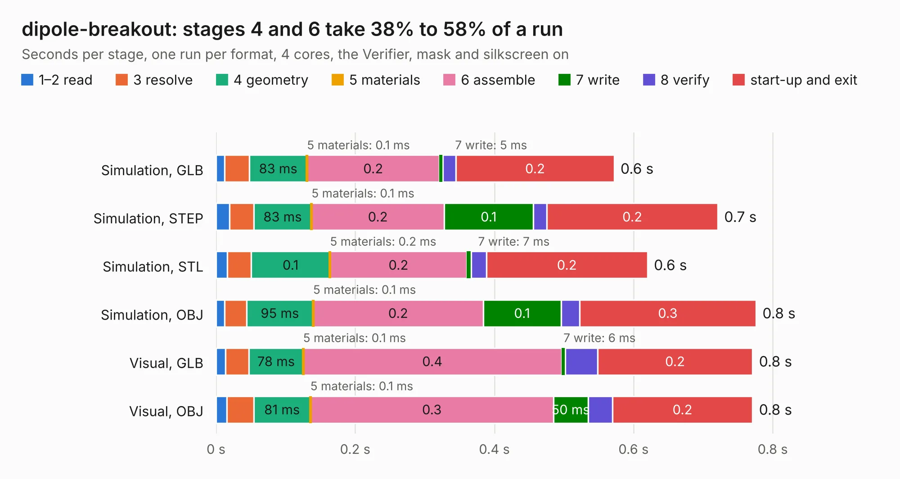

# 2740. dipole-breakout

Board 2,740 of the 3,110 of [Corpus Testing](../Corpus-Testing.md), on [Corpus Page 26](../CorpusTestingPages/Corpus-Testing-26.md#2740-dipole-breakout).

| Mode and format | 1–2 read | 3 resolve | 4 geometry | 5 materials | 6 assemble | 7 write | 8 verify | start-up and exit | Total |
|---|---:|---:|---:|---:|---:|---:|---:|---:|---:|
| Simulation, GLB | 12&nbsp;ms | 36&nbsp;ms | 83&nbsp;ms | 0.1&nbsp;ms | 0.2 | 5&nbsp;ms | 19&nbsp;ms | 0.2 | 0.6 |
| Simulation, STEP | 20&nbsp;ms | 35&nbsp;ms | 83&nbsp;ms | 0.1&nbsp;ms | 0.2 | 0.1 | 20&nbsp;ms | 0.2 | 0.7 |
| Simulation, STL | 16&nbsp;ms | 34&nbsp;ms | 0.1 | 0.2&nbsp;ms | 0.2 | 7&nbsp;ms | 21&nbsp;ms | 0.2 | 0.6 |
| Simulation, OBJ | 12&nbsp;ms | 32&nbsp;ms | 95&nbsp;ms | 0.1&nbsp;ms | 0.2 | 0.1 | 27&nbsp;ms | 0.3 | 0.8 |
| Visual, GLB | 14&nbsp;ms | 34&nbsp;ms | 78&nbsp;ms | 0.1&nbsp;ms | 0.4 | 6&nbsp;ms | 46&nbsp;ms | 0.2 | 0.8 |
| Visual, OBJ | 16&nbsp;ms | 39&nbsp;ms | 81&nbsp;ms | 0.1&nbsp;ms | 0.3 | 50&nbsp;ms | 35&nbsp;ms | 0.2 | 0.8 |

<table align="center"><tr><td valign="top">

| Board | Repo: [terrapin-rocket-team/srad-avionics](https://github.com/terrapin-rocket-team/srad-avionics) Board: `dipole-breakout.kicad_pcb` |
|---|---|
| Folder | Spaceport / PCBs / dipole-breakout |
| Complexity | 135&nbsp;/&nbsp;1000 (size&nbsp;80, features&nbsp;55) |
| KESE&nbsp;features | through vias, rounded, trapezoid or chamfered pads, filled zones, curved board outline |
| Tested | 9th November 2026 |
| Copper&nbsp;layers | 2 |
| File&nbsp;format | KiCad 8 (20240108) |
| Parts,&nbsp;tracks,&nbsp;vias | 3, 12, 2 |
| Triangles,&nbsp;simulation | 14,840 in 12 parts |
| Verifier | PASS in all six runs |

</td><td valign="top">

<table>
<tr><th>File type</th><th>File size</th><th>Peak memory used</th></tr>
<tr><th colspan="3" align="left">Simulation</th></tr>
<tr><td>GLB</td><td align="right">545&nbsp;kB</td><td align="right">41&nbsp;MB</td></tr>
<tr><td>STEP</td><td align="right">1.8&nbsp;MB</td><td align="right">42&nbsp;MB</td></tr>
<tr><td>STL</td><td align="right">743&nbsp;kB</td><td align="right">42&nbsp;MB</td></tr>
<tr><td>OBJ</td><td align="right">1.4&nbsp;MB</td><td align="right">44&nbsp;MB</td></tr>
<tr><th colspan="3" align="left">Visual</th></tr>
<tr><td>GLB</td><td align="right">320&nbsp;kB</td><td align="right">55&nbsp;MB</td></tr>
<tr><td>OBJ</td><td align="right">809&nbsp;kB</td><td align="right">60&nbsp;MB</td></tr>
</table>

</td></tr></table>

| Previous | Next |
|:---|---:|
| [2739. Blue Raven Extension](b2739b_srad-avionics_Blue-Raven-Extension.md) | [2741. flight-computer](b2741b_srad-avionics_Spaceport-PCBs-flight-computer-Alternate-layout-2025-2026_flight-computer.md) |
