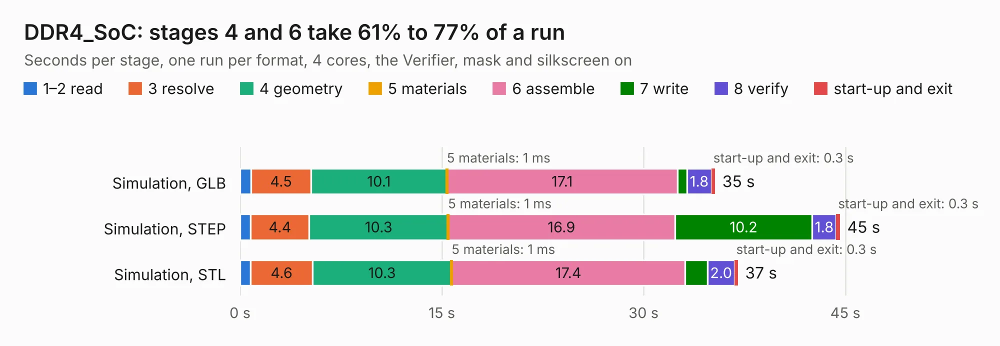

# 2741. DDR4_SoC

Board 2,741 of the 3,120 of [Corpus Testing](../Corpus-Testing.md), on [Corpus Page 26](../CorpusTestingPages/Corpus-Testing-26.md#2741-ddr4_soc).

| Mode and format | 1–2 read | 3 resolve | 4 geometry | 5 materials | 6 assemble | 7 write | 8 verify | start-up and exit | Total |
|---|---:|---:|---:|---:|---:|---:|---:|---:|---:|
| Simulation, GLB | 0.8 | 4.5 | 10.1 | 1&nbsp;ms | 17.1 | 0.7 | 1.8 | 0.3 | 35.3 |
| Simulation, STEP | 0.8 | 4.4 | 10.3 | 1&nbsp;ms | 16.9 | 10.2 | 1.8 | 0.3 | 44.6 |
| Simulation, STL | 0.8 | 4.6 | 10.3 | 1&nbsp;ms | 17.4 | 1.7 | 2.0 | 0.3 | 37.0 |
| Simulation, OBJ | 0.9 | 4.5 | 10.6 | 1&nbsp;ms | 17.4 | 21.6 | 2.2 | 0.3 | 57.4 |
| Visual, GLB | 0.9 | 4.9 | 10.6 | 2&nbsp;ms | 36.4 | 0.5 | 5.5 | 0.3 | 59.0 |
| Visual, OBJ | 0.8 | 4.7 | 10.9 | 1&nbsp;ms | 36.7 | 14.3 | 6.1 | 0.3 | 74.0 |

<table align="center"><tr><td valign="top">

| Board | Repo: [tatakimon/lpddr4_w_allwinner_soc](https://github.com/tatakimon/lpddr4_w_allwinner_soc) Board: `DDR4_SoC.kicad_pcb` |
|---|---|
| Folder | DDR4_SoC |
| Complexity | 442&nbsp;/&nbsp;1000 (size&nbsp;307, features&nbsp;135) |
| KESE&nbsp;features | through vias, rounded, trapezoid or chamfered pads, arc tracks, filled zones, copper drawings, copper text, curved board outline, knockout text, stack-up, dielectric εr and tanδ |
| Tested | 9th November 2026 |
| Copper&nbsp;layers | 6 |
| File&nbsp;format | KiCad 9 (20241229) |
| Parts,&nbsp;tracks,&nbsp;vias | 152, 6,210, 715 |
| Triangles,&nbsp;simulation | 4,953,774 in 335 parts |
| Verifier | PASS in all six runs |

</td><td valign="top">

<table>
<tr><th>File type</th><th>File size</th><th>Peak memory used</th></tr>
<tr><th colspan="3" align="left">Simulation</th></tr>
<tr><td>GLB</td><td align="right">164&nbsp;MB</td><td align="right">1.5&nbsp;GB</td></tr>
<tr><td>STEP</td><td align="right">584&nbsp;MB</td><td align="right">2.0&nbsp;GB</td></tr>
<tr><td>STL</td><td align="right">248&nbsp;MB</td><td align="right">1.4&nbsp;GB</td></tr>
<tr><td>OBJ</td><td align="right">519&nbsp;MB</td><td align="right">3.1&nbsp;GB</td></tr>
<tr><th colspan="3" align="left">Visual</th></tr>
<tr><td>GLB</td><td align="right">102&nbsp;MB</td><td align="right">1.7&nbsp;GB</td></tr>
<tr><td>OBJ</td><td align="right">329&nbsp;MB</td><td align="right">2.2&nbsp;GB</td></tr>
</table>

</td></tr></table>

| Previous | Next |
|:---|---:|
| [2740. TAPRX-888](b2740b_TAPRx888_TAPRX-888.md) | [2742. OpenInverter_20b](b2742b_Open-Inverter-2-0b-Kicad_OpenInverter-20b.md) |
