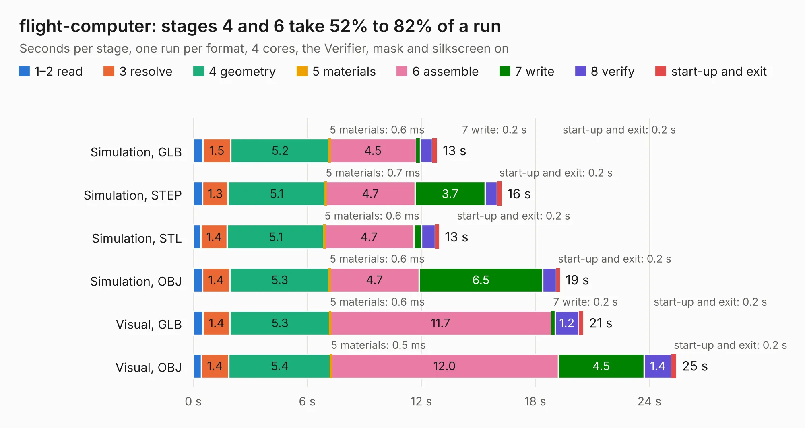

# 2741. flight-computer

Board 2,741 of the 3,110 of [Corpus Testing](../Corpus-Testing.md), on [Corpus Page 26](../CorpusTestingPages/Corpus-Testing-26.md#2741-flight-computer).

| Mode and format | 1–2 read | 3 resolve | 4 geometry | 5 materials | 6 assemble | 7 write | 8 verify | start-up and exit | Total |
|---|---:|---:|---:|---:|---:|---:|---:|---:|---:|
| Simulation, GLB | 0.5 | 1.5 | 5.2 | 0.6&nbsp;ms | 4.5 | 0.2 | 0.6 | 0.2 | 12.8 |
| Simulation, STEP | 0.5 | 1.3 | 5.1 | 0.7&nbsp;ms | 4.7 | 3.7 | 0.6 | 0.2 | 16.2 |
| Simulation, STL | 0.4 | 1.4 | 5.1 | 0.6&nbsp;ms | 4.7 | 0.4 | 0.7 | 0.2 | 12.9 |
| Simulation, OBJ | 0.5 | 1.4 | 5.3 | 0.6&nbsp;ms | 4.7 | 6.5 | 0.7 | 0.2 | 19.3 |
| Visual, GLB | 0.5 | 1.4 | 5.3 | 0.6&nbsp;ms | 11.7 | 0.2 | 1.2 | 0.2 | 20.5 |
| Visual, OBJ | 0.4 | 1.4 | 5.4 | 0.5&nbsp;ms | 12.0 | 4.5 | 1.4 | 0.2 | 25.4 |

<table align="center"><tr><td valign="top">

| Board | Repo: [terrapin-rocket-team/srad-avionics](https://github.com/terrapin-rocket-team/srad-avionics) Board: `flight-computer.kicad_pcb` |
|---|---|
| Folder | Spaceport / PCBs / flight-computer / Alternate layout-2025-2026 |
| Complexity | 400&nbsp;/&nbsp;1000 (size&nbsp;250, features&nbsp;150) |
| KESE&nbsp;features | through vias, slotted holes, custom pads, rounded, trapezoid or chamfered pads, filled zones, copper drawings, curved board outline, knockout text, TrueType text, stack-up, dielectric εr and tanδ |
| Tested | 9th November 2026 |
| Copper&nbsp;layers | 4 |
| File&nbsp;format | KiCad 10 (20260206) |
| Parts,&nbsp;tracks,&nbsp;vias | 96, 737, 135 |
| Triangles,&nbsp;simulation | 1,549,962 in 145 parts |
| Verifier | PASS in all six runs |

</td><td valign="top">

<table>
<tr><th>File type</th><th>File size</th><th>Peak memory used</th></tr>
<tr><th colspan="3" align="left">Simulation</th></tr>
<tr><td>GLB</td><td align="right">54&nbsp;MB</td><td align="right">581&nbsp;MB</td></tr>
<tr><td>STEP</td><td align="right">247&nbsp;MB</td><td align="right">692&nbsp;MB</td></tr>
<tr><td>STL</td><td align="right">78&nbsp;MB</td><td align="right">581&nbsp;MB</td></tr>
<tr><td>OBJ</td><td align="right">162&nbsp;MB</td><td align="right">1.1&nbsp;GB</td></tr>
<tr><th colspan="3" align="left">Visual</th></tr>
<tr><td>GLB</td><td align="right">36&nbsp;MB</td><td align="right">770&nbsp;MB</td></tr>
<tr><td>OBJ</td><td align="right">109&nbsp;MB</td><td align="right">786&nbsp;MB</td></tr>
</table>

</td></tr></table>

| Previous | Next |
|:---|---:|
| [2740. dipole-breakout](b2740b_srad-avionics_dipole-breakout.md) | [2742. flight-computer](b2742b_srad-avionics_Spaceport-PCBs-flight-computer-flight-computer-2025-2026_flight-computer.md) |
