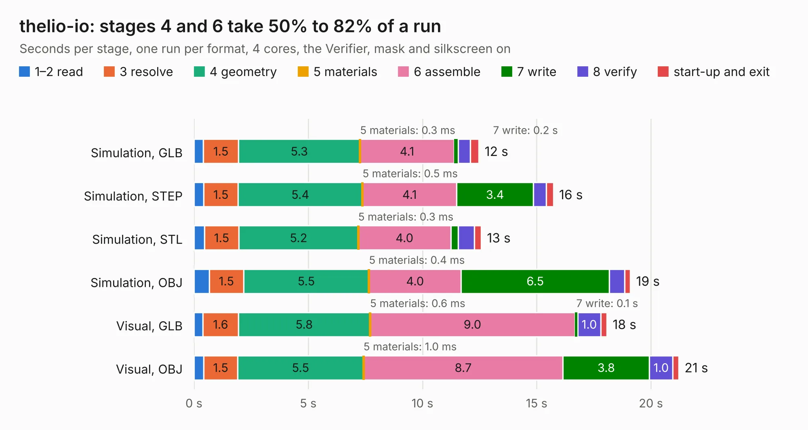

# 2742. thelio-io

Board 2,742 of the 3,128 of [Corpus Testing](../Corpus-Testing.md), on [Corpus Page 26](../CorpusTestingPages/Corpus-Testing-26.md#2742-thelio-io).

| Mode and format | 1–2 read | 3 resolve | 4 geometry | 5 materials | 6 assemble | 7 write | 8 verify | start-up and exit | Total |
|---|---:|---:|---:|---:|---:|---:|---:|---:|---:|
| Simulation, GLB | 0.4 | 1.5 | 5.3 | 0.3&nbsp;ms | 4.1 | 0.2 | 0.5 | 0.4 | 12.5 |
| Simulation, STEP | 0.4 | 1.5 | 5.4 | 0.5&nbsp;ms | 4.1 | 3.4 | 0.6 | 0.3 | 15.7 |
| Simulation, STL | 0.5 | 1.5 | 5.2 | 0.3&nbsp;ms | 4.0 | 0.3 | 0.7 | 0.3 | 12.6 |
| Simulation, OBJ | 0.7 | 1.5 | 5.5 | 0.4&nbsp;ms | 4.0 | 6.5 | 0.7 | 0.2 | 19.1 |
| Visual, GLB | 0.4 | 1.6 | 5.8 | 0.6&nbsp;ms | 9.0 | 0.1 | 1.0 | 0.3 | 18.1 |
| Visual, OBJ | 0.4 | 1.5 | 5.5 | 1.0&nbsp;ms | 8.7 | 3.8 | 1.0 | 0.3 | 21.2 |

<table align="center"><tr><td valign="top">

| Board | Repo: [system76/thelio-io-hardware](https://github.com/system76/thelio-io-hardware) Board: `thelio-io.kicad_pcb` |
|---|---|
| Folder | pcb-thelio-io |
| Complexity | 326&nbsp;/&nbsp;1000 (size&nbsp;231, features&nbsp;95) |
| KESE&nbsp;features | through vias, rounded, trapezoid or chamfered pads, filled zones, copper text, curved board outline, stack-up, dielectric εr and tanδ |
| Tested | 9th November 2026 |
| Copper&nbsp;layers | 4 |
| File&nbsp;format | KiCad 7 (20221018) |
| Parts,&nbsp;tracks,&nbsp;vias | 77, 543, 93 |
| Triangles,&nbsp;simulation | 1,048,850 in 86 parts |
| Verifier | PASS in all six runs |

</td><td valign="top">

<table>
<tr><th>File type</th><th>File size</th><th>Peak memory used</th></tr>
<tr><th colspan="3" align="left">Simulation</th></tr>
<tr><td>GLB</td><td align="right">37&nbsp;MB</td><td align="right">452&nbsp;MB</td></tr>
<tr><td>STEP</td><td align="right">169&nbsp;MB</td><td align="right">540&nbsp;MB</td></tr>
<tr><td>STL</td><td align="right">52&nbsp;MB</td><td align="right">453&nbsp;MB</td></tr>
<tr><td>OBJ</td><td align="right">108&nbsp;MB</td><td align="right">761&nbsp;MB</td></tr>
<tr><th colspan="3" align="left">Visual</th></tr>
<tr><td>GLB</td><td align="right">22&nbsp;MB</td><td align="right">583&nbsp;MB</td></tr>
<tr><td>OBJ</td><td align="right">67&nbsp;MB</td><td align="right">579&nbsp;MB</td></tr>
</table>

</td></tr></table>

| Previous | Next |
|:---|---:|
| [2741. thelio-io-sata](b2741b_thelio-io-hardware_thelio-io-sata.md) | [2743. virgo-keyboard-test](b2743b_virgo_virgo-keyboard-test.md) |
