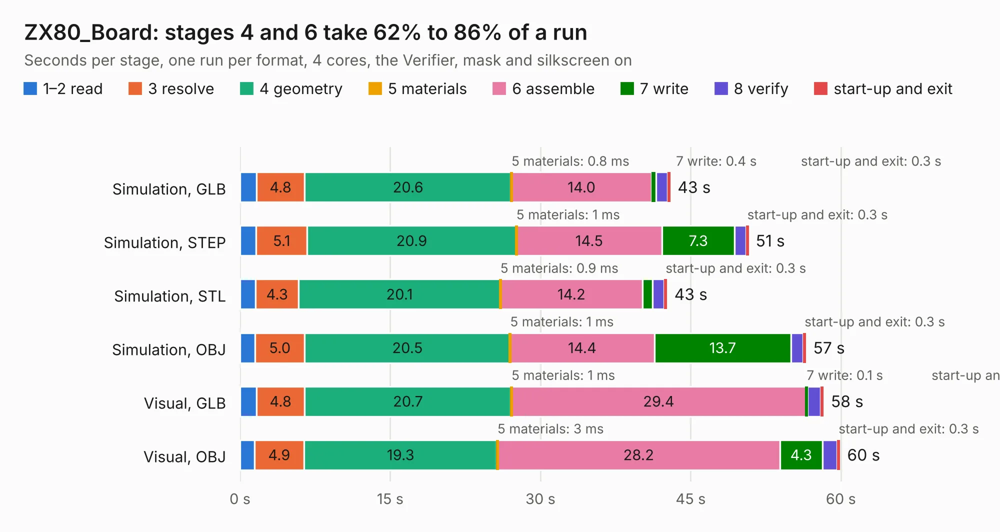

# 2743. ZX80_Board

Board 2,743 of the 3,125 of [Corpus Testing](../Corpus-Testing.md), on [Corpus Page 26](../CorpusTestingPages/Corpus-Testing-26.md#2743-zx80_board).

| Mode and format | 1–2 read | 3 resolve | 4 geometry | 5 materials | 6 assemble | 7 write | 8 verify | start-up and exit | Total |
|---|---:|---:|---:|---:|---:|---:|---:|---:|---:|
| Simulation, GLB | 1.6 | 4.8 | 20.6 | 0.8&nbsp;ms | 14.0 | 0.4 | 1.1 | 0.3 | 43.0 |
| Simulation, STEP | 1.6 | 5.1 | 20.9 | 1&nbsp;ms | 14.5 | 7.3 | 1.1 | 0.3 | 50.8 |
| Simulation, STL | 1.6 | 4.3 | 20.1 | 0.9&nbsp;ms | 14.2 | 1.0 | 1.2 | 0.3 | 42.6 |
| Simulation, OBJ | 1.5 | 5.0 | 20.5 | 1&nbsp;ms | 14.4 | 13.7 | 1.2 | 0.3 | 56.5 |
| Visual, GLB | 1.7 | 4.8 | 20.7 | 1&nbsp;ms | 29.4 | 0.1 | 1.3 | 0.3 | 58.3 |
| Visual, OBJ | 1.4 | 4.9 | 19.3 | 3&nbsp;ms | 28.2 | 4.3 | 1.5 | 0.3 | 59.9 |

<table align="center"><tr><td valign="top">

| Board | Repo: [TankedThomas/ZX80](https://github.com/TankedThomas/ZX80) Board: `ZX80_Board.kicad_pcb` |
|---|---|
| Complexity | 243&nbsp;/&nbsp;1000 (size&nbsp;178, features&nbsp;65) |
| KESE&nbsp;features | through vias, filled zones, stack-up, dielectric εr and tanδ |
| Tested | 9th November 2026 |
| Copper&nbsp;layers | 2 |
| File&nbsp;format | KiCad 7 (20221018) |
| Parts,&nbsp;tracks,&nbsp;vias | 124, 703, 30 |
| Triangles,&nbsp;simulation | 2,814,382 in 144 parts |
| Verifier | PASS in all six runs |

</td><td valign="top">

<table>
<tr><th>File type</th><th>File size</th><th>Peak memory used</th></tr>
<tr><th colspan="3" align="left">Simulation</th></tr>
<tr><td>GLB</td><td align="right">99&nbsp;MB</td><td align="right">886&nbsp;MB</td></tr>
<tr><td>STEP</td><td align="right">519&nbsp;MB</td><td align="right">1.2&nbsp;GB</td></tr>
<tr><td>STL</td><td align="right">141&nbsp;MB</td><td align="right">907&nbsp;MB</td></tr>
<tr><td>OBJ</td><td align="right">306&nbsp;MB</td><td align="right">1.9&nbsp;GB</td></tr>
<tr><th colspan="3" align="left">Visual</th></tr>
<tr><td>GLB</td><td align="right">32&nbsp;MB</td><td align="right">836&nbsp;MB</td></tr>
<tr><td>OBJ</td><td align="right">95&nbsp;MB</td><td align="right">835&nbsp;MB</td></tr>
</table>

</td></tr></table>

| Previous | Next |
|:---|---:|
| [2742. virgo-rpl-uph](b2742b_virgo_virgo-rpl-uph.md) | [2744. ZX80_Board_Foil](b2744b_ZX80_ZX80-Board-Foil.md) |
