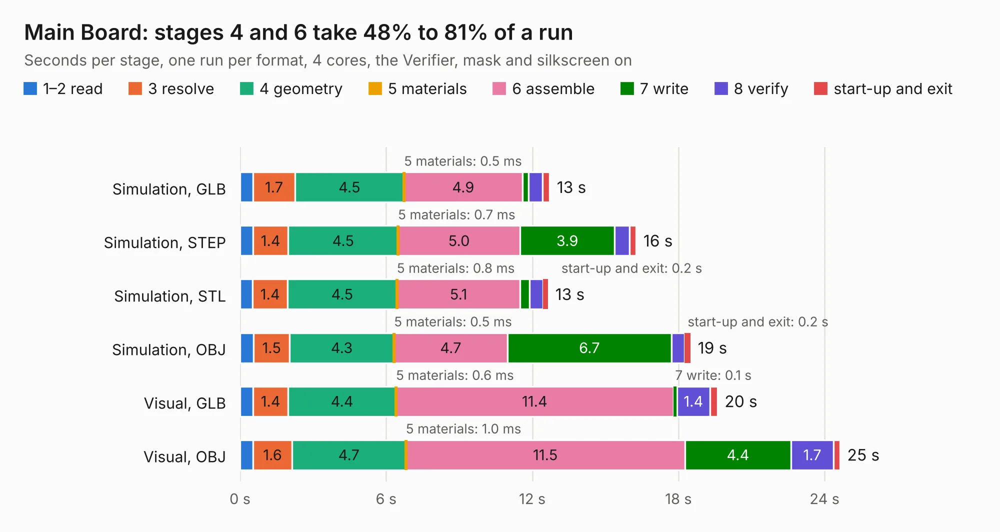

# 2743. Main Board

Board 2,743 of the 3,100 of [Corpus Testing](../Corpus-Testing.md), on [Corpus Page 26](../CorpusTestingPages/Corpus-Testing-26.md#2743-main-board).

| Mode and format | 1–2 read | 3 resolve | 4 geometry | 5 materials | 6 assemble | 7 write | 8 verify | start-up and exit | Total |
|---|---:|---:|---:|---:|---:|---:|---:|---:|---:|
| Simulation, GLB | 0.5 | 1.7 | 4.5 | 0.5&nbsp;ms | 4.9 | 0.3 | 0.6 | 0.3 | 12.7 |
| Simulation, STEP | 0.5 | 1.4 | 4.5 | 0.7&nbsp;ms | 5.0 | 3.9 | 0.6 | 0.3 | 16.3 |
| Simulation, STL | 0.5 | 1.4 | 4.5 | 0.8&nbsp;ms | 5.1 | 0.4 | 0.6 | 0.2 | 12.7 |
| Simulation, OBJ | 0.6 | 1.5 | 4.3 | 0.5&nbsp;ms | 4.7 | 6.7 | 0.5 | 0.2 | 18.5 |
| Visual, GLB | 0.5 | 1.4 | 4.4 | 0.6&nbsp;ms | 11.4 | 0.1 | 1.4 | 0.3 | 19.6 |
| Visual, OBJ | 0.5 | 1.6 | 4.7 | 1.0&nbsp;ms | 11.5 | 4.4 | 1.7 | 0.3 | 24.6 |

<table align="center"><tr><td valign="top">

| Board | Repo: [terrapin-rocket-team/srad-avionics](https://github.com/terrapin-rocket-team/srad-avionics) Board: `Main Board.kicad_pcb` |
|---|---|
| Folder | Spaceport / PCBs / MCU Boards / STM32 MCU Large |
| Complexity | 367&nbsp;/&nbsp;1000 (size&nbsp;242, features&nbsp;125) |
| KESE&nbsp;features | through vias, slotted holes, rounded, trapezoid or chamfered pads, filled zones, curved board outline, knockout text, TrueType text, stack-up, dielectric εr and tanδ |
| Tested | 9th November 2026 |
| Copper&nbsp;layers | 4 |
| File&nbsp;format | KiCad 8 (20240108) |
| Parts,&nbsp;tracks,&nbsp;vias | 87, 889, 199 |
| Triangles,&nbsp;simulation | 1,703,898 in 161 parts |
| Verifier | PASS in all six runs |

</td><td valign="top">

<table>
<tr><th>File type</th><th>File size</th><th>Peak memory used</th></tr>
<tr><th colspan="3" align="left">Simulation</th></tr>
<tr><td>GLB</td><td align="right">58&nbsp;MB</td><td align="right">600&nbsp;MB</td></tr>
<tr><td>STEP</td><td align="right">214&nbsp;MB</td><td align="right">741&nbsp;MB</td></tr>
<tr><td>STL</td><td align="right">85&nbsp;MB</td><td align="right">601&nbsp;MB</td></tr>
<tr><td>OBJ</td><td align="right">176&nbsp;MB</td><td align="right">1.2&nbsp;GB</td></tr>
<tr><th colspan="3" align="left">Visual</th></tr>
<tr><td>GLB</td><td align="right">37&nbsp;MB</td><td align="right">711&nbsp;MB</td></tr>
<tr><td>OBJ</td><td align="right">112&nbsp;MB</td><td align="right">879&nbsp;MB</td></tr>
</table>

</td></tr></table>

| Previous | Next |
|:---|---:|
| [2742. ESP32_BluetoothModule_TerrapinRockets](b2742b_srad-avionics_ESP32-BluetoothModule-TerrapinRockets.md) | [2744. mcu-board](b2744b_srad-avionics_mcu-board.md) |
