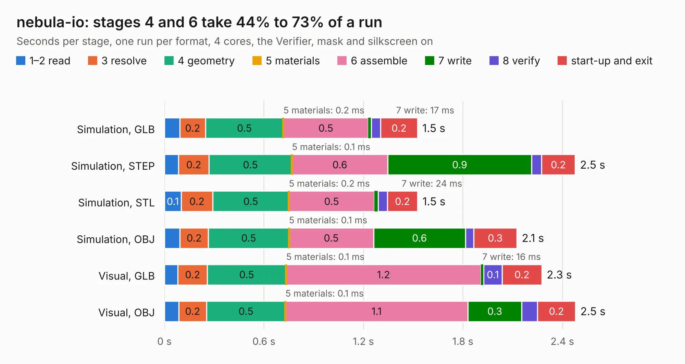

# 2743. nebula-io

Board 2,743 of the 3,131 of [Corpus Testing](../Corpus-Testing.md), on [Corpus Page 26](../CorpusTestingPages/Corpus-Testing-26.md#2743-nebula-io).

| Mode and format | 1–2 read | 3 resolve | 4 geometry | 5 materials | 6 assemble | 7 write | 8 verify | start-up and exit | Total |
|---|---:|---:|---:|---:|---:|---:|---:|---:|---:|
| Simulation, GLB | 93&nbsp;ms | 0.2 | 0.5 | 0.2&nbsp;ms | 0.5 | 17&nbsp;ms | 58&nbsp;ms | 0.2 | 1.5 |
| Simulation, STEP | 86&nbsp;ms | 0.2 | 0.5 | 0.1&nbsp;ms | 0.6 | 0.9 | 60&nbsp;ms | 0.2 | 2.5 |
| Simulation, STL | 0.1 | 0.2 | 0.5 | 0.2&nbsp;ms | 0.5 | 24&nbsp;ms | 55&nbsp;ms | 0.2 | 1.5 |
| Simulation, OBJ | 94&nbsp;ms | 0.2 | 0.5 | 0.1&nbsp;ms | 0.5 | 0.6 | 49&nbsp;ms | 0.3 | 2.1 |
| Visual, GLB | 82&nbsp;ms | 0.2 | 0.5 | 0.1&nbsp;ms | 1.2 | 16&nbsp;ms | 0.1 | 0.2 | 2.3 |
| Visual, OBJ | 86&nbsp;ms | 0.2 | 0.5 | 0.1&nbsp;ms | 1.1 | 0.3 | 95&nbsp;ms | 0.2 | 2.5 |

<table align="center"><tr><td valign="top">

| Board | Repo: [system76/thelio-io-hardware](https://github.com/system76/thelio-io-hardware) Board: `nebula-io.kicad_pcb` |
|---|---|
| Folder | pcb-nebula-io |
| Complexity | 176&nbsp;/&nbsp;1000 (size&nbsp;96, features&nbsp;80) |
| KESE&nbsp;features | rounded, trapezoid or chamfered pads, filled zones, copper text, curved board outline, stack-up, dielectric εr and tanδ |
| Tested | 9th November 2026 |
| Copper&nbsp;layers | 2 |
| File&nbsp;format | KiCad 7 (20221018) |
| Parts,&nbsp;tracks,&nbsp;vias | 8, 28, 0 |
| Triangles,&nbsp;simulation | 104,494 in 18 parts |
| Verifier | PASS in all six runs |

</td><td valign="top">

<table>
<tr><th>File type</th><th>File size</th><th>Peak memory used</th></tr>
<tr><th colspan="3" align="left">Simulation</th></tr>
<tr><td>GLB</td><td align="right">3.7&nbsp;MB</td><td align="right">183&nbsp;MB</td></tr>
<tr><td>STEP</td><td align="right">19&nbsp;MB</td><td align="right">187&nbsp;MB</td></tr>
<tr><td>STL</td><td align="right">5.2&nbsp;MB</td><td align="right">180&nbsp;MB</td></tr>
<tr><td>OBJ</td><td align="right">10&nbsp;MB</td><td align="right">182&nbsp;MB</td></tr>
<tr><th colspan="3" align="left">Visual</th></tr>
<tr><td>GLB</td><td align="right">2.4&nbsp;MB</td><td align="right">154&nbsp;MB</td></tr>
<tr><td>OBJ</td><td align="right">6.6&nbsp;MB</td><td align="right">153&nbsp;MB</td></tr>
</table>

</td></tr></table>

| Previous | Next |
|:---|---:|
| [2742. launch](b2742b_launch_launch.md) | [2744. thelio-io-sata](b2744b_thelio-io-hardware_thelio-io-sata.md) |
