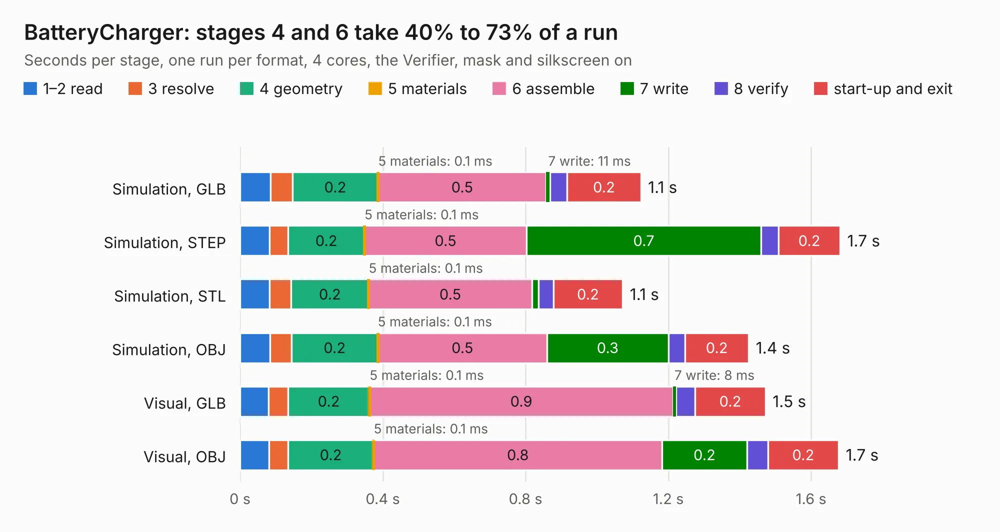

# 2746. BatteryCharger

Board 2,746 of the 3,118 of [Corpus Testing](../Corpus-Testing.md), on [Corpus Page 26](../CorpusTestingPages/Corpus-Testing-26.md#2746-batterycharger).

| Mode and format | 1–2 read | 3 resolve | 4 geometry | 5 materials | 6 assemble | 7 write | 8 verify | start-up and exit | Total |
|---|---:|---:|---:|---:|---:|---:|---:|---:|---:|
| Simulation, GLB | 85&nbsp;ms | 61&nbsp;ms | 0.2 | 0.1&nbsp;ms | 0.5 | 11&nbsp;ms | 48&nbsp;ms | 0.2 | 1.1 |
| Simulation, STEP | 82&nbsp;ms | 53&nbsp;ms | 0.2 | 0.1&nbsp;ms | 0.5 | 0.7 | 49&nbsp;ms | 0.2 | 1.7 |
| Simulation, STL | 82&nbsp;ms | 61&nbsp;ms | 0.2 | 0.1&nbsp;ms | 0.5 | 19&nbsp;ms | 42&nbsp;ms | 0.2 | 1.1 |
| Simulation, OBJ | 84&nbsp;ms | 60&nbsp;ms | 0.2 | 0.1&nbsp;ms | 0.5 | 0.3 | 47&nbsp;ms | 0.2 | 1.4 |
| Visual, GLB | 80&nbsp;ms | 54&nbsp;ms | 0.2 | 0.1&nbsp;ms | 0.9 | 8&nbsp;ms | 54&nbsp;ms | 0.2 | 1.5 |
| Visual, OBJ | 81&nbsp;ms | 53&nbsp;ms | 0.2 | 0.1&nbsp;ms | 0.8 | 0.2 | 58&nbsp;ms | 0.2 | 1.7 |

<table align="center"><tr><td valign="top">

| Board | Repo: [terrapin-rocket-team/srad-avionics](https://github.com/terrapin-rocket-team/srad-avionics) Board: `BatteryCharger.kicad_pcb` |
|---|---|
| Folder | Spaceport / PCBs / BatteryCharger / BatteryCharger |
| Complexity | 155&nbsp;/&nbsp;1000 (size&nbsp;110, features&nbsp;45) |
| KESE&nbsp;features | through vias, rounded, trapezoid or chamfered pads, filled zones |
| Tested | 9th November 2026 |
| Copper&nbsp;layers | 2 |
| File&nbsp;format | KiCad 9 (20241229) |
| Parts,&nbsp;tracks,&nbsp;vias | 9, 46, 6 |
| Triangles,&nbsp;simulation | 72,036 in 16 parts |
| Verifier | PASS in all six runs |

</td><td valign="top">

<table>
<tr><th>File type</th><th>File size</th><th>Peak memory used</th></tr>
<tr><th colspan="3" align="left">Simulation</th></tr>
<tr><td>GLB</td><td align="right">2.5&nbsp;MB</td><td align="right">175&nbsp;MB</td></tr>
<tr><td>STEP</td><td align="right">12&nbsp;MB</td><td align="right">179&nbsp;MB</td></tr>
<tr><td>STL</td><td align="right">3.6&nbsp;MB</td><td align="right">174&nbsp;MB</td></tr>
<tr><td>OBJ</td><td align="right">6.9&nbsp;MB</td><td align="right">174&nbsp;MB</td></tr>
<tr><th colspan="3" align="left">Visual</th></tr>
<tr><td>GLB</td><td align="right">1.9&nbsp;MB</td><td align="right">151&nbsp;MB</td></tr>
<tr><td>OBJ</td><td align="right">5.1&nbsp;MB</td><td align="right">151&nbsp;MB</td></tr>
</table>

</td></tr></table>

| Previous | Next |
|:---|---:|
| [2745. ARCH](b2745b_srad-avionics_ARCH.md) | [2747. Blue Raven Extension](b2747b_srad-avionics_Blue-Raven-Extension.md) |
