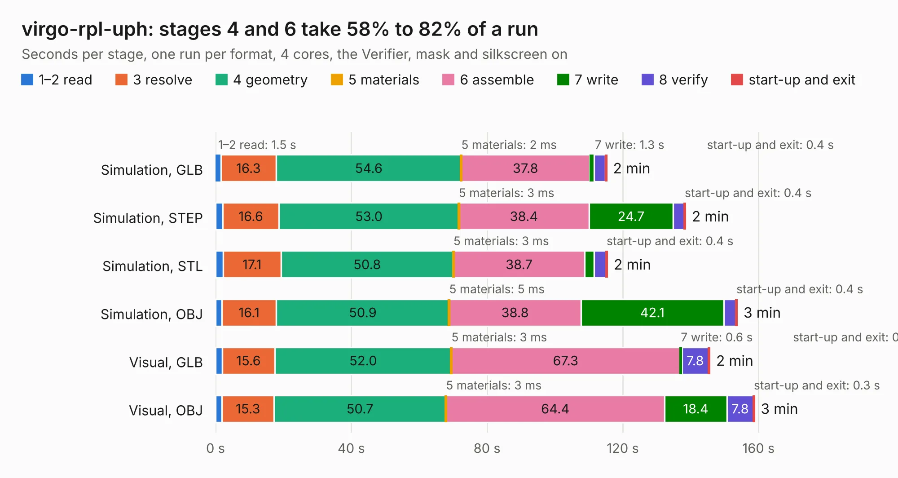

# 2746. virgo-rpl-uph

Board 2,746 of the 3,130 of [Corpus Testing](../Corpus-Testing.md), on [Corpus Page 26](../CorpusTestingPages/Corpus-Testing-26.md#2746-virgo-rpl-uph).

| Mode and format | 1–2 read | 3 resolve | 4 geometry | 5 materials | 6 assemble | 7 write | 8 verify | start-up and exit | Total |
|---|---:|---:|---:|---:|---:|---:|---:|---:|---:|
| Simulation, GLB | 1.5 | 16.3 | 54.6 | 2&nbsp;ms | 37.8 | 1.3 | 3.3 | 0.4 | 115.3 |
| Simulation, STEP | 2.1 | 16.6 | 53.0 | 3&nbsp;ms | 38.4 | 24.7 | 3.3 | 0.4 | 138.5 |
| Simulation, STL | 2.2 | 17.1 | 50.8 | 3&nbsp;ms | 38.7 | 2.8 | 3.4 | 0.4 | 115.5 |
| Simulation, OBJ | 1.8 | 16.1 | 50.9 | 5&nbsp;ms | 38.8 | 42.1 | 3.5 | 0.4 | 153.7 |
| Visual, GLB | 1.9 | 15.6 | 52.0 | 3&nbsp;ms | 67.3 | 0.6 | 7.8 | 0.3 | 145.6 |
| Visual, OBJ | 1.9 | 15.3 | 50.7 | 3&nbsp;ms | 64.4 | 18.4 | 7.8 | 0.3 | 158.8 |

<table align="center"><tr><td valign="top">

| Board | Repo: [system76/virgo](https://github.com/system76/virgo) Board: `virgo-rpl-uph.kicad_pcb` |
|---|---|
| Folder | pcb-rpl-uph |
| Complexity | 429&nbsp;/&nbsp;1000 (size&nbsp;309, features&nbsp;120) |
| KESE&nbsp;features | through vias, slotted holes, custom pads, rounded, trapezoid or chamfered pads, filled zones, copper drawings, copper text, stack-up, dielectric εr and tanδ |
| Tested | 9th November 2026 |
| Copper&nbsp;layers | 10 |
| File&nbsp;format | KiCad 7 (20221018) |
| Parts,&nbsp;tracks,&nbsp;vias | 591, 434, 292 |
| Triangles,&nbsp;simulation | 7,085,540 in 1533 parts |
| Verifier | PASS in all six runs |

</td><td valign="top">

<table>
<tr><th>File type</th><th>File size</th><th>Peak memory used</th></tr>
<tr><th colspan="3" align="left">Simulation</th></tr>
<tr><td>GLB</td><td align="right">242&nbsp;MB</td><td align="right">2.7&nbsp;GB</td></tr>
<tr><td>STEP</td><td align="right">1.4&nbsp;GB</td><td align="right">3.4&nbsp;GB</td></tr>
<tr><td>STL</td><td align="right">354&nbsp;MB</td><td align="right">2.6&nbsp;GB</td></tr>
<tr><td>OBJ</td><td align="right">778&nbsp;MB</td><td align="right">4.7&nbsp;GB</td></tr>
<tr><th colspan="3" align="left">Visual</th></tr>
<tr><td>GLB</td><td align="right">126&nbsp;MB</td><td align="right">2.4&nbsp;GB</td></tr>
<tr><td>OBJ</td><td align="right">404&nbsp;MB</td><td align="right">2.7&nbsp;GB</td></tr>
</table>

</td></tr></table>

| Previous | Next |
|:---|---:|
| [2745. virgo-keyboard-test](b2745b_virgo_virgo-keyboard-test.md) | [2747. ZX80_Board](b2747b_ZX80_ZX80-Board.md) |
