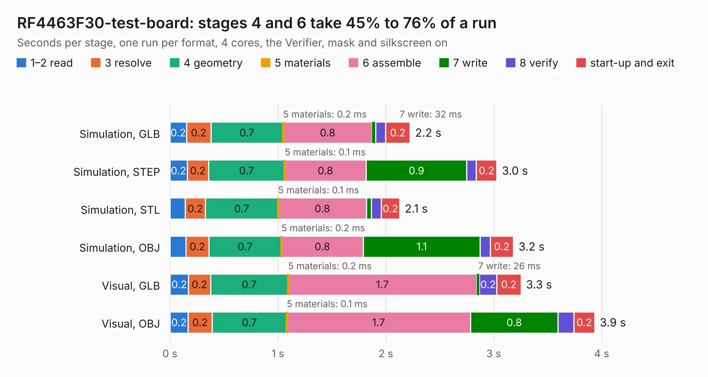

# 2749. RF4463F30-test-board

Board 2,749 of the 3,101 of [Corpus Testing](../Corpus-Testing.md), on [Corpus Page 26](../CorpusTestingPages/Corpus-Testing-26.md#2749-rf4463f30-test-board).

| Mode and format | 1–2 read | 3 resolve | 4 geometry | 5 materials | 6 assemble | 7 write | 8 verify | start-up and exit | Total |
|---|---:|---:|---:|---:|---:|---:|---:|---:|---:|
| Simulation, GLB | 0.2 | 0.2 | 0.7 | 0.2&nbsp;ms | 0.8 | 32&nbsp;ms | 91&nbsp;ms | 0.2 | 2.2 |
| Simulation, STEP | 0.2 | 0.2 | 0.7 | 0.1&nbsp;ms | 0.8 | 0.9 | 88&nbsp;ms | 0.2 | 3.0 |
| Simulation, STL | 0.1 | 0.2 | 0.7 | 0.1&nbsp;ms | 0.8 | 43&nbsp;ms | 92&nbsp;ms | 0.2 | 2.1 |
| Simulation, OBJ | 0.1 | 0.2 | 0.7 | 0.2&nbsp;ms | 0.8 | 1.1 | 94&nbsp;ms | 0.2 | 3.2 |
| Visual, GLB | 0.2 | 0.2 | 0.7 | 0.2&nbsp;ms | 1.7 | 26&nbsp;ms | 0.2 | 0.2 | 3.3 |
| Visual, OBJ | 0.2 | 0.2 | 0.7 | 0.1&nbsp;ms | 1.7 | 0.8 | 0.1 | 0.2 | 3.9 |

<table align="center"><tr><td valign="top">

| Board | Repo: [terrapin-rocket-team/srad-avionics](https://github.com/terrapin-rocket-team/srad-avionics) Board: `RF4463F30-test-board.kicad_pcb` |
|---|---|
| Folder | Spaceport / PCBs / RF4463F30-test-board |
| Complexity | 211&nbsp;/&nbsp;1000 (size&nbsp;126, features&nbsp;85) |
| KESE&nbsp;features | through vias, rounded, trapezoid or chamfered pads, filled zones, curved board outline, stack-up, dielectric εr and tanδ |
| Tested | 9th November 2026 |
| Copper&nbsp;layers | 2 |
| File&nbsp;format | KiCad 8 (20240108) |
| Parts,&nbsp;tracks,&nbsp;vias | 14, 85, 16 |
| Triangles,&nbsp;simulation | 189,326 in 32 parts |
| Verifier | PASS in all six runs |

</td><td valign="top">

<table>
<tr><th>File type</th><th>File size</th><th>Peak memory used</th></tr>
<tr><th colspan="3" align="left">Simulation</th></tr>
<tr><td>GLB</td><td align="right">6.6&nbsp;MB</td><td align="right">208&nbsp;MB</td></tr>
<tr><td>STEP</td><td align="right">32&nbsp;MB</td><td align="right">230&nbsp;MB</td></tr>
<tr><td>STL</td><td align="right">9.5&nbsp;MB</td><td align="right">206&nbsp;MB</td></tr>
<tr><td>OBJ</td><td align="right">19&nbsp;MB</td><td align="right">215&nbsp;MB</td></tr>
<tr><th colspan="3" align="left">Visual</th></tr>
<tr><td>GLB</td><td align="right">5.7&nbsp;MB</td><td align="right">216&nbsp;MB</td></tr>
<tr><td>OBJ</td><td align="right">16&nbsp;MB</td><td align="right">214&nbsp;MB</td></tr>
</table>

</td></tr></table>

| Previous | Next |
|:---|---:|
| [2748. power-delivery-board](b2748b_srad-avionics_power-delivery-board.md) | [2750. Screw Switch](b2750b_srad-avionics_Screw-Switch.md) |
