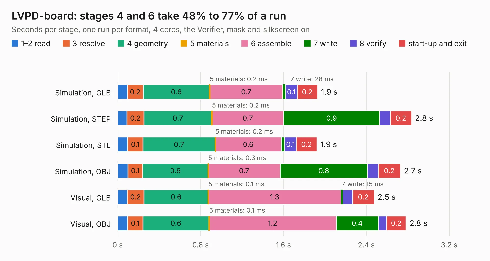

# 2750. LVPD-board

Board 2,750 of the 3,128 of [Corpus Testing](../Corpus-Testing.md), on [Corpus Page 26](../CorpusTestingPages/Corpus-Testing-26.md#2750-lvpd-board).

| Mode and format | 1–2 read | 3 resolve | 4 geometry | 5 materials | 6 assemble | 7 write | 8 verify | start-up and exit | Total |
|---|---:|---:|---:|---:|---:|---:|---:|---:|---:|
| Simulation, GLB | 95&nbsp;ms | 0.2 | 0.6 | 0.2&nbsp;ms | 0.7 | 28&nbsp;ms | 0.1 | 0.2 | 1.9 |
| Simulation, STEP | 91&nbsp;ms | 0.2 | 0.7 | 0.2&nbsp;ms | 0.7 | 0.9 | 0.1 | 0.2 | 2.8 |
| Simulation, STL | 97&nbsp;ms | 0.1 | 0.7 | 0.2&nbsp;ms | 0.6 | 36&nbsp;ms | 0.1 | 0.2 | 1.9 |
| Simulation, OBJ | 0.1 | 0.1 | 0.6 | 0.3&nbsp;ms | 0.7 | 0.8 | 0.1 | 0.2 | 2.7 |
| Visual, GLB | 92&nbsp;ms | 0.2 | 0.6 | 0.1&nbsp;ms | 1.3 | 15&nbsp;ms | 97&nbsp;ms | 0.2 | 2.5 |
| Visual, OBJ | 96&nbsp;ms | 0.1 | 0.6 | 0.1&nbsp;ms | 1.2 | 0.4 | 81&nbsp;ms | 0.2 | 2.8 |

<table align="center"><tr><td valign="top">

| Board | Repo: [terrapin-rocket-team/srad-avionics](https://github.com/terrapin-rocket-team/srad-avionics) Board: `LVPD-board.kicad_pcb` |
|---|---|
| Folder | Side_Projects / ARC / PCBs |
| Complexity | 117&nbsp;/&nbsp;1000 (size&nbsp;107, features&nbsp;10) |
| KESE&nbsp;features | rounded, trapezoid or chamfered pads |
| Tested | 9th November 2026 |
| Copper&nbsp;layers | 2 |
| File&nbsp;format | KiCad 7 (20221018) |
| Parts,&nbsp;tracks,&nbsp;vias | 7, 61, 0 |
| Triangles,&nbsp;simulation | 160,928 in 29 parts |
| Verifier | PASS in all six runs |

</td><td valign="top">

<table>
<tr><th>File type</th><th>File size</th><th>Peak memory used</th></tr>
<tr><th colspan="3" align="left">Simulation</th></tr>
<tr><td>GLB</td><td align="right">5.4&nbsp;MB</td><td align="right">201&nbsp;MB</td></tr>
<tr><td>STEP</td><td align="right">20&nbsp;MB</td><td align="right">209&nbsp;MB</td></tr>
<tr><td>STL</td><td align="right">8.0&nbsp;MB</td><td align="right">190&nbsp;MB</td></tr>
<tr><td>OBJ</td><td align="right">15&nbsp;MB</td><td align="right">194&nbsp;MB</td></tr>
<tr><th colspan="3" align="left">Visual</th></tr>
<tr><td>GLB</td><td align="right">3.1&nbsp;MB</td><td align="right">158&nbsp;MB</td></tr>
<tr><td>OBJ</td><td align="right">8.5&nbsp;MB</td><td align="right">159&nbsp;MB</td></tr>
</table>

</td></tr></table>

| Previous | Next |
|:---|---:|
| [2749. OpenInverter_20b](b2749b_Open-Inverter-2-0b-Kicad_OpenInverter-20b.md) | [2751. LVPD-board_Payload](b2751b_srad-avionics_LVPD-board-Payload.md) |
