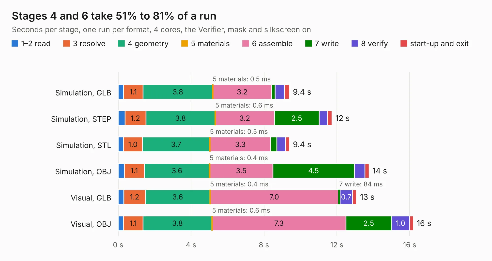

# 2750. live-video-multi-function-board

Board 2,750 of the 3,110 of [Corpus Testing](../Corpus-Testing.md), on [Corpus Page 26](../CorpusTestingPages/Corpus-Testing-26.md#2750-live-video-multi-function-board).

| Mode and format | 1–2 read | 3 resolve | 4 geometry | 5 materials | 6 assemble | 7 write | 8 verify | start-up and exit | Total |
|---|---:|---:|---:|---:|---:|---:|---:|---:|---:|
| Simulation, GLB | 0.3 | 1.1 | 3.8 | 0.5&nbsp;ms | 3.2 | 0.2 | 0.5 | 0.3 | 9.4 |
| Simulation, STEP | 0.4 | 1.2 | 3.8 | 0.6&nbsp;ms | 3.2 | 2.5 | 0.5 | 0.2 | 11.7 |
| Simulation, STL | 0.3 | 1.0 | 3.7 | 0.5&nbsp;ms | 3.3 | 0.3 | 0.5 | 0.2 | 9.4 |
| Simulation, OBJ | 0.3 | 1.1 | 3.6 | 0.4&nbsp;ms | 3.5 | 4.5 | 0.6 | 0.2 | 13.8 |
| Visual, GLB | 0.3 | 1.2 | 3.6 | 0.4&nbsp;ms | 7.0 | 84&nbsp;ms | 0.7 | 0.2 | 13.1 |
| Visual, OBJ | 0.3 | 1.1 | 3.8 | 0.6&nbsp;ms | 7.3 | 2.5 | 1.0 | 0.2 | 16.2 |

<table align="center"><tr><td valign="top">

| Board | Repo: [terrapin-rocket-team/srad-avionics](https://github.com/terrapin-rocket-team/srad-avionics) Board: `live-video-multi-function-board.kicad_pcb` |
|---|---|
| Folder | Spaceport / PCBs / live-video-multi-function-board |
| Complexity | 275&nbsp;/&nbsp;1000 (size&nbsp;180, features&nbsp;95) |
| KESE&nbsp;features | through vias, slotted holes, rounded, trapezoid or chamfered pads, filled zones, curved board outline, stack-up, dielectric εr and tanδ |
| Tested | 9th November 2026 |
| Copper&nbsp;layers | 4 |
| File&nbsp;format | KiCad 8 (20240108) |
| Parts,&nbsp;tracks,&nbsp;vias | 59, 378, 49 |
| Triangles,&nbsp;simulation | 1,147,784 in 132 parts |
| Verifier | PASS in all six runs |

</td><td valign="top">

<table>
<tr><th>File type</th><th>File size</th><th>Peak memory used</th></tr>
<tr><th colspan="3" align="left">Simulation</th></tr>
<tr><td>GLB</td><td align="right">38&nbsp;MB</td><td align="right">476&nbsp;MB</td></tr>
<tr><td>STEP</td><td align="right">149&nbsp;MB</td><td align="right">530&nbsp;MB</td></tr>
<tr><td>STL</td><td align="right">57&nbsp;MB</td><td align="right">481&nbsp;MB</td></tr>
<tr><td>OBJ</td><td align="right">116&nbsp;MB</td><td align="right">795&nbsp;MB</td></tr>
<tr><th colspan="3" align="left">Visual</th></tr>
<tr><td>GLB</td><td align="right">21&nbsp;MB</td><td align="right">588&nbsp;MB</td></tr>
<tr><td>OBJ</td><td align="right">64&nbsp;MB</td><td align="right">593&nbsp;MB</td></tr>
</table>

</td></tr></table>

| Previous | Next |
|:---|---:|
| [2749. LiBatteryCharger](b2749b_srad-avionics_LiBatteryCharger.md) | [2751. low_power_module](b2751b_srad-avionics_low-power-module.md) |
