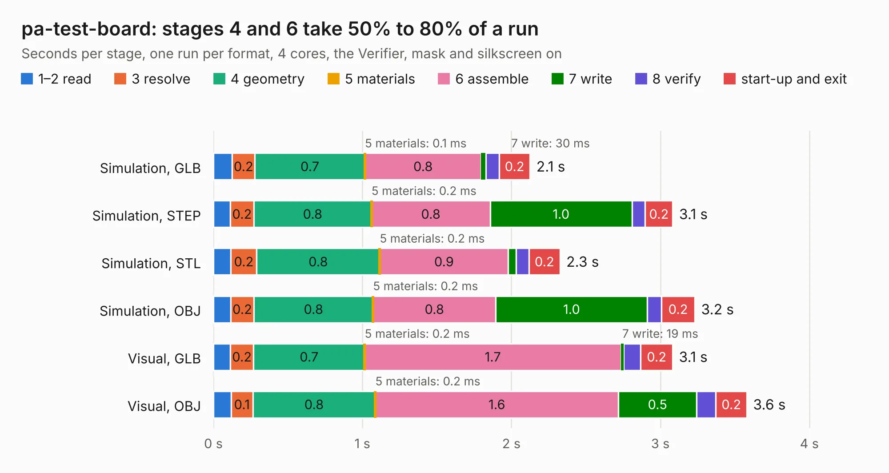

# 2750. pa-test-board

Board 2,750 of the 3,104 of [Corpus Testing](../Corpus-Testing.md), on [Corpus Page 26](../CorpusTestingPages/Corpus-Testing-26.md#2750-pa-test-board).

| Mode and format | 1–2 read | 3 resolve | 4 geometry | 5 materials | 6 assemble | 7 write | 8 verify | start-up and exit | Total |
|---|---:|---:|---:|---:|---:|---:|---:|---:|---:|
| Simulation, GLB | 0.1 | 0.2 | 0.7 | 0.1&nbsp;ms | 0.8 | 30&nbsp;ms | 90&nbsp;ms | 0.2 | 2.1 |
| Simulation, STEP | 0.1 | 0.2 | 0.8 | 0.2&nbsp;ms | 0.8 | 1.0 | 88&nbsp;ms | 0.2 | 3.1 |
| Simulation, STL | 0.1 | 0.2 | 0.8 | 0.2&nbsp;ms | 0.9 | 51&nbsp;ms | 88&nbsp;ms | 0.2 | 2.3 |
| Simulation, OBJ | 0.1 | 0.2 | 0.8 | 0.2&nbsp;ms | 0.8 | 1.0 | 94&nbsp;ms | 0.2 | 3.2 |
| Visual, GLB | 0.1 | 0.2 | 0.7 | 0.2&nbsp;ms | 1.7 | 19&nbsp;ms | 0.1 | 0.2 | 3.1 |
| Visual, OBJ | 0.1 | 0.1 | 0.8 | 0.2&nbsp;ms | 1.6 | 0.5 | 0.1 | 0.2 | 3.6 |

<table align="center"><tr><td valign="top">

| Board | Repo: [terrapin-rocket-team/srad-avionics](https://github.com/terrapin-rocket-team/srad-avionics) Board: `pa-test-board.kicad_pcb` |
|---|---|
| Folder | Spaceport / PCBs / pa-test-board |
| Complexity | 212&nbsp;/&nbsp;1000 (size&nbsp;137, features&nbsp;75) |
| KESE&nbsp;features | through vias, rounded, trapezoid or chamfered pads, filled zones, stack-up, dielectric εr and tanδ |
| Tested | 9th November 2026 |
| Copper&nbsp;layers | 2 |
| File&nbsp;format | KiCad 8 (20240108) |
| Parts,&nbsp;tracks,&nbsp;vias | 26, 126, 15 |
| Triangles,&nbsp;simulation | 197,652 in 27 parts |
| Verifier | PASS in all six runs |

</td><td valign="top">

<table>
<tr><th>File type</th><th>File size</th><th>Peak memory used</th></tr>
<tr><th colspan="3" align="left">Simulation</th></tr>
<tr><td>GLB</td><td align="right">7.0&nbsp;MB</td><td align="right">218&nbsp;MB</td></tr>
<tr><td>STEP</td><td align="right">33&nbsp;MB</td><td align="right">228&nbsp;MB</td></tr>
<tr><td>STL</td><td align="right">9.9&nbsp;MB</td><td align="right">212&nbsp;MB</td></tr>
<tr><td>OBJ</td><td align="right">20&nbsp;MB</td><td align="right">213&nbsp;MB</td></tr>
<tr><th colspan="3" align="left">Visual</th></tr>
<tr><td>GLB</td><td align="right">4.6&nbsp;MB</td><td align="right">202&nbsp;MB</td></tr>
<tr><td>OBJ</td><td align="right">13&nbsp;MB</td><td align="right">199&nbsp;MB</td></tr>
</table>

</td></tr></table>

| Previous | Next |
|:---|---:|
| [2749. new-pa-test-board](b2749b_srad-avionics_new-pa-test-board.md) | [2751. power-delivery-board](b2751b_srad-avionics_power-delivery-board.md) |
