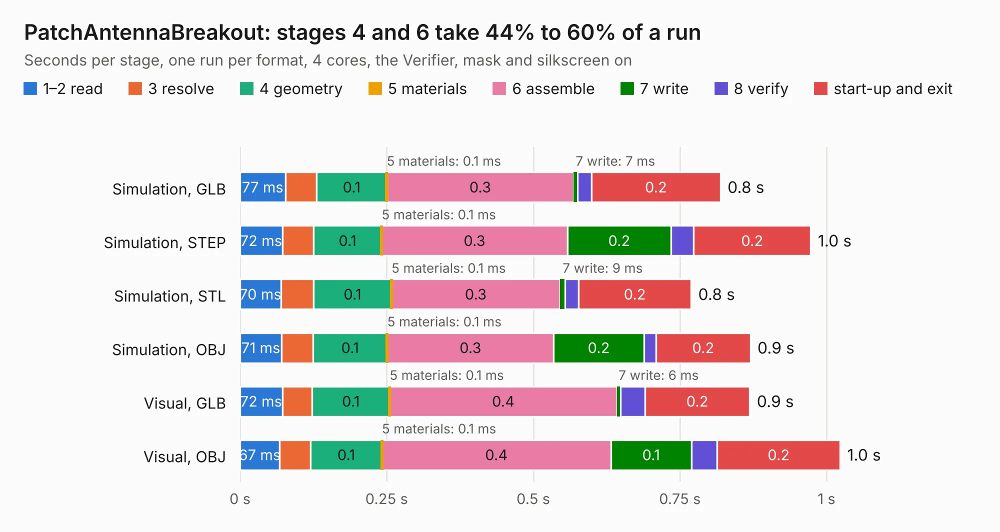

# 2752. PatchAntennaBreakout

Board 2,752 of the 3,101 of [Corpus Testing](../Corpus-Testing.md), on [Corpus Page 26](../CorpusTestingPages/Corpus-Testing-26.md#2752-patchantennabreakout).

| Mode and format | 1–2 read | 3 resolve | 4 geometry | 5 materials | 6 assemble | 7 write | 8 verify | start-up and exit | Total |
|---|---:|---:|---:|---:|---:|---:|---:|---:|---:|
| Simulation, GLB | 77&nbsp;ms | 53&nbsp;ms | 0.1 | 0.1&nbsp;ms | 0.3 | 7&nbsp;ms | 24&nbsp;ms | 0.2 | 0.8 |
| Simulation, STEP | 72&nbsp;ms | 53&nbsp;ms | 0.1 | 0.1&nbsp;ms | 0.3 | 0.2 | 39&nbsp;ms | 0.2 | 1.0 |
| Simulation, STL | 70&nbsp;ms | 56&nbsp;ms | 0.1 | 0.1&nbsp;ms | 0.3 | 9&nbsp;ms | 23&nbsp;ms | 0.2 | 0.8 |
| Simulation, OBJ | 71&nbsp;ms | 54&nbsp;ms | 0.1 | 0.1&nbsp;ms | 0.3 | 0.2 | 21&nbsp;ms | 0.2 | 0.9 |
| Visual, GLB | 72&nbsp;ms | 51&nbsp;ms | 0.1 | 0.1&nbsp;ms | 0.4 | 6&nbsp;ms | 42&nbsp;ms | 0.2 | 0.9 |
| Visual, OBJ | 67&nbsp;ms | 53&nbsp;ms | 0.1 | 0.1&nbsp;ms | 0.4 | 0.1 | 44&nbsp;ms | 0.2 | 1.0 |

<table align="center"><tr><td valign="top">

| Board | Repo: [terrapin-rocket-team/srad-avionics](https://github.com/terrapin-rocket-team/srad-avionics) Board: `PatchAntennaBreakout.kicad_pcb` |
|---|---|
| Folder | Spaceport / PCBs / Sensor Boards / PatchAntennaBreakout |
| Complexity | 170&nbsp;/&nbsp;1000 (size&nbsp;95, features&nbsp;75) |
| KESE&nbsp;features | through vias, filled zones, curved board outline, stack-up, dielectric εr and tanδ |
| Tested | 9th November 2026 |
| Copper&nbsp;layers | 2 |
| File&nbsp;format | KiCad 8 (20240108) |
| Parts,&nbsp;tracks,&nbsp;vias | 2, 1, 19 |
| Triangles,&nbsp;simulation | 40,898 in 10 parts |
| Verifier | PASS in all six runs |

</td><td valign="top">

<table>
<tr><th>File type</th><th>File size</th><th>Peak memory used</th></tr>
<tr><th colspan="3" align="left">Simulation</th></tr>
<tr><td>GLB</td><td align="right">1.4&nbsp;MB</td><td align="right">69&nbsp;MB</td></tr>
<tr><td>STEP</td><td align="right">4.6&nbsp;MB</td><td align="right">73&nbsp;MB</td></tr>
<tr><td>STL</td><td align="right">2.0&nbsp;MB</td><td align="right">70&nbsp;MB</td></tr>
<tr><td>OBJ</td><td align="right">3.9&nbsp;MB</td><td align="right">80&nbsp;MB</td></tr>
<tr><th colspan="3" align="left">Visual</th></tr>
<tr><td>GLB</td><td align="right">1.2&nbsp;MB</td><td align="right">92&nbsp;MB</td></tr>
<tr><td>OBJ</td><td align="right">3.3&nbsp;MB</td><td align="right">103&nbsp;MB</td></tr>
</table>

</td></tr></table>

| Previous | Next |
|:---|---:|
| [2751. high-range-IMU](b2751b_srad-avionics_high-range-IMU.md) | [2753. SensorBoardNoMCU](b2753b_srad-avionics_Spaceport-PCBs-Sensor-Boards-SensorBoardAirbrake_SensorBoardNoMCU.md) |
