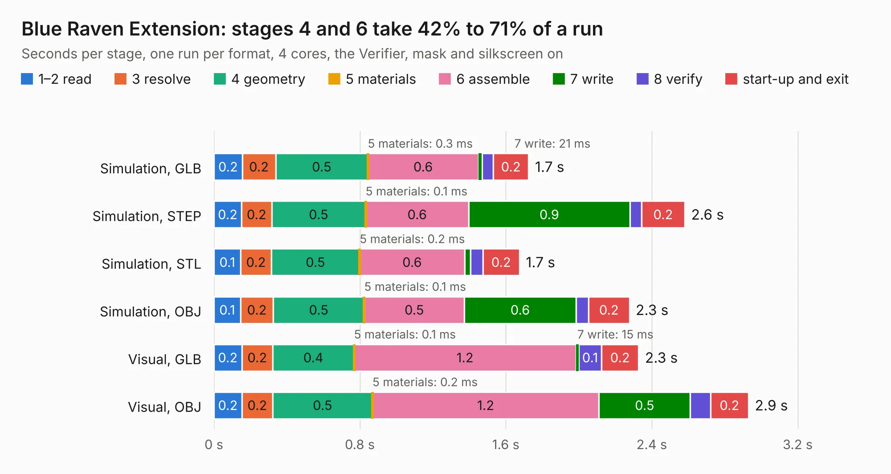

# 2753. Blue Raven Extension

Board 2,753 of the 3,124 of [Corpus Testing](../Corpus-Testing.md), on [Corpus Page 26](../CorpusTestingPages/Corpus-Testing-26.md#2753-blue-raven-extension).

| Mode and format | 1–2 read | 3 resolve | 4 geometry | 5 materials | 6 assemble | 7 write | 8 verify | start-up and exit | Total |
|---|---:|---:|---:|---:|---:|---:|---:|---:|---:|
| Simulation, GLB | 0.2 | 0.2 | 0.5 | 0.3&nbsp;ms | 0.6 | 21&nbsp;ms | 60&nbsp;ms | 0.2 | 1.7 |
| Simulation, STEP | 0.2 | 0.2 | 0.5 | 0.1&nbsp;ms | 0.6 | 0.9 | 64&nbsp;ms | 0.2 | 2.6 |
| Simulation, STL | 0.1 | 0.2 | 0.5 | 0.2&nbsp;ms | 0.6 | 33&nbsp;ms | 67&nbsp;ms | 0.2 | 1.7 |
| Simulation, OBJ | 0.1 | 0.2 | 0.5 | 0.1&nbsp;ms | 0.5 | 0.6 | 69&nbsp;ms | 0.2 | 2.3 |
| Visual, GLB | 0.2 | 0.2 | 0.4 | 0.1&nbsp;ms | 1.2 | 15&nbsp;ms | 0.1 | 0.2 | 2.3 |
| Visual, OBJ | 0.2 | 0.2 | 0.5 | 0.2&nbsp;ms | 1.2 | 0.5 | 0.1 | 0.2 | 2.9 |

<table align="center"><tr><td valign="top">

| Board | Repo: [terrapin-rocket-team/srad-avionics](https://github.com/terrapin-rocket-team/srad-avionics) Board: `Blue Raven Extension.kicad_pcb` |
|---|---|
| Folder | Spaceport / PCBs / Blue Raven Extension |
| Complexity | 147&nbsp;/&nbsp;1000 (size&nbsp;87, features&nbsp;60) |
| KESE&nbsp;features | filled zones, curved board outline, knockout text, TrueType text |
| Tested | 9th November 2026 |
| Copper&nbsp;layers | 2 |
| File&nbsp;format | KiCad 9 (20241229) |
| Parts,&nbsp;tracks,&nbsp;vias | 3, 29, 0 |
| Triangles,&nbsp;simulation | 129,722 in 18 parts |
| Verifier | PASS in all six runs |

</td><td valign="top">

<table>
<tr><th>File type</th><th>File size</th><th>Peak memory used</th></tr>
<tr><th colspan="3" align="left">Simulation</th></tr>
<tr><td>GLB</td><td align="right">4.4&nbsp;MB</td><td align="right">191&nbsp;MB</td></tr>
<tr><td>STEP</td><td align="right">20&nbsp;MB</td><td align="right">199&nbsp;MB</td></tr>
<tr><td>STL</td><td align="right">6.5&nbsp;MB</td><td align="right">191&nbsp;MB</td></tr>
<tr><td>OBJ</td><td align="right">13&nbsp;MB</td><td align="right">187&nbsp;MB</td></tr>
<tr><th colspan="3" align="left">Visual</th></tr>
<tr><td>GLB</td><td align="right">3.3&nbsp;MB</td><td align="right">158&nbsp;MB</td></tr>
<tr><td>OBJ</td><td align="right">9.1&nbsp;MB</td><td align="right">160&nbsp;MB</td></tr>
</table>

</td></tr></table>

| Previous | Next |
|:---|---:|
| [2752. BatteryCharger](b2752b_srad-avionics_BatteryCharger.md) | [2754. dipole-breakout](b2754b_srad-avionics_dipole-breakout.md) |
