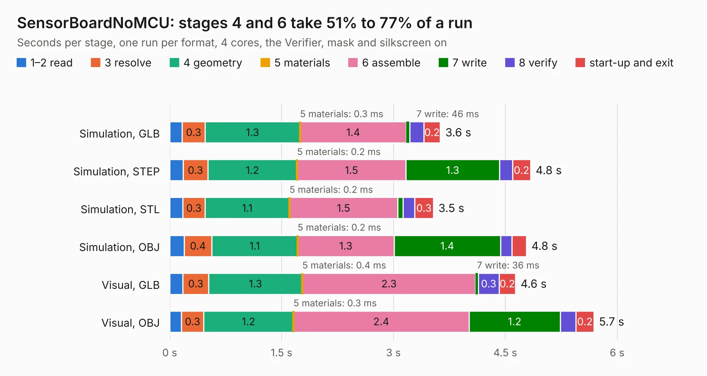

# 2753. SensorBoardNoMCU

Board 2,753 of the 3,119 of [Corpus Testing](../Corpus-Testing.md), on [Corpus Page 26](../CorpusTestingPages/Corpus-Testing-26.md#2753-sensorboardnomcu).

| Mode and format | 1–2 read | 3 resolve | 4 geometry | 5 materials | 6 assemble | 7 write | 8 verify | start-up and exit | Total |
|---|---:|---:|---:|---:|---:|---:|---:|---:|---:|
| Simulation, GLB | 0.2 | 0.3 | 1.3 | 0.3&nbsp;ms | 1.4 | 46&nbsp;ms | 0.2 | 0.2 | 3.6 |
| Simulation, STEP | 0.2 | 0.3 | 1.2 | 0.2&nbsp;ms | 1.5 | 1.3 | 0.2 | 0.2 | 4.8 |
| Simulation, STL | 0.2 | 0.3 | 1.1 | 0.2&nbsp;ms | 1.5 | 74&nbsp;ms | 0.2 | 0.3 | 3.5 |
| Simulation, OBJ | 0.2 | 0.4 | 1.1 | 0.2&nbsp;ms | 1.3 | 1.4 | 0.2 | 0.2 | 4.8 |
| Visual, GLB | 0.2 | 0.3 | 1.3 | 0.4&nbsp;ms | 2.3 | 36&nbsp;ms | 0.3 | 0.2 | 4.6 |
| Visual, OBJ | 0.2 | 0.3 | 1.2 | 0.3&nbsp;ms | 2.4 | 1.2 | 0.2 | 0.2 | 5.7 |

<table align="center"><tr><td valign="top">

| Board | Repo: [terrapin-rocket-team/srad-avionics](https://github.com/terrapin-rocket-team/srad-avionics) Board: `SensorBoardNoMCU.kicad_pcb` |
|---|---|
| Folder | Spaceport / PCBs / Gerbers / Teensy v3.0 |
| Complexity | 266&nbsp;/&nbsp;1000 (size&nbsp;151, features&nbsp;115) |
| KESE&nbsp;features | through vias, rounded, trapezoid or chamfered pads, filled zones, curved board outline, knockout text, TrueType text, stack-up, dielectric εr and tanδ |
| Tested | 9th November 2026 |
| Copper&nbsp;layers | 2 |
| File&nbsp;format | KiCad 8 (20240108) |
| Parts,&nbsp;tracks,&nbsp;vias | 25, 221, 67 |
| Triangles,&nbsp;simulation | 259,862 in 37 parts |
| Verifier | PASS in all six runs |

</td><td valign="top">

<table>
<tr><th>File type</th><th>File size</th><th>Peak memory used</th></tr>
<tr><th colspan="3" align="left">Simulation</th></tr>
<tr><td>GLB</td><td align="right">9.0&nbsp;MB</td><td align="right">239&nbsp;MB</td></tr>
<tr><td>STEP</td><td align="right">39&nbsp;MB</td><td align="right">271&nbsp;MB</td></tr>
<tr><td>STL</td><td align="right">13&nbsp;MB</td><td align="right">241&nbsp;MB</td></tr>
<tr><td>OBJ</td><td align="right">26&nbsp;MB</td><td align="right">242&nbsp;MB</td></tr>
<tr><th colspan="3" align="left">Visual</th></tr>
<tr><td>GLB</td><td align="right">7.5&nbsp;MB</td><td align="right">250&nbsp;MB</td></tr>
<tr><td>OBJ</td><td align="right">22&nbsp;MB</td><td align="right">253&nbsp;MB</td></tr>
</table>

</td></tr></table>

| Previous | Next |
|:---|---:|
| [2752. mcu-board v2](b2752b_srad-avionics_mcu-board-v2.md) | [2754. Ground Receiver v2](b2754b_srad-avionics_Ground-Receiver-v2.md) |
