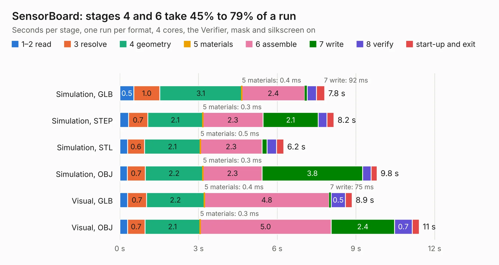

# 2754. SensorBoard

Board 2,754 of the 3,100 of [Corpus Testing](../Corpus-Testing.md), on [Corpus Page 26](../CorpusTestingPages/Corpus-Testing-26.md#2754-sensorboard).

| Mode and format | 1–2 read | 3 resolve | 4 geometry | 5 materials | 6 assemble | 7 write | 8 verify | start-up and exit | Total |
|---|---:|---:|---:|---:|---:|---:|---:|---:|---:|
| Simulation, GLB | 0.5 | 1.0 | 3.1 | 0.4&nbsp;ms | 2.4 | 92&nbsp;ms | 0.4 | 0.3 | 7.8 |
| Simulation, STEP | 0.3 | 0.7 | 2.1 | 0.3&nbsp;ms | 2.3 | 2.1 | 0.3 | 0.3 | 8.2 |
| Simulation, STL | 0.3 | 0.6 | 2.1 | 0.5&nbsp;ms | 2.3 | 0.2 | 0.4 | 0.3 | 6.2 |
| Simulation, OBJ | 0.3 | 0.7 | 2.2 | 0.3&nbsp;ms | 2.3 | 3.8 | 0.3 | 0.2 | 9.8 |
| Visual, GLB | 0.3 | 0.7 | 2.2 | 0.4&nbsp;ms | 4.8 | 75&nbsp;ms | 0.5 | 0.3 | 8.9 |
| Visual, OBJ | 0.3 | 0.7 | 2.1 | 0.3&nbsp;ms | 5.0 | 2.4 | 0.7 | 0.3 | 11.4 |

<table align="center"><tr><td valign="top">

| Board | Repo: [terrapin-rocket-team/srad-avionics](https://github.com/terrapin-rocket-team/srad-avionics) Board: `SensorBoard.kicad_pcb` |
|---|---|
| Folder | Spaceport / PCBs / Sensor Boards / SensorBoardSTM32 |
| Complexity | 306&nbsp;/&nbsp;1000 (size&nbsp;221, features&nbsp;85) |
| KESE&nbsp;features | through vias, rounded, trapezoid or chamfered pads, filled zones, curved board outline, stack-up, dielectric εr and tanδ |
| Tested | 9th November 2026 |
| Copper&nbsp;layers | 4 |
| File&nbsp;format | KiCad 8 (20240108) |
| Parts,&nbsp;tracks,&nbsp;vias | 47, 460, 58 |
| Triangles,&nbsp;simulation | 654,322 in 80 parts |
| Verifier | PASS in all six runs |

</td><td valign="top">

<table>
<tr><th>File type</th><th>File size</th><th>Peak memory used</th></tr>
<tr><th colspan="3" align="left">Simulation</th></tr>
<tr><td>GLB</td><td align="right">22&nbsp;MB</td><td align="right">331&nbsp;MB</td></tr>
<tr><td>STEP</td><td align="right">92&nbsp;MB</td><td align="right">409&nbsp;MB</td></tr>
<tr><td>STL</td><td align="right">33&nbsp;MB</td><td align="right">335&nbsp;MB</td></tr>
<tr><td>OBJ</td><td align="right">66&nbsp;MB</td><td align="right">492&nbsp;MB</td></tr>
<tr><th colspan="3" align="left">Visual</th></tr>
<tr><td>GLB</td><td align="right">16&nbsp;MB</td><td align="right">472&nbsp;MB</td></tr>
<tr><td>OBJ</td><td align="right">48&nbsp;MB</td><td align="right">413&nbsp;MB</td></tr>
</table>

</td></tr></table>

| Previous | Next |
|:---|---:|
| [2753. SensorBoardNoMCU](b2753b_srad-avionics_Spaceport-PCBs-Sensor-Boards-SensorBoardPatch_SensorBoardNoMCU.md) | [2755. Unified_Board](b2755b_srad-avionics_Unified-Board.md) |
