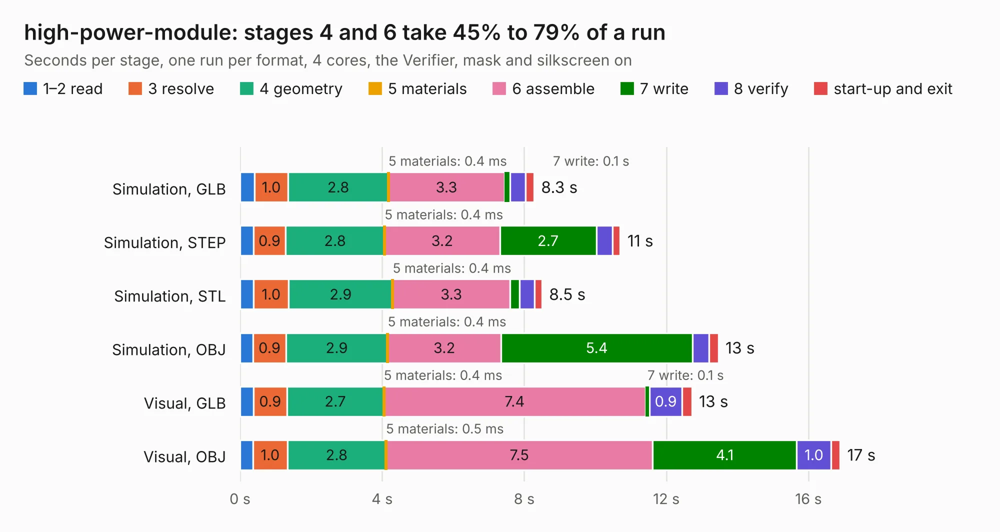

# 2754. high-power-module

Board 2,754 of the 3,116 of [Corpus Testing](../Corpus-Testing.md), on [Corpus Page 26](../CorpusTestingPages/Corpus-Testing-26.md#2754-high-power-module).

| Mode and format | 1–2 read | 3 resolve | 4 geometry | 5 materials | 6 assemble | 7 write | 8 verify | start-up and exit | Total |
|---|---:|---:|---:|---:|---:|---:|---:|---:|---:|
| Simulation, GLB | 0.4 | 1.0 | 2.8 | 0.4&nbsp;ms | 3.3 | 0.1 | 0.4 | 0.2 | 8.3 |
| Simulation, STEP | 0.4 | 0.9 | 2.8 | 0.4&nbsp;ms | 3.2 | 2.7 | 0.5 | 0.2 | 10.7 |
| Simulation, STL | 0.4 | 1.0 | 2.9 | 0.4&nbsp;ms | 3.3 | 0.3 | 0.4 | 0.2 | 8.5 |
| Simulation, OBJ | 0.4 | 0.9 | 2.9 | 0.4&nbsp;ms | 3.2 | 5.4 | 0.5 | 0.3 | 13.5 |
| Visual, GLB | 0.4 | 0.9 | 2.7 | 0.4&nbsp;ms | 7.4 | 0.1 | 0.9 | 0.3 | 12.7 |
| Visual, OBJ | 0.4 | 1.0 | 2.8 | 0.5&nbsp;ms | 7.5 | 4.1 | 1.0 | 0.2 | 16.9 |

<table align="center"><tr><td valign="top">

| Board | Repo: [terrapin-rocket-team/srad-avionics](https://github.com/terrapin-rocket-team/srad-avionics) Board: `high-power-module.kicad_pcb` |
|---|---|
| Folder | Spaceport / PCBs / high-power-module |
| Complexity | 343&nbsp;/&nbsp;1000 (size&nbsp;233, features&nbsp;110) |
| KESE&nbsp;features | through vias, custom pads, rounded, trapezoid or chamfered pads, filled zones, copper drawings, curved board outline, stack-up, dielectric εr and tanδ |
| Tested | 9th November 2026 |
| Copper&nbsp;layers | 4 |
| File&nbsp;format | KiCad 8 (20240108) |
| Parts,&nbsp;tracks,&nbsp;vias | 83, 566, 107 |
| Triangles,&nbsp;simulation | 972,140 in 95 parts |
| Verifier | PASS in all six runs |

</td><td valign="top">

<table>
<tr><th>File type</th><th>File size</th><th>Peak memory used</th></tr>
<tr><th colspan="3" align="left">Simulation</th></tr>
<tr><td>GLB</td><td align="right">33&nbsp;MB</td><td align="right">443&nbsp;MB</td></tr>
<tr><td>STEP</td><td align="right">139&nbsp;MB</td><td align="right">516&nbsp;MB</td></tr>
<tr><td>STL</td><td align="right">49&nbsp;MB</td><td align="right">438&nbsp;MB</td></tr>
<tr><td>OBJ</td><td align="right">99&nbsp;MB</td><td align="right">666&nbsp;MB</td></tr>
<tr><th colspan="3" align="left">Visual</th></tr>
<tr><td>GLB</td><td align="right">24&nbsp;MB</td><td align="right">535&nbsp;MB</td></tr>
<tr><td>OBJ</td><td align="right">72&nbsp;MB</td><td align="right">601&nbsp;MB</td></tr>
</table>

</td></tr></table>

| Previous | Next |
|:---|---:|
| [2753. ground-receiver](b2753b_srad-avionics_ground-receiver.md) | [2755. LiBatteryCharger](b2755b_srad-avionics_LiBatteryCharger.md) |
