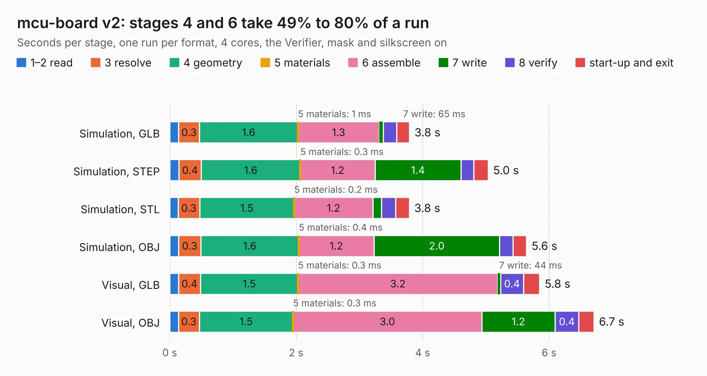

# 2755. mcu-board v2

Board 2,755 of the 3,122 of [Corpus Testing](../Corpus-Testing.md), on [Corpus Page 26](../CorpusTestingPages/Corpus-Testing-26.md#2755-mcu-board-v2).

| Mode and format | 1–2 read | 3 resolve | 4 geometry | 5 materials | 6 assemble | 7 write | 8 verify | start-up and exit | Total |
|---|---:|---:|---:|---:|---:|---:|---:|---:|---:|
| Simulation, GLB | 0.1 | 0.3 | 1.6 | 1&nbsp;ms | 1.3 | 65&nbsp;ms | 0.2 | 0.2 | 3.8 |
| Simulation, STEP | 0.1 | 0.4 | 1.6 | 0.3&nbsp;ms | 1.2 | 1.4 | 0.2 | 0.2 | 5.0 |
| Simulation, STL | 0.1 | 0.3 | 1.5 | 0.2&nbsp;ms | 1.2 | 0.1 | 0.2 | 0.2 | 3.8 |
| Simulation, OBJ | 0.1 | 0.3 | 1.6 | 0.4&nbsp;ms | 1.2 | 2.0 | 0.2 | 0.2 | 5.6 |
| Visual, GLB | 0.1 | 0.4 | 1.5 | 0.3&nbsp;ms | 3.2 | 44&nbsp;ms | 0.4 | 0.3 | 5.8 |
| Visual, OBJ | 0.1 | 0.3 | 1.5 | 0.3&nbsp;ms | 3.0 | 1.2 | 0.4 | 0.2 | 6.7 |

<table align="center"><tr><td valign="top">

| Board | Repo: [terrapin-rocket-team/srad-avionics](https://github.com/terrapin-rocket-team/srad-avionics) Board: `mcu-board v2.kicad_pcb` |
|---|---|
| Folder | Spaceport / PCBs / Gerbers / Teensy v3.0 |
| Complexity | 159&nbsp;/&nbsp;1000 (size&nbsp;114, features&nbsp;45) |
| KESE&nbsp;features | through vias, rounded, trapezoid or chamfered pads, filled zones |
| Tested | 9th November 2026 |
| Copper&nbsp;layers | 2 |
| File&nbsp;format | KiCad 8 (20240108) |
| Parts,&nbsp;tracks,&nbsp;vias | 12, 61, 2 |
| Triangles,&nbsp;simulation | 381,418 in 60 parts |
| Verifier | PASS in all six runs |

</td><td valign="top">

<table>
<tr><th>File type</th><th>File size</th><th>Peak memory used</th></tr>
<tr><th colspan="3" align="left">Simulation</th></tr>
<tr><td>GLB</td><td align="right">12&nbsp;MB</td><td align="right">254&nbsp;MB</td></tr>
<tr><td>STEP</td><td align="right">50&nbsp;MB</td><td align="right">292&nbsp;MB</td></tr>
<tr><td>STL</td><td align="right">19&nbsp;MB</td><td align="right">257&nbsp;MB</td></tr>
<tr><td>OBJ</td><td align="right">38&nbsp;MB</td><td align="right">303&nbsp;MB</td></tr>
<tr><th colspan="3" align="left">Visual</th></tr>
<tr><td>GLB</td><td align="right">7.9&nbsp;MB</td><td align="right">278&nbsp;MB</td></tr>
<tr><td>OBJ</td><td align="right">23&nbsp;MB</td><td align="right">272&nbsp;MB</td></tr>
</table>

</td></tr></table>

| Previous | Next |
|:---|---:|
| [2754. flight-computer](b2754b_srad-avionics_Spaceport-PCBs-flight-computer-flight-computer-2025-2026_flight-computer.md) | [2756. SensorBoardNoMCU](b2756b_srad-avionics_Spaceport-PCBs-Gerbers-Teensy-v3-0_SensorBoardNoMCU.md) |
