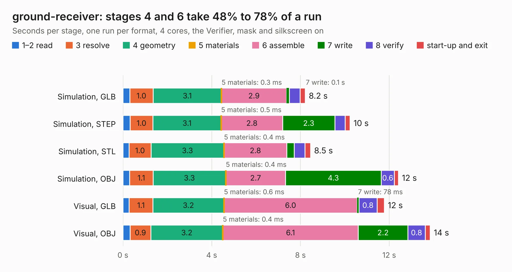

# 2756. ground-receiver

Board 2,756 of the 3,119 of [Corpus Testing](../Corpus-Testing.md), on [Corpus Page 26](../CorpusTestingPages/Corpus-Testing-26.md#2756-ground-receiver).

| Mode and format | 1–2 read | 3 resolve | 4 geometry | 5 materials | 6 assemble | 7 write | 8 verify | start-up and exit | Total |
|---|---:|---:|---:|---:|---:|---:|---:|---:|---:|
| Simulation, GLB | 0.3 | 1.0 | 3.1 | 0.3&nbsp;ms | 2.9 | 0.1 | 0.5 | 0.2 | 8.2 |
| Simulation, STEP | 0.3 | 1.0 | 3.1 | 0.5&nbsp;ms | 2.8 | 2.3 | 0.5 | 0.2 | 10.2 |
| Simulation, STL | 0.3 | 1.0 | 3.3 | 0.4&nbsp;ms | 2.8 | 0.3 | 0.5 | 0.3 | 8.5 |
| Simulation, OBJ | 0.3 | 1.1 | 3.3 | 0.4&nbsp;ms | 2.7 | 4.3 | 0.6 | 0.2 | 12.4 |
| Visual, GLB | 0.3 | 1.1 | 3.2 | 0.6&nbsp;ms | 6.0 | 78&nbsp;ms | 0.8 | 0.3 | 11.8 |
| Visual, OBJ | 0.3 | 0.9 | 3.2 | 0.4&nbsp;ms | 6.1 | 2.2 | 0.8 | 0.2 | 13.8 |

<table align="center"><tr><td valign="top">

| Board | Repo: [terrapin-rocket-team/srad-avionics](https://github.com/terrapin-rocket-team/srad-avionics) Board: `ground-receiver.kicad_pcb` |
|---|---|
| Folder | Spaceport / PCBs / ground-receiver |
| Complexity | 276&nbsp;/&nbsp;1000 (size&nbsp;181, features&nbsp;95) |
| KESE&nbsp;features | through vias, slotted holes, rounded, trapezoid or chamfered pads, filled zones, curved board outline, stack-up, dielectric εr and tanδ |
| Tested | 9th November 2026 |
| Copper&nbsp;layers | 4 |
| File&nbsp;format | KiCad 8 (20240108) |
| Parts,&nbsp;tracks,&nbsp;vias | 56, 423, 43 |
| Triangles,&nbsp;simulation | 988,588 in 93 parts |
| Verifier | PASS in all six runs |

</td><td valign="top">

<table>
<tr><th>File type</th><th>File size</th><th>Peak memory used</th></tr>
<tr><th colspan="3" align="left">Simulation</th></tr>
<tr><td>GLB</td><td align="right">34&nbsp;MB</td><td align="right">437&nbsp;MB</td></tr>
<tr><td>STEP</td><td align="right">145&nbsp;MB</td><td align="right">494&nbsp;MB</td></tr>
<tr><td>STL</td><td align="right">49&nbsp;MB</td><td align="right">431&nbsp;MB</td></tr>
<tr><td>OBJ</td><td align="right">101&nbsp;MB</td><td align="right">713&nbsp;MB</td></tr>
<tr><th colspan="3" align="left">Visual</th></tr>
<tr><td>GLB</td><td align="right">18&nbsp;MB</td><td align="right">529&nbsp;MB</td></tr>
<tr><td>OBJ</td><td align="right">54&nbsp;MB</td><td align="right">478&nbsp;MB</td></tr>
</table>

</td></tr></table>

| Previous | Next |
|:---|---:|
| [2755. Ground Reciever](b2755b_srad-avionics_Ground-Reciever.md) | [2757. high-power-module](b2757b_srad-avionics_high-power-module.md) |
