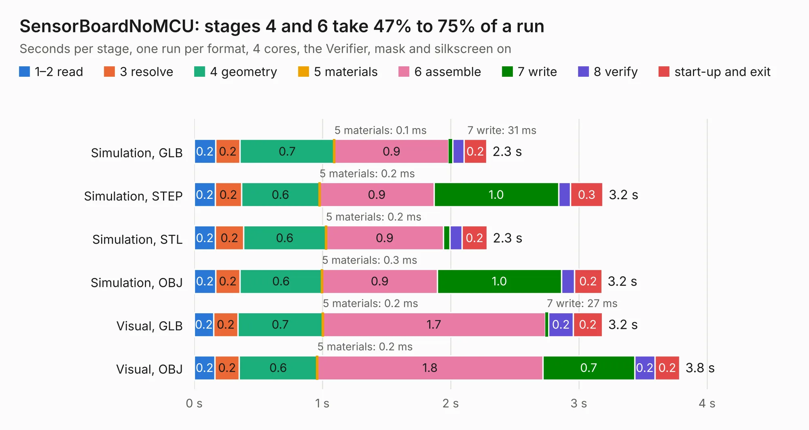

# 2758. SensorBoardNoMCU

Board 2,758 of the 3,105 of [Corpus Testing](../Corpus-Testing.md), on [Corpus Page 26](../CorpusTestingPages/Corpus-Testing-26.md#2758-sensorboardnomcu).

| Mode and format | 1–2 read | 3 resolve | 4 geometry | 5 materials | 6 assemble | 7 write | 8 verify | start-up and exit | Total |
|---|---:|---:|---:|---:|---:|---:|---:|---:|---:|
| Simulation, GLB | 0.2 | 0.2 | 0.7 | 0.1&nbsp;ms | 0.9 | 31&nbsp;ms | 88&nbsp;ms | 0.2 | 2.3 |
| Simulation, STEP | 0.2 | 0.2 | 0.6 | 0.2&nbsp;ms | 0.9 | 1.0 | 93&nbsp;ms | 0.3 | 3.2 |
| Simulation, STL | 0.2 | 0.2 | 0.6 | 0.2&nbsp;ms | 0.9 | 50&nbsp;ms | 96&nbsp;ms | 0.2 | 2.3 |
| Simulation, OBJ | 0.2 | 0.2 | 0.6 | 0.3&nbsp;ms | 0.9 | 1.0 | 0.1 | 0.2 | 3.2 |
| Visual, GLB | 0.2 | 0.2 | 0.7 | 0.2&nbsp;ms | 1.7 | 27&nbsp;ms | 0.2 | 0.2 | 3.2 |
| Visual, OBJ | 0.2 | 0.2 | 0.6 | 0.2&nbsp;ms | 1.8 | 0.7 | 0.2 | 0.2 | 3.8 |

<table align="center"><tr><td valign="top">

| Board | Repo: [terrapin-rocket-team/srad-avionics](https://github.com/terrapin-rocket-team/srad-avionics) Board: `SensorBoardNoMCU.kicad_pcb` |
|---|---|
| Folder | Spaceport / PCBs / Sensor Boards / SensorBoardPatch |
| Complexity | 260&nbsp;/&nbsp;1000 (size&nbsp;145, features&nbsp;115) |
| KESE&nbsp;features | through vias, rounded, trapezoid or chamfered pads, filled zones, curved board outline, knockout text, TrueType text, stack-up, dielectric εr and tanδ |
| Tested | 9th November 2026 |
| Copper&nbsp;layers | 2 |
| File&nbsp;format | KiCad 8 (20240108) |
| Parts,&nbsp;tracks,&nbsp;vias | 23, 227, 25 |
| Triangles,&nbsp;simulation | 201,870 in 37 parts |
| Verifier | PASS in all six runs |

</td><td valign="top">

<table>
<tr><th>File type</th><th>File size</th><th>Peak memory used</th></tr>
<tr><th colspan="3" align="left">Simulation</th></tr>
<tr><td>GLB</td><td align="right">7.1&nbsp;MB</td><td align="right">231&nbsp;MB</td></tr>
<tr><td>STEP</td><td align="right">36&nbsp;MB</td><td align="right">245&nbsp;MB</td></tr>
<tr><td>STL</td><td align="right">10&nbsp;MB</td><td align="right">229&nbsp;MB</td></tr>
<tr><td>OBJ</td><td align="right">20&nbsp;MB</td><td align="right">232&nbsp;MB</td></tr>
<tr><th colspan="3" align="left">Visual</th></tr>
<tr><td>GLB</td><td align="right">6.3&nbsp;MB</td><td align="right">227&nbsp;MB</td></tr>
<tr><td>OBJ</td><td align="right">18&nbsp;MB</td><td align="right">225&nbsp;MB</td></tr>
</table>

</td></tr></table>

| Previous | Next |
|:---|---:|
| [2757. SensorBoardNoMCU](b2757b_srad-avionics_Spaceport-PCBs-Sensor-Boards-SensorBoardAirbrake_SensorBoardNoMCU.md) | [2759. SensorBoard](b2759b_srad-avionics_SensorBoard.md) |
