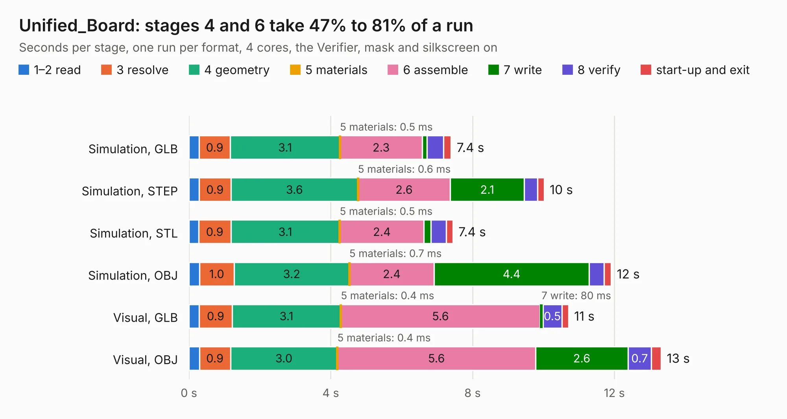

# 2758. Unified_Board

Board 2,758 of the 3,103 of [Corpus Testing](../Corpus-Testing.md), on [Corpus Page 26](../CorpusTestingPages/Corpus-Testing-26.md#2758-unified_board).

| Mode and format | 1–2 read | 3 resolve | 4 geometry | 5 materials | 6 assemble | 7 write | 8 verify | start-up and exit | Total |
|---|---:|---:|---:|---:|---:|---:|---:|---:|---:|
| Simulation, GLB | 0.3 | 0.9 | 3.1 | 0.5&nbsp;ms | 2.3 | 0.1 | 0.5 | 0.2 | 7.4 |
| Simulation, STEP | 0.3 | 0.9 | 3.6 | 0.6&nbsp;ms | 2.6 | 2.1 | 0.4 | 0.2 | 10.0 |
| Simulation, STL | 0.3 | 0.9 | 3.1 | 0.5&nbsp;ms | 2.4 | 0.2 | 0.4 | 0.2 | 7.4 |
| Simulation, OBJ | 0.3 | 1.0 | 3.2 | 0.7&nbsp;ms | 2.4 | 4.4 | 0.4 | 0.2 | 11.9 |
| Visual, GLB | 0.3 | 0.9 | 3.1 | 0.4&nbsp;ms | 5.6 | 80&nbsp;ms | 0.5 | 0.2 | 10.7 |
| Visual, OBJ | 0.3 | 0.9 | 3.0 | 0.4&nbsp;ms | 5.6 | 2.6 | 0.7 | 0.3 | 13.3 |

<table align="center"><tr><td valign="top">

| Board | Repo: [terrapin-rocket-team/srad-avionics](https://github.com/terrapin-rocket-team/srad-avionics) Board: `Unified_Board.kicad_pcb` |
|---|---|
| Folder | Spaceport / PCBs / Unified Board / Unified_Board |
| Complexity | 300&nbsp;/&nbsp;1000 (size&nbsp;225, features&nbsp;75) |
| KESE&nbsp;features | through vias, rounded, trapezoid or chamfered pads, filled zones, stack-up, dielectric εr and tanδ |
| Tested | 10th November 2026 |
| Copper&nbsp;layers | 4 |
| File&nbsp;format | KiCad 7 (20221018) |
| Parts,&nbsp;tracks,&nbsp;vias | 47, 409, 26 |
| Triangles,&nbsp;simulation | 865,554 in 102 parts |
| Verifier | PASS in all six runs |

</td><td valign="top">

<table>
<tr><th>File type</th><th>File size</th><th>Peak memory used</th></tr>
<tr><th colspan="3" align="left">Simulation</th></tr>
<tr><td>GLB</td><td align="right">29&nbsp;MB</td><td align="right">393&nbsp;MB</td></tr>
<tr><td>STEP</td><td align="right">114&nbsp;MB</td><td align="right">464&nbsp;MB</td></tr>
<tr><td>STL</td><td align="right">43&nbsp;MB</td><td align="right">397&nbsp;MB</td></tr>
<tr><td>OBJ</td><td align="right">88&nbsp;MB</td><td align="right">614&nbsp;MB</td></tr>
<tr><th colspan="3" align="left">Visual</th></tr>
<tr><td>GLB</td><td align="right">18&nbsp;MB</td><td align="right">535&nbsp;MB</td></tr>
<tr><td>OBJ</td><td align="right">55&nbsp;MB</td><td align="right">507&nbsp;MB</td></tr>
</table>

</td></tr></table>

| Previous | Next |
|:---|---:|
| [2757. SensorBoard](b2757b_srad-avionics_SensorBoard.md) | [2759. CM4_MATX](b2759b_CM4-MATX_KiCad_CM4-MATX_2174.md) |
