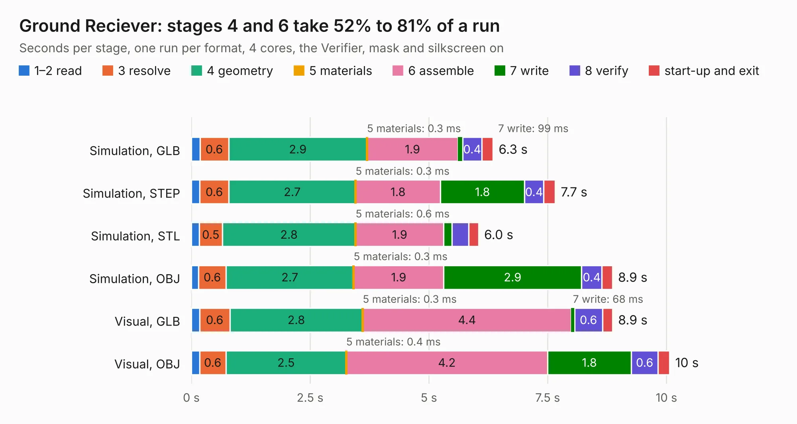

# 2759. Ground Reciever

Board 2,759 of the 3,123 of [Corpus Testing](../Corpus-Testing.md), on [Corpus Page 26](../CorpusTestingPages/Corpus-Testing-26.md#2759-ground-reciever).

| Mode and format | 1–2 read | 3 resolve | 4 geometry | 5 materials | 6 assemble | 7 write | 8 verify | start-up and exit | Total |
|---|---:|---:|---:|---:|---:|---:|---:|---:|---:|
| Simulation, GLB | 0.2 | 0.6 | 2.9 | 0.3&nbsp;ms | 1.9 | 99&nbsp;ms | 0.4 | 0.2 | 6.3 |
| Simulation, STEP | 0.2 | 0.6 | 2.7 | 0.3&nbsp;ms | 1.8 | 1.8 | 0.4 | 0.2 | 7.7 |
| Simulation, STL | 0.2 | 0.5 | 2.8 | 0.6&nbsp;ms | 1.9 | 0.2 | 0.4 | 0.2 | 6.0 |
| Simulation, OBJ | 0.2 | 0.6 | 2.7 | 0.3&nbsp;ms | 1.9 | 2.9 | 0.4 | 0.2 | 8.9 |
| Visual, GLB | 0.2 | 0.6 | 2.8 | 0.3&nbsp;ms | 4.4 | 68&nbsp;ms | 0.6 | 0.2 | 8.9 |
| Visual, OBJ | 0.2 | 0.6 | 2.5 | 0.4&nbsp;ms | 4.2 | 1.8 | 0.6 | 0.2 | 10.1 |

<table align="center"><tr><td valign="top">

| Board | Repo: [terrapin-rocket-team/srad-avionics](https://github.com/terrapin-rocket-team/srad-avionics) Board: `Ground Reciever.kicad_pcb` |
|---|---|
| Folder | Spaceport / PCBs / Ground Reciever |
| Complexity | 174&nbsp;/&nbsp;1000 (size&nbsp;149, features&nbsp;25) |
| KESE&nbsp;features | through vias, rounded, trapezoid or chamfered pads |
| Tested | 9th November 2026 |
| Copper&nbsp;layers | 2 |
| File&nbsp;format | KiCad 7 (20221018) |
| Parts,&nbsp;tracks,&nbsp;vias | 19, 392, 20 |
| Triangles,&nbsp;simulation | 612,778 in 72 parts |
| Verifier | PASS in all six runs |

</td><td valign="top">

<table>
<tr><th>File type</th><th>File size</th><th>Peak memory used</th></tr>
<tr><th colspan="3" align="left">Simulation</th></tr>
<tr><td>GLB</td><td align="right">20&nbsp;MB</td><td align="right">339&nbsp;MB</td></tr>
<tr><td>STEP</td><td align="right">86&nbsp;MB</td><td align="right">379&nbsp;MB</td></tr>
<tr><td>STL</td><td align="right">31&nbsp;MB</td><td align="right">331&nbsp;MB</td></tr>
<tr><td>OBJ</td><td align="right">61&nbsp;MB</td><td align="right">447&nbsp;MB</td></tr>
<tr><th colspan="3" align="left">Visual</th></tr>
<tr><td>GLB</td><td align="right">13&nbsp;MB</td><td align="right">393&nbsp;MB</td></tr>
<tr><td>OBJ</td><td align="right">40&nbsp;MB</td><td align="right">396&nbsp;MB</td></tr>
</table>

</td></tr></table>

| Previous | Next |
|:---|---:|
| [2758. Ground Receiver v2](b2758b_srad-avionics_Ground-Receiver-v2.md) | [2760. ground-receiver](b2760b_srad-avionics_ground-receiver.md) |
