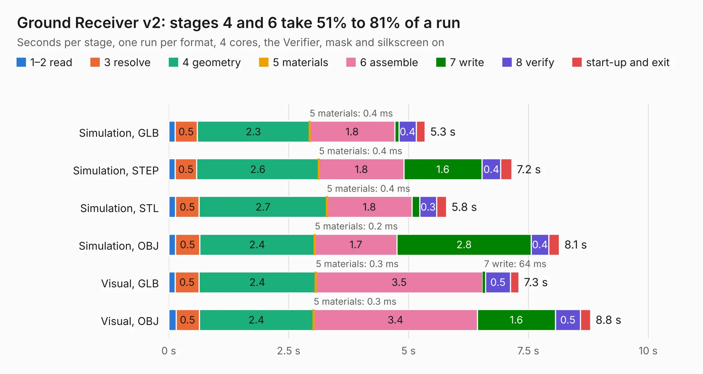

# 2760. Ground Receiver v2

Board 2,760 of the 3,125 of [Corpus Testing](../Corpus-Testing.md), on [Corpus Page 26](../CorpusTestingPages/Corpus-Testing-26.md#2760-ground-receiver-v2).

| Mode and format | 1–2 read | 3 resolve | 4 geometry | 5 materials | 6 assemble | 7 write | 8 verify | start-up and exit | Total |
|---|---:|---:|---:|---:|---:|---:|---:|---:|---:|
| Simulation, GLB | 0.1 | 0.5 | 2.3 | 0.4&nbsp;ms | 1.8 | 92&nbsp;ms | 0.4 | 0.2 | 5.3 |
| Simulation, STEP | 0.1 | 0.5 | 2.6 | 0.4&nbsp;ms | 1.8 | 1.6 | 0.4 | 0.2 | 7.2 |
| Simulation, STL | 0.1 | 0.5 | 2.7 | 0.4&nbsp;ms | 1.8 | 0.2 | 0.3 | 0.2 | 5.8 |
| Simulation, OBJ | 0.1 | 0.5 | 2.4 | 0.2&nbsp;ms | 1.7 | 2.8 | 0.4 | 0.2 | 8.1 |
| Visual, GLB | 0.1 | 0.5 | 2.4 | 0.3&nbsp;ms | 3.5 | 64&nbsp;ms | 0.5 | 0.2 | 7.3 |
| Visual, OBJ | 0.2 | 0.5 | 2.4 | 0.3&nbsp;ms | 3.4 | 1.6 | 0.5 | 0.2 | 8.8 |

<table align="center"><tr><td valign="top">

| Board | Repo: [terrapin-rocket-team/srad-avionics](https://github.com/terrapin-rocket-team/srad-avionics) Board: `Ground Receiver v2.kicad_pcb` |
|---|---|
| Folder | Spaceport / PCBs / Ground Reciever / Ground Reciever v2 |
| Complexity | 170&nbsp;/&nbsp;1000 (size&nbsp;145, features&nbsp;25) |
| KESE&nbsp;features | through vias, rounded, trapezoid or chamfered pads |
| Tested | 9th November 2026 |
| Copper&nbsp;layers | 2 |
| File&nbsp;format | KiCad 7 (20221018) |
| Parts,&nbsp;tracks,&nbsp;vias | 19, 293, 16 |
| Triangles,&nbsp;simulation | 560,782 in 72 parts |
| Verifier | PASS in all six runs |

</td><td valign="top">

<table>
<tr><th>File type</th><th>File size</th><th>Peak memory used</th></tr>
<tr><th colspan="3" align="left">Simulation</th></tr>
<tr><td>GLB</td><td align="right">18&nbsp;MB</td><td align="right">298&nbsp;MB</td></tr>
<tr><td>STEP</td><td align="right">74&nbsp;MB</td><td align="right">358&nbsp;MB</td></tr>
<tr><td>STL</td><td align="right">28&nbsp;MB</td><td align="right">289&nbsp;MB</td></tr>
<tr><td>OBJ</td><td align="right">56&nbsp;MB</td><td align="right">412&nbsp;MB</td></tr>
<tr><th colspan="3" align="left">Visual</th></tr>
<tr><td>GLB</td><td align="right">11&nbsp;MB</td><td align="right">371&nbsp;MB</td></tr>
<tr><td>OBJ</td><td align="right">34&nbsp;MB</td><td align="right">355&nbsp;MB</td></tr>
</table>

</td></tr></table>

| Previous | Next |
|:---|---:|
| [2759. SensorBoardNoMCU](b2759b_srad-avionics_Spaceport-PCBs-Gerbers-Teensy-v3-0_SensorBoardNoMCU.md) | [2761. Ground Reciever](b2761b_srad-avionics_Ground-Reciever.md) |
