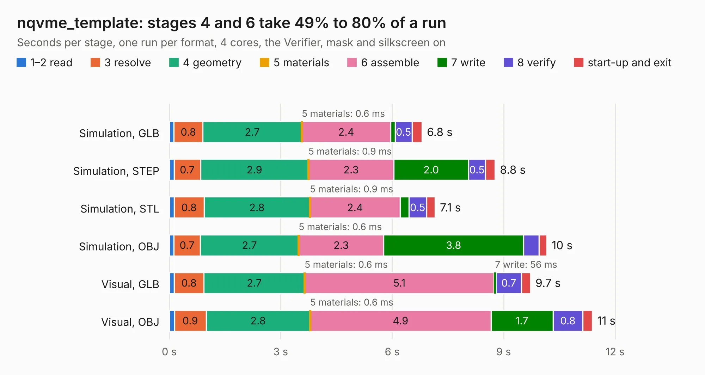

# 2762. nqvme_template

Board 2,762 of the 3,104 of [Corpus Testing](../Corpus-Testing.md), on [Corpus Page 26](../CorpusTestingPages/Corpus-Testing-26.md#2762-nqvme_template).

| Mode and format | 1–2 read | 3 resolve | 4 geometry | 5 materials | 6 assemble | 7 write | 8 verify | start-up and exit | Total |
|---|---:|---:|---:|---:|---:|---:|---:|---:|---:|
| Simulation, GLB | 0.1 | 0.8 | 2.7 | 0.6&nbsp;ms | 2.4 | 0.1 | 0.5 | 0.3 | 6.8 |
| Simulation, STEP | 0.1 | 0.7 | 2.9 | 0.9&nbsp;ms | 2.3 | 2.0 | 0.5 | 0.3 | 8.8 |
| Simulation, STL | 0.1 | 0.8 | 2.8 | 0.9&nbsp;ms | 2.4 | 0.2 | 0.5 | 0.2 | 7.1 |
| Simulation, OBJ | 0.1 | 0.7 | 2.7 | 0.6&nbsp;ms | 2.3 | 3.8 | 0.4 | 0.2 | 10.2 |
| Visual, GLB | 0.1 | 0.8 | 2.7 | 0.6&nbsp;ms | 5.1 | 56&nbsp;ms | 0.7 | 0.2 | 9.7 |
| Visual, OBJ | 0.1 | 0.9 | 2.8 | 0.6&nbsp;ms | 4.9 | 1.7 | 0.8 | 0.3 | 11.4 |

<table align="center"><tr><td valign="top">

| Board | Repo: [thorpej/pg68k](https://github.com/thorpej/pg68k) Board: `nqvme_template.kicad_pcb` |
|---|---|
| Folder | nqvme_template / design-files |
| Complexity | 98&nbsp;/&nbsp;1000 (size&nbsp;58, features&nbsp;40) |
| KESE&nbsp;features | rounded, trapezoid or chamfered pads, stack-up, dielectric εr and tanδ |
| Tested | 9th November 2026 |
| Copper&nbsp;layers | 4 |
| File&nbsp;format | KiCad 9 (20241229) |
| Parts,&nbsp;tracks,&nbsp;vias | 9, 0, 0 |
| Triangles,&nbsp;simulation | 790,980 in 115 parts |
| Verifier | PASS in all six runs |

</td><td valign="top">

<table>
<tr><th>File type</th><th>File size</th><th>Peak memory used</th></tr>
<tr><th colspan="3" align="left">Simulation</th></tr>
<tr><td>GLB</td><td align="right">25&nbsp;MB</td><td align="right">327&nbsp;MB</td></tr>
<tr><td>STEP</td><td align="right">68&nbsp;MB</td><td align="right">390&nbsp;MB</td></tr>
<tr><td>STL</td><td align="right">40&nbsp;MB</td><td align="right">324&nbsp;MB</td></tr>
<tr><td>OBJ</td><td align="right">80&nbsp;MB</td><td align="right">563&nbsp;MB</td></tr>
<tr><th colspan="3" align="left">Visual</th></tr>
<tr><td>GLB</td><td align="right">13&nbsp;MB</td><td align="right">425&nbsp;MB</td></tr>
<tr><td>OBJ</td><td align="right">38&nbsp;MB</td><td align="right">430&nbsp;MB</td></tr>
</table>

</td></tr></table>

| Previous | Next |
|:---|---:|
| [2761. cpu030](b2761b_pg68k_cpu030.md) | [2763. Apple2Card](b2763b_Apple2Card_Apple2Card_Apple2Card.md) |
