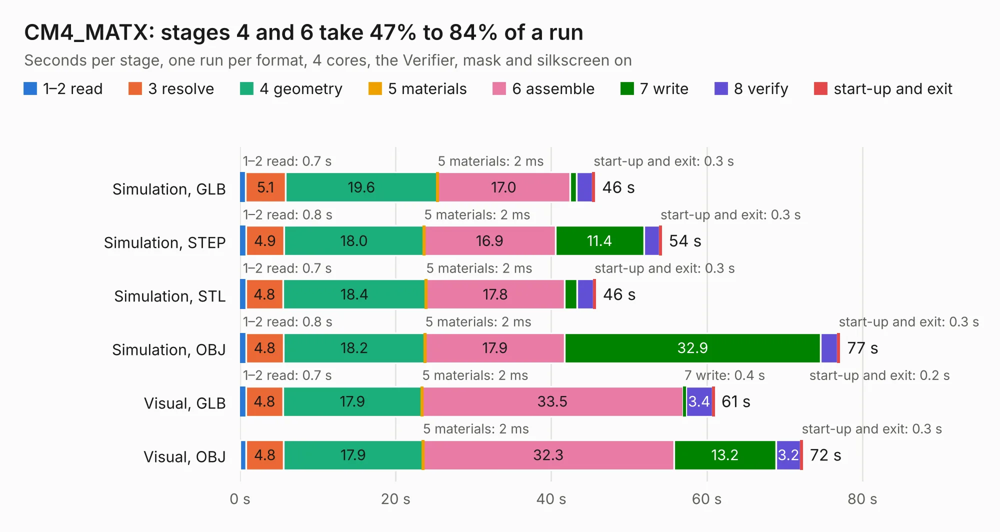

# 2763. CM4_MATX

Board 2,763 of the 3,107 of [Corpus Testing](../Corpus-Testing.md), on [Corpus Page 26](../CorpusTestingPages/Corpus-Testing-26.md#2763-cm4_matx).

| Mode and format | 1–2 read | 3 resolve | 4 geometry | 5 materials | 6 assemble | 7 write | 8 verify | start-up and exit | Total |
|---|---:|---:|---:|---:|---:|---:|---:|---:|---:|
| Simulation, GLB | 0.7 | 5.1 | 19.6 | 2&nbsp;ms | 17.0 | 0.9 | 2.0 | 0.3 | 45.6 |
| Simulation, STEP | 0.8 | 4.9 | 18.0 | 2&nbsp;ms | 16.9 | 11.4 | 2.0 | 0.3 | 54.2 |
| Simulation, STL | 0.7 | 4.8 | 18.4 | 2&nbsp;ms | 17.8 | 1.6 | 2.1 | 0.3 | 45.7 |
| Simulation, OBJ | 0.8 | 4.8 | 18.2 | 2&nbsp;ms | 17.9 | 32.9 | 2.2 | 0.3 | 77.1 |
| Visual, GLB | 0.7 | 4.8 | 17.9 | 2&nbsp;ms | 33.5 | 0.4 | 3.4 | 0.2 | 61.0 |
| Visual, OBJ | 0.8 | 4.8 | 17.9 | 2&nbsp;ms | 32.3 | 13.2 | 3.2 | 0.3 | 72.3 |

<table align="center"><tr><td valign="top">

| Board | Repo: [TheGuyDanish/CM4_MATX](https://github.com/TheGuyDanish/CM4_MATX) Board: `CM4_MATX.kicad_pcb` |
|---|---|
| Folder | KiCad |
| Complexity | 178&nbsp;/&nbsp;1000 (size&nbsp;138, features&nbsp;40) |
| KESE&nbsp;features | rounded, trapezoid or chamfered pads, filled zones, curved board outline |
| Tested | 9th November 2026 |
| Copper&nbsp;layers | 4 |
| File&nbsp;format | KiCad 5 (20171130) |
| Parts,&nbsp;tracks,&nbsp;vias | 207, 0, 0 |
| Triangles,&nbsp;simulation | 5,118,422 in 613 parts |
| Note | mostly unrouted |
| Verifier | PASS in all six runs |

</td><td valign="top">

<table>
<tr><th>File type</th><th>File size</th><th>Peak memory used</th></tr>
<tr><th colspan="3" align="left">Simulation</th></tr>
<tr><td>GLB</td><td align="right">169&nbsp;MB</td><td align="right">1.4&nbsp;GB</td></tr>
<tr><td>STEP</td><td align="right">517&nbsp;MB</td><td align="right">1.7&nbsp;GB</td></tr>
<tr><td>STL</td><td align="right">256&nbsp;MB</td><td align="right">1.3&nbsp;GB</td></tr>
<tr><td>OBJ</td><td align="right">550&nbsp;MB</td><td align="right">3.3&nbsp;GB</td></tr>
<tr><th colspan="3" align="left">Visual</th></tr>
<tr><td>GLB</td><td align="right">86&nbsp;MB</td><td align="right">1.5&nbsp;GB</td></tr>
<tr><td>OBJ</td><td align="right">272&nbsp;MB</td><td align="right">1.8&nbsp;GB</td></tr>
</table>

</td></tr></table>

| Previous | Next |
|:---|---:|
| [2762. Unified_Board](b2762b_srad-avionics_Unified-Board.md) | [2764. cpu030](b2764b_pg68k_cpu030.md) |
