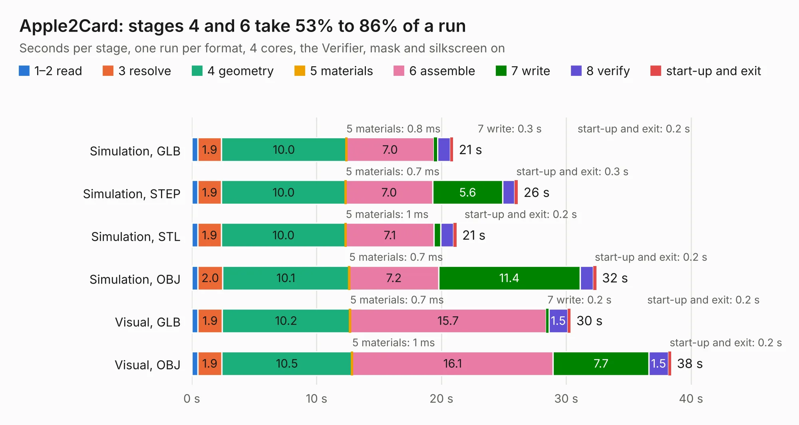

# 2765. Apple2Card

Board 2,765 of the 3,106 of [Corpus Testing](../Corpus-Testing.md), on [Corpus Page 26](../CorpusTestingPages/Corpus-Testing-26.md#2765-apple2card).

| Mode and format | 1–2 read | 3 resolve | 4 geometry | 5 materials | 6 assemble | 7 write | 8 verify | start-up and exit | Total |
|---|---:|---:|---:|---:|---:|---:|---:|---:|---:|
| Simulation, GLB | 0.5 | 1.9 | 10.0 | 0.8&nbsp;ms | 7.0 | 0.3 | 1.0 | 0.2 | 20.9 |
| Simulation, STEP | 0.5 | 1.9 | 10.0 | 0.7&nbsp;ms | 7.0 | 5.6 | 1.0 | 0.3 | 26.1 |
| Simulation, STL | 0.5 | 1.9 | 10.0 | 1&nbsp;ms | 7.1 | 0.5 | 1.0 | 0.2 | 21.2 |
| Simulation, OBJ | 0.5 | 2.0 | 10.1 | 0.7&nbsp;ms | 7.2 | 11.4 | 1.1 | 0.2 | 32.4 |
| Visual, GLB | 0.5 | 1.9 | 10.2 | 0.7&nbsp;ms | 15.7 | 0.2 | 1.5 | 0.2 | 30.4 |
| Visual, OBJ | 0.5 | 1.9 | 10.5 | 1&nbsp;ms | 16.1 | 7.7 | 1.5 | 0.2 | 38.4 |

<table align="center"><tr><td valign="top">

| Board | Repo: [ThorstenBr/Apple2Card](https://github.com/ThorstenBr/Apple2Card) Board: `Apple2Card.kicad_pcb` |
|---|---|
| Folder | Apple2Card |
| Complexity | 258&nbsp;/&nbsp;1000 (size&nbsp;183, features&nbsp;75) |
| KESE&nbsp;features | through vias, filled zones, curved board outline, stack-up, dielectric εr and tanδ |
| Tested | 9th November 2026 |
| Copper&nbsp;layers | 2 |
| File&nbsp;format | KiCad 6 (20211014) |
| Parts,&nbsp;tracks,&nbsp;vias | 77, 1,251, 48 |
| Triangles,&nbsp;simulation | 2,203,334 in 140 parts |
| Verifier | PASS in all six runs |

</td><td valign="top">

<table>
<tr><th>File type</th><th>File size</th><th>Peak memory used</th></tr>
<tr><th colspan="3" align="left">Simulation</th></tr>
<tr><td>GLB</td><td align="right">75&nbsp;MB</td><td align="right">791&nbsp;MB</td></tr>
<tr><td>STEP</td><td align="right">329&nbsp;MB</td><td align="right">941&nbsp;MB</td></tr>
<tr><td>STL</td><td align="right">110&nbsp;MB</td><td align="right">782&nbsp;MB</td></tr>
<tr><td>OBJ</td><td align="right">229&nbsp;MB</td><td align="right">1.5&nbsp;GB</td></tr>
<tr><th colspan="3" align="left">Visual</th></tr>
<tr><td>GLB</td><td align="right">50&nbsp;MB</td><td align="right">918&nbsp;MB</td></tr>
<tr><td>OBJ</td><td align="right">152&nbsp;MB</td><td align="right">1.1&nbsp;GB</td></tr>
</table>

</td></tr></table>

| Previous | Next |
|:---|---:|
| [2764. nqvme_template](b2764b_pg68k_nqvme-template.md) | [2766. Apple2Card](b2766b_Apple2Card_Apple2Card-x44_Apple2Card.md) |
