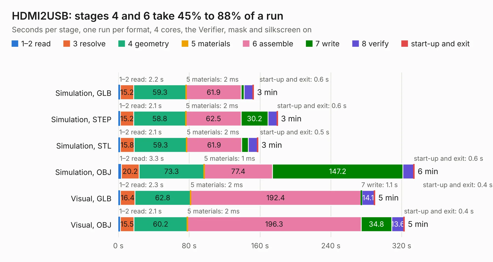

# 2765. HDMI2USB

Board 2,765 of the 3,102 of [Corpus Testing](../Corpus-Testing.md), on [Corpus Page 26](../CorpusTestingPages/Corpus-Testing-26.md#2765-hdmi2usb).

| Mode and format | 1–2 read | 3 resolve | 4 geometry | 5 materials | 6 assemble | 7 write | 8 verify | start-up and exit | Total |
|---|---:|---:|---:|---:|---:|---:|---:|---:|---:|
| Simulation, GLB | 2.2 | 15.2 | 59.3 | 2&nbsp;ms | 61.9 | 3.5 | 10.0 | 0.6 | 152.7 |
| Simulation, STEP | 2.1 | 15.2 | 58.8 | 2&nbsp;ms | 62.5 | 30.2 | 10.2 | 0.6 | 179.7 |
| Simulation, STL | 2.1 | 15.8 | 59.3 | 2&nbsp;ms | 61.9 | 7.6 | 10.5 | 0.5 | 157.7 |
| Simulation, OBJ | 3.3 | 20.2 | 73.3 | 1&nbsp;ms | 77.4 | 147.2 | 12.1 | 0.6 | 334.1 |
| Visual, GLB | 2.3 | 16.4 | 62.8 | 2&nbsp;ms | 192.4 | 1.1 | 14.1 | 0.4 | 289.5 |
| Visual, OBJ | 2.1 | 15.5 | 60.2 | 2&nbsp;ms | 196.3 | 34.8 | 13.6 | 0.4 | 322.9 |

<table align="center"><tr><td valign="top">

| Board | Repo: [timvideos/HDMI2USB-numato-opsis-hardware](https://github.com/timvideos/HDMI2USB-numato-opsis-hardware) Board: `HDMI2USB.kicad_pcb` |
|---|---|
| Folder | board |
| Complexity | 395&nbsp;/&nbsp;1000 (size&nbsp;350, features&nbsp;45) |
| KESE&nbsp;features | through vias, slotted holes, filled zones |
| Tested | 9th November 2026 to 10th November 2026 |
| Copper&nbsp;layers | 10 |
| File&nbsp;format | KiCad 3 (3) |
| Parts,&nbsp;tracks,&nbsp;vias | 521, 14,026, 1,490 |
| Triangles,&nbsp;simulation | 17,762,300 in 499 parts |
| Verifier | PASS in all six runs |
| Run&nbsp;again | Simulation, OBJ: failed in the corpus run, run again with the memory cap raised from 11 GB to 14.5 GB, and passed |

</td><td valign="top">

<table>
<tr><th>File type</th><th>File size</th><th>Peak memory used</th></tr>
<tr><th colspan="3" align="left">Simulation</th></tr>
<tr><td>GLB</td><td align="right">610&nbsp;MB</td><td align="right">3.1&nbsp;GB</td></tr>
<tr><td>STEP</td><td align="right">1.9&nbsp;GB</td><td align="right">4.8&nbsp;GB</td></tr>
<tr><td>STL</td><td align="right">888&nbsp;MB</td><td align="right">3.5&nbsp;GB</td></tr>
<tr><td>OBJ</td><td align="right">2.0&nbsp;GB</td><td align="right">11&nbsp;GB</td></tr>
<tr><th colspan="3" align="left">Visual</th></tr>
<tr><td>GLB</td><td align="right">239&nbsp;MB</td><td align="right">4.1&nbsp;GB</td></tr>
<tr><td>OBJ</td><td align="right">800&nbsp;MB</td><td align="right">5.1&nbsp;GB</td></tr>
</table>

</td></tr></table>

| Previous | Next |
|:---|---:|
| [2764. tigard](b2764b_tigard_tigard.md) | [2766. ethernet-extension-poe](b2766b_ethernet-extension_ethernet-extension-poe.md) |
