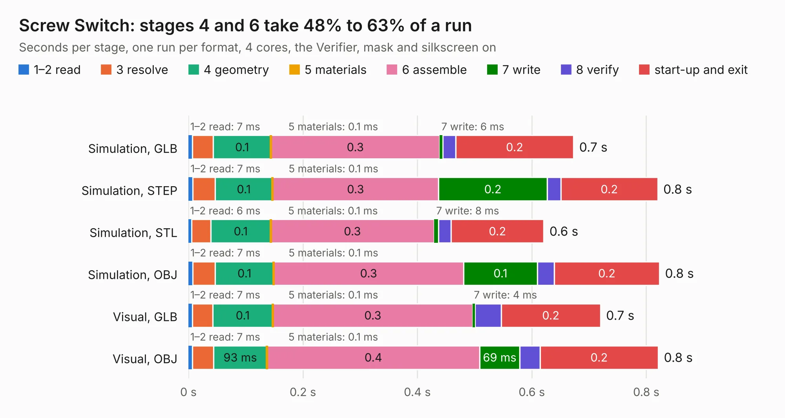

# 2770. Screw Switch

Board 2,770 of the 3,121 of [Corpus Testing](../Corpus-Testing.md), on [Corpus Page 26](../CorpusTestingPages/Corpus-Testing-26.md#2770-screw-switch).

| Mode and format | 1–2 read | 3 resolve | 4 geometry | 5 materials | 6 assemble | 7 write | 8 verify | start-up and exit | Total |
|---|---:|---:|---:|---:|---:|---:|---:|---:|---:|
| Simulation, GLB | 7&nbsp;ms | 37&nbsp;ms | 0.1 | 0.1&nbsp;ms | 0.3 | 6&nbsp;ms | 22&nbsp;ms | 0.2 | 0.7 |
| Simulation, STEP | 7&nbsp;ms | 39&nbsp;ms | 0.1 | 0.1&nbsp;ms | 0.3 | 0.2 | 24&nbsp;ms | 0.2 | 0.8 |
| Simulation, STL | 6&nbsp;ms | 33&nbsp;ms | 0.1 | 0.1&nbsp;ms | 0.3 | 8&nbsp;ms | 22&nbsp;ms | 0.2 | 0.6 |
| Simulation, OBJ | 7&nbsp;ms | 40&nbsp;ms | 0.1 | 0.1&nbsp;ms | 0.3 | 0.1 | 29&nbsp;ms | 0.2 | 0.8 |
| Visual, GLB | 7&nbsp;ms | 35&nbsp;ms | 0.1 | 0.1&nbsp;ms | 0.3 | 4&nbsp;ms | 45&nbsp;ms | 0.2 | 0.7 |
| Visual, OBJ | 7&nbsp;ms | 37&nbsp;ms | 93&nbsp;ms | 0.1&nbsp;ms | 0.4 | 69&nbsp;ms | 36&nbsp;ms | 0.2 | 0.8 |

<table align="center"><tr><td valign="top">

| Board | Repo: [terrapin-rocket-team/srad-avionics](https://github.com/terrapin-rocket-team/srad-avionics) Board: `Screw Switch.kicad_pcb` |
|---|---|
| Folder | Spaceport / PCBs / Screw Switch |
| Complexity | 90&nbsp;/&nbsp;1000 (size&nbsp;70, features&nbsp;20) |
| KESE&nbsp;features | copper drawings, curved board outline |
| Tested | 9th November 2026 |
| Copper&nbsp;layers | 2 |
| File&nbsp;format | KiCad 9 (20241229) |
| Parts,&nbsp;tracks,&nbsp;vias | 4, 8, 0 |
| Triangles,&nbsp;simulation | 33,832 in 12 parts |
| Verifier | PASS in all six runs |

</td><td valign="top">

<table>
<tr><th>File type</th><th>File size</th><th>Peak memory used</th></tr>
<tr><th colspan="3" align="left">Simulation</th></tr>
<tr><td>GLB</td><td align="right">1.2&nbsp;MB</td><td align="right">44&nbsp;MB</td></tr>
<tr><td>STEP</td><td align="right">5.3&nbsp;MB</td><td align="right">47&nbsp;MB</td></tr>
<tr><td>STL</td><td align="right">1.7&nbsp;MB</td><td align="right">45&nbsp;MB</td></tr>
<tr><td>OBJ</td><td align="right">3.1&nbsp;MB</td><td align="right">51&nbsp;MB</td></tr>
<tr><th colspan="3" align="left">Visual</th></tr>
<tr><td>GLB</td><td align="right">597&nbsp;kB</td><td align="right">64&nbsp;MB</td></tr>
<tr><td>OBJ</td><td align="right">1.6&nbsp;MB</td><td align="right">58&nbsp;MB</td></tr>
</table>

</td></tr></table>

| Previous | Next |
|:---|---:|
| [2769. RF4463F30-test-board](b2769b_srad-avionics_RF4463F30-test-board.md) | [2771. high-range-IMU](b2771b_srad-avionics_high-range-IMU.md) |
