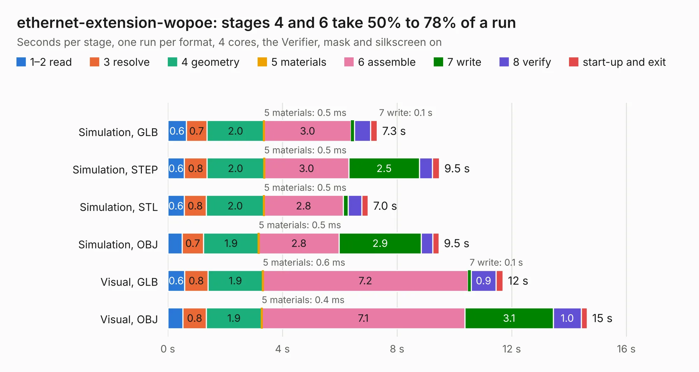

# 2774. ethernet-extension-wopoe

Board 2,774 of the 3,109 of [Corpus Testing](../Corpus-Testing.md), on [Corpus Page 26](../CorpusTestingPages/Corpus-Testing-26.md#2774-ethernet-extension-wopoe).

| Mode and format | 1–2 read | 3 resolve | 4 geometry | 5 materials | 6 assemble | 7 write | 8 verify | start-up and exit | Total |
|---|---:|---:|---:|---:|---:|---:|---:|---:|---:|
| Simulation, GLB | 0.6 | 0.7 | 2.0 | 0.5&nbsp;ms | 3.0 | 0.1 | 0.6 | 0.2 | 7.3 |
| Simulation, STEP | 0.6 | 0.8 | 2.0 | 0.5&nbsp;ms | 3.0 | 2.5 | 0.5 | 0.2 | 9.5 |
| Simulation, STL | 0.6 | 0.8 | 2.0 | 0.5&nbsp;ms | 2.8 | 0.2 | 0.5 | 0.2 | 7.0 |
| Simulation, OBJ | 0.5 | 0.7 | 1.9 | 0.5&nbsp;ms | 2.8 | 2.9 | 0.4 | 0.2 | 9.5 |
| Visual, GLB | 0.6 | 0.8 | 1.9 | 0.6&nbsp;ms | 7.2 | 0.1 | 0.9 | 0.2 | 11.7 |
| Visual, OBJ | 0.5 | 0.8 | 1.9 | 0.4&nbsp;ms | 7.1 | 3.1 | 1.0 | 0.2 | 14.6 |

<table align="center"><tr><td valign="top">

| Board | Repo: [Tinkerforge/ethernet-extension](https://github.com/Tinkerforge/ethernet-extension) Board: `ethernet-extension-wopoe.kicad_pcb` |
|---|---|
| Folder | hardware / wo_poe |
| Complexity | 268&nbsp;/&nbsp;1000 (size&nbsp;223, features&nbsp;45) |
| KESE&nbsp;features | through vias, filled zones, curved board outline |
| Tested | 9th November 2026 |
| Copper&nbsp;layers | 2 |
| File&nbsp;format | KiCad 6 (20211014) |
| Parts,&nbsp;tracks,&nbsp;vias | 58, 1,029, 222 |
| Triangles,&nbsp;simulation | 668,918 in 103 parts |
| Verifier | PASS in all six runs |

</td><td valign="top">

<table>
<tr><th>File type</th><th>File size</th><th>Peak memory used</th></tr>
<tr><th colspan="3" align="left">Simulation</th></tr>
<tr><td>GLB</td><td align="right">23&nbsp;MB</td><td align="right">466&nbsp;MB</td></tr>
<tr><td>STEP</td><td align="right">102&nbsp;MB</td><td align="right">475&nbsp;MB</td></tr>
<tr><td>STL</td><td align="right">33&nbsp;MB</td><td align="right">461&nbsp;MB</td></tr>
<tr><td>OBJ</td><td align="right">69&nbsp;MB</td><td align="right">500&nbsp;MB</td></tr>
<tr><th colspan="3" align="left">Visual</th></tr>
<tr><td>GLB</td><td align="right">21&nbsp;MB</td><td align="right">519&nbsp;MB</td></tr>
<tr><td>OBJ</td><td align="right">66&nbsp;MB</td><td align="right">582&nbsp;MB</td></tr>
</table>

</td></tr></table>

| Previous | Next |
|:---|---:|
| [2773. ethernet-extension-poe](b2773b_ethernet-extension_ethernet-extension-poe.md) | [2775. evse-v4](b2775b_evse-v4-bricklet_evse-v4.md) |
