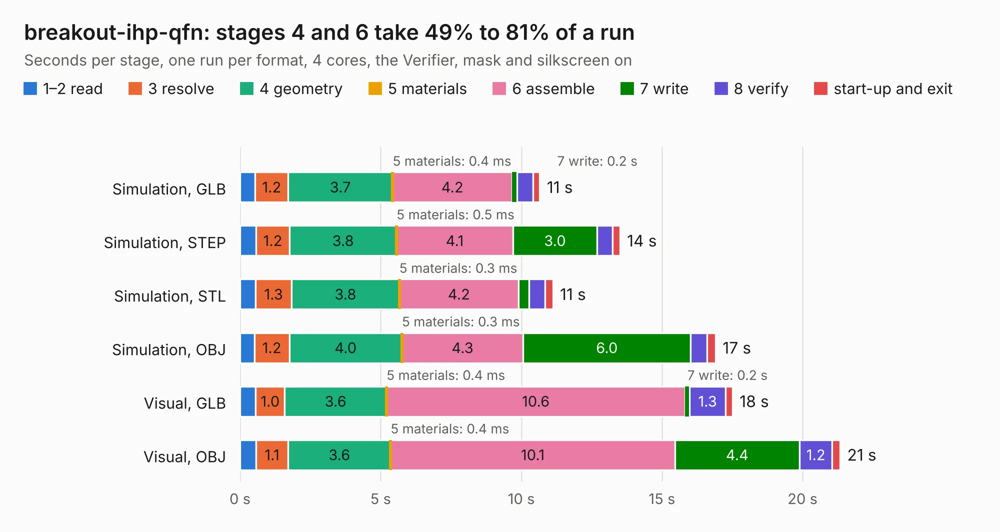

# 2776. breakout-ihp-qfn

Board 2,776 of the 3,101 of [Corpus Testing](../Corpus-Testing.md), on [Corpus Page 26](../CorpusTestingPages/Corpus-Testing-26.md#2776-breakout-ihp-qfn).

| Mode and format | 1–2 read | 3 resolve | 4 geometry | 5 materials | 6 assemble | 7 write | 8 verify | start-up and exit | Total |
|---|---:|---:|---:|---:|---:|---:|---:|---:|---:|
| Simulation, GLB | 0.5 | 1.2 | 3.7 | 0.4&nbsp;ms | 4.2 | 0.2 | 0.6 | 0.2 | 10.7 |
| Simulation, STEP | 0.6 | 1.2 | 3.8 | 0.5&nbsp;ms | 4.1 | 3.0 | 0.5 | 0.3 | 13.5 |
| Simulation, STL | 0.6 | 1.3 | 3.8 | 0.3&nbsp;ms | 4.2 | 0.4 | 0.6 | 0.3 | 11.1 |
| Simulation, OBJ | 0.5 | 1.2 | 4.0 | 0.3&nbsp;ms | 4.3 | 6.0 | 0.6 | 0.3 | 16.9 |
| Visual, GLB | 0.6 | 1.0 | 3.6 | 0.4&nbsp;ms | 10.6 | 0.2 | 1.3 | 0.2 | 17.5 |
| Visual, OBJ | 0.6 | 1.1 | 3.6 | 0.4&nbsp;ms | 10.1 | 4.4 | 1.2 | 0.3 | 21.3 |

<table align="center"><tr><td valign="top">

| Board | Repo: [TinyTapeout/breakout-pcb](https://github.com/TinyTapeout/breakout-pcb) Board: `breakout-ihp-qfn.kicad_pcb` |
|---|---|
| Folder | breakout-ihp-qfn |
| Complexity | 378&nbsp;/&nbsp;1000 (size&nbsp;233, features&nbsp;145) |
| KESE&nbsp;features | through vias, custom pads, rounded, trapezoid or chamfered pads, filled zones, copper drawings, curved board outline, knockout text, TrueType text, stack-up, dielectric εr and tanδ, mask and silkscreen colours |
| Tested | 9th November 2026 |
| Copper&nbsp;layers | 4 |
| File&nbsp;format | KiCad 10 (20260206) |
| Parts,&nbsp;tracks,&nbsp;vias | 37, 1,034, 182 |
| Triangles,&nbsp;simulation | 1,229,514 in 101 parts |
| Verifier | PASS in all six runs |

</td><td valign="top">

<table>
<tr><th>File type</th><th>File size</th><th>Peak memory used</th></tr>
<tr><th colspan="3" align="left">Simulation</th></tr>
<tr><td>GLB</td><td align="right">43&nbsp;MB</td><td align="right">533&nbsp;MB</td></tr>
<tr><td>STEP</td><td align="right">176&nbsp;MB</td><td align="right">628&nbsp;MB</td></tr>
<tr><td>STL</td><td align="right">61&nbsp;MB</td><td align="right">516&nbsp;MB</td></tr>
<tr><td>OBJ</td><td align="right">128&nbsp;MB</td><td align="right">845&nbsp;MB</td></tr>
<tr><th colspan="3" align="left">Visual</th></tr>
<tr><td>GLB</td><td align="right">32&nbsp;MB</td><td align="right">709&nbsp;MB</td></tr>
<tr><td>OBJ</td><td align="right">96&nbsp;MB</td><td align="right">733&nbsp;MB</td></tr>
</table>

</td></tr></table>

| Previous | Next |
|:---|---:|
| [2775. breakout-dip-gf](b2775b_breakout-pcb_breakout-dip-gf.md) | [2777. breakout-qfn](b2777b_breakout-pcb_breakout-qfn.md) |
