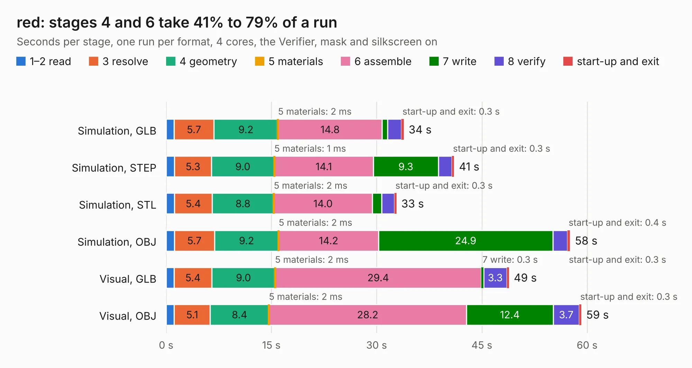

# 2776. red

Board 2,776 of the 3,108 of [Corpus Testing](../Corpus-Testing.md), on [Corpus Page 26](../CorpusTestingPages/Corpus-Testing-26.md#2776-red).

| Mode and format | 1–2 read | 3 resolve | 4 geometry | 5 materials | 6 assemble | 7 write | 8 verify | start-up and exit | Total |
|---|---:|---:|---:|---:|---:|---:|---:|---:|---:|
| Simulation, GLB | 1.1 | 5.7 | 9.2 | 2&nbsp;ms | 14.8 | 0.8 | 2.0 | 0.3 | 33.9 |
| Simulation, STEP | 1.2 | 5.3 | 9.0 | 1&nbsp;ms | 14.1 | 9.3 | 1.9 | 0.3 | 41.0 |
| Simulation, STL | 1.2 | 5.4 | 8.8 | 2&nbsp;ms | 14.0 | 1.4 | 1.8 | 0.3 | 32.8 |
| Simulation, OBJ | 1.2 | 5.7 | 9.2 | 2&nbsp;ms | 14.2 | 24.9 | 2.1 | 0.4 | 57.6 |
| Visual, GLB | 1.1 | 5.4 | 9.0 | 2&nbsp;ms | 29.4 | 0.3 | 3.3 | 0.3 | 48.8 |
| Visual, OBJ | 1.1 | 5.1 | 8.4 | 2&nbsp;ms | 28.2 | 12.4 | 3.7 | 0.3 | 59.2 |

<table align="center"><tr><td valign="top">

| Board | Repo: [Tinkerforge/red-brick](https://github.com/Tinkerforge/red-brick) Board: `red.kicad_pcb` |
|---|---|
| Folder | hardware |
| Complexity | 366&nbsp;/&nbsp;1000 (size&nbsp;311, features&nbsp;55) |
| KESE&nbsp;features | through vias, slotted holes, filled zones, curved board outline |
| Tested | 9th November 2026 |
| Copper&nbsp;layers | 6 |
| File&nbsp;format | KiCad 4 (4) |
| Parts,&nbsp;tracks,&nbsp;vias | 180, 8,041, 754 |
| Triangles,&nbsp;simulation | 4,307,386 in 319 parts |
| Verifier | PASS in all six runs |

</td><td valign="top">

<table>
<tr><th>File type</th><th>File size</th><th>Peak memory used</th></tr>
<tr><th colspan="3" align="left">Simulation</th></tr>
<tr><td>GLB</td><td align="right">147&nbsp;MB</td><td align="right">1.1&nbsp;GB</td></tr>
<tr><td>STEP</td><td align="right">444&nbsp;MB</td><td align="right">1.6&nbsp;GB</td></tr>
<tr><td>STL</td><td align="right">215&nbsp;MB</td><td align="right">1.2&nbsp;GB</td></tr>
<tr><td>OBJ</td><td align="right">465&nbsp;MB</td><td align="right">2.7&nbsp;GB</td></tr>
<tr><th colspan="3" align="left">Visual</th></tr>
<tr><td>GLB</td><td align="right">73&nbsp;MB</td><td align="right">1.4&nbsp;GB</td></tr>
<tr><td>OBJ</td><td align="right">249&nbsp;MB</td><td align="right">1.6&nbsp;GB</td></tr>
</table>

</td></tr></table>

| Previous | Next |
|:---|---:|
| [2775. evse-v4b](b2775b_evse-v4-bricklet_evse-v4b.md) | [2777. TinyFPGA-BX](b2777b_TinyFPGA-BX_TinyFPGA-BX.md) |
