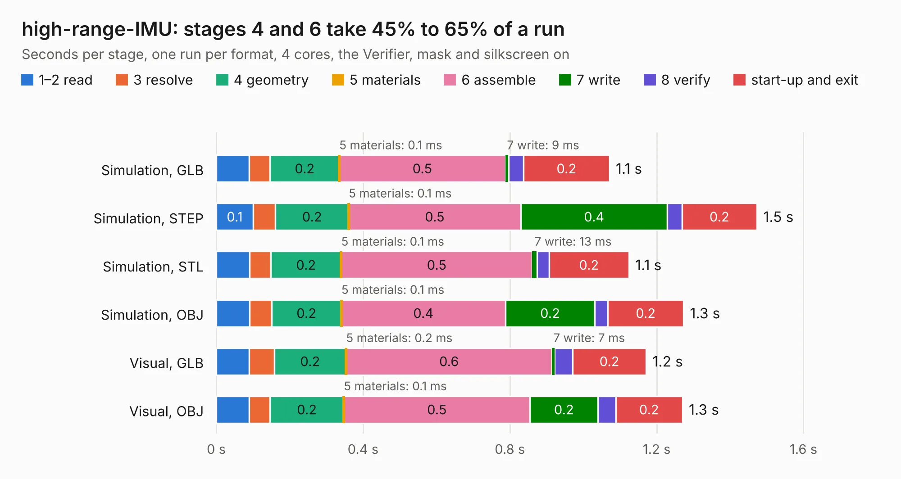

# 2779. high-range-IMU

Board 2,779 of the 3,130 of [Corpus Testing](../Corpus-Testing.md), on [Corpus Page 26](../CorpusTestingPages/Corpus-Testing-26.md#2779-high-range-imu).

| Mode and format | 1–2 read | 3 resolve | 4 geometry | 5 materials | 6 assemble | 7 write | 8 verify | start-up and exit | Total |
|---|---:|---:|---:|---:|---:|---:|---:|---:|---:|
| Simulation, GLB | 90&nbsp;ms | 57&nbsp;ms | 0.2 | 0.1&nbsp;ms | 0.5 | 9&nbsp;ms | 41&nbsp;ms | 0.2 | 1.1 |
| Simulation, STEP | 0.1 | 61&nbsp;ms | 0.2 | 0.1&nbsp;ms | 0.5 | 0.4 | 39&nbsp;ms | 0.2 | 1.5 |
| Simulation, STL | 91&nbsp;ms | 58&nbsp;ms | 0.2 | 0.1&nbsp;ms | 0.5 | 13&nbsp;ms | 33&nbsp;ms | 0.2 | 1.1 |
| Simulation, OBJ | 91&nbsp;ms | 60&nbsp;ms | 0.2 | 0.1&nbsp;ms | 0.4 | 0.2 | 36&nbsp;ms | 0.2 | 1.3 |
| Visual, GLB | 89&nbsp;ms | 68&nbsp;ms | 0.2 | 0.2&nbsp;ms | 0.6 | 7&nbsp;ms | 49&nbsp;ms | 0.2 | 1.2 |
| Visual, OBJ | 89&nbsp;ms | 57&nbsp;ms | 0.2 | 0.1&nbsp;ms | 0.5 | 0.2 | 49&nbsp;ms | 0.2 | 1.3 |

<table align="center"><tr><td valign="top">

| Board | Repo: [terrapin-rocket-team/srad-avionics](https://github.com/terrapin-rocket-team/srad-avionics) Board: `high-range-IMU.kicad_pcb` |
|---|---|
| Folder | Spaceport / PCBs / Sensor Boards / high-range-IMU |
| Complexity | 156&nbsp;/&nbsp;1000 (size&nbsp;101, features&nbsp;55) |
| KESE&nbsp;features | through vias, rounded, trapezoid or chamfered pads, filled zones, curved board outline |
| Tested | 9th November 2026 |
| Copper&nbsp;layers | 2 |
| File&nbsp;format | KiCad 9 (20241229) |
| Parts,&nbsp;tracks,&nbsp;vias | 5, 44, 2 |
| Triangles,&nbsp;simulation | 45,474 in 19 parts |
| Verifier | PASS in all six runs |

</td><td valign="top">

<table>
<tr><th>File type</th><th>File size</th><th>Peak memory used</th></tr>
<tr><th colspan="3" align="left">Simulation</th></tr>
<tr><td>GLB</td><td align="right">1.6&nbsp;MB</td><td align="right">68&nbsp;MB</td></tr>
<tr><td>STEP</td><td align="right">7.1&nbsp;MB</td><td align="right">72&nbsp;MB</td></tr>
<tr><td>STL</td><td align="right">2.3&nbsp;MB</td><td align="right">69&nbsp;MB</td></tr>
<tr><td>OBJ</td><td align="right">4.4&nbsp;MB</td><td align="right">78&nbsp;MB</td></tr>
<tr><th colspan="3" align="left">Visual</th></tr>
<tr><td>GLB</td><td align="right">1.2&nbsp;MB</td><td align="right">102&nbsp;MB</td></tr>
<tr><td>OBJ</td><td align="right">3.4&nbsp;MB</td><td align="right">96&nbsp;MB</td></tr>
</table>

</td></tr></table>

| Previous | Next |
|:---|---:|
| [2778. Screw Switch](b2778b_srad-avionics_Screw-Switch.md) | [2780. PatchAntennaBreakout](b2780b_srad-avionics_PatchAntennaBreakout.md) |
