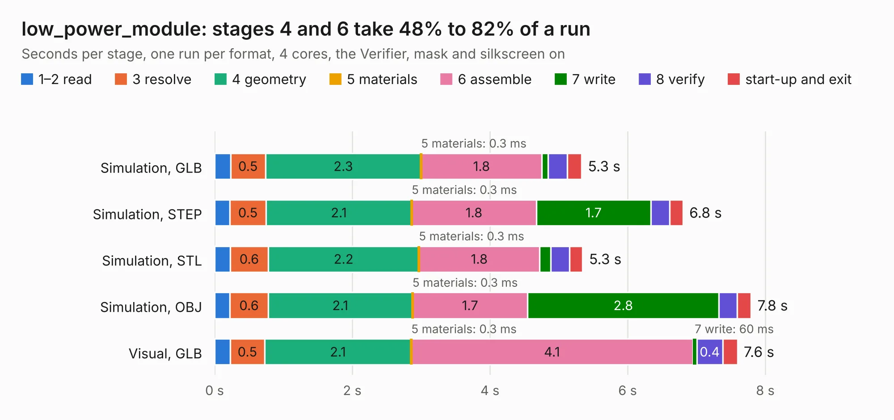

# 2779. low_power_module

Board 2,779 of the 3,139 of [Corpus Testing](../Corpus-Testing.md), on [Corpus Page 26](../CorpusTestingPages/Corpus-Testing-26.md#2779-low_power_module).

| Mode and format | 1–2 read | 3 resolve | 4 geometry | 5 materials | 6 assemble | 7 write | 8 verify | start-up and exit | Total |
|---|---:|---:|---:|---:|---:|---:|---:|---:|---:|
| Simulation, GLB | 0.2 | 0.5 | 2.3 | 0.3&nbsp;ms | 1.8 | 86&nbsp;ms | 0.3 | 0.2 | 5.3 |
| Simulation, STEP | 0.2 | 0.5 | 2.1 | 0.3&nbsp;ms | 1.8 | 1.7 | 0.3 | 0.2 | 6.8 |
| Simulation, STL | 0.2 | 0.6 | 2.2 | 0.3&nbsp;ms | 1.8 | 0.2 | 0.3 | 0.2 | 5.3 |
| Simulation, OBJ | 0.2 | 0.6 | 2.1 | 0.3&nbsp;ms | 1.7 | 2.8 | 0.3 | 0.2 | 7.8 |
| Visual, GLB | 0.2 | 0.5 | 2.1 | 0.3&nbsp;ms | 4.1 | 60&nbsp;ms | 0.4 | 0.2 | 7.6 |
| Visual, OBJ | 0.2 | 0.5 | 2.2 | 0.2&nbsp;ms | 4.0 | 2.0 | 0.5 | 0.2 | 9.7 |

<table align="center"><tr><td valign="top">

| Board | Repo: [terrapin-rocket-team/srad-avionics](https://github.com/terrapin-rocket-team/srad-avionics) Board: `low_power_module.kicad_pcb` |
|---|---|
| Folder | Spaceport / PCBs / low_power_module |
| Complexity | 200&nbsp;/&nbsp;1000 (size&nbsp;155, features&nbsp;45) |
| KESE&nbsp;features | through vias, rounded, trapezoid or chamfered pads, filled zones |
| Tested | 9th November 2026 |
| Copper&nbsp;layers | 2 |
| File&nbsp;format | KiCad 8 (20240108) |
| Parts,&nbsp;tracks,&nbsp;vias | 49, 230, 36 |
| Triangles,&nbsp;simulation | 593,664 in 84 parts |
| Verifier | PASS in all six runs |

</td><td valign="top">

<table>
<tr><th>File type</th><th>File size</th><th>Peak memory used</th></tr>
<tr><th colspan="3" align="left">Simulation</th></tr>
<tr><td>GLB</td><td align="right">20&nbsp;MB</td><td align="right">320&nbsp;MB</td></tr>
<tr><td>STEP</td><td align="right">90&nbsp;MB</td><td align="right">399&nbsp;MB</td></tr>
<tr><td>STL</td><td align="right">30&nbsp;MB</td><td align="right">340&nbsp;MB</td></tr>
<tr><td>OBJ</td><td align="right">60&nbsp;MB</td><td align="right">428&nbsp;MB</td></tr>
<tr><th colspan="3" align="left">Visual</th></tr>
<tr><td>GLB</td><td align="right">14&nbsp;MB</td><td align="right">399&nbsp;MB</td></tr>
<tr><td>OBJ</td><td align="right">43&nbsp;MB</td><td align="right">440&nbsp;MB</td></tr>
</table>

</td></tr></table>

| Previous | Next |
|:---|---:|
| [2778. live-video-multi-function-board](b2778b_srad-avionics_live-video-multi-function-board.md) | [2780. ESP32_BluetoothModule_TerrapinRockets](b2780b_srad-avionics_ESP32-BluetoothModule-TerrapinRockets.md) |
