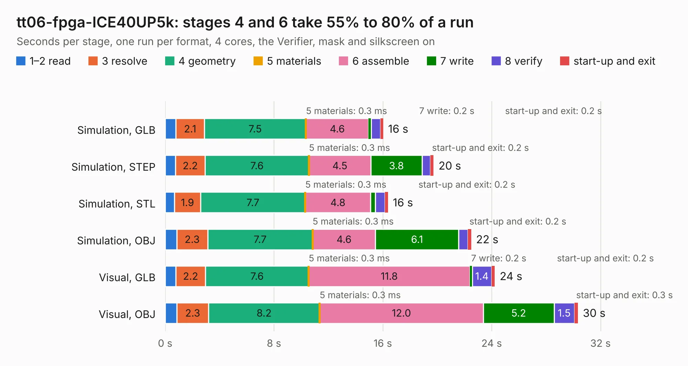

# 2780. tt06-fpga-ICE40UP5k

Board 2,780 of the 3,108 of [Corpus Testing](../Corpus-Testing.md), on [Corpus Page 26](../CorpusTestingPages/Corpus-Testing-26.md#2780-tt06-fpga-ice40up5k).

| Mode and format | 1–2 read | 3 resolve | 4 geometry | 5 materials | 6 assemble | 7 write | 8 verify | start-up and exit | Total |
|---|---:|---:|---:|---:|---:|---:|---:|---:|---:|
| Simulation, GLB | 0.8 | 2.1 | 7.5 | 0.3&nbsp;ms | 4.6 | 0.2 | 0.7 | 0.2 | 16.0 |
| Simulation, STEP | 0.8 | 2.2 | 7.6 | 0.3&nbsp;ms | 4.5 | 3.8 | 0.6 | 0.2 | 19.7 |
| Simulation, STL | 0.7 | 1.9 | 7.7 | 0.3&nbsp;ms | 4.8 | 0.4 | 0.7 | 0.2 | 16.4 |
| Simulation, OBJ | 0.8 | 2.3 | 7.7 | 0.3&nbsp;ms | 4.6 | 6.1 | 0.7 | 0.2 | 22.5 |
| Visual, GLB | 0.8 | 2.2 | 7.6 | 0.3&nbsp;ms | 11.8 | 0.2 | 1.4 | 0.2 | 24.2 |
| Visual, OBJ | 0.9 | 2.3 | 8.2 | 0.3&nbsp;ms | 12.0 | 5.2 | 1.5 | 0.3 | 30.3 |

<table align="center"><tr><td valign="top">

| Board | Repo: [TinyTapeout/breakout-pcb](https://github.com/TinyTapeout/breakout-pcb) Board: `tt06-fpga-ICE40UP5k.kicad_pcb` |
|---|---|
| Folder | ASIC-simulator / tt06-fpga-ICE40UP5k |
| Complexity | 348&nbsp;/&nbsp;1000 (size&nbsp;228, features&nbsp;120) |
| KESE&nbsp;features | through vias, rounded, trapezoid or chamfered pads, filled zones, curved board outline, knockout text, TrueType text, stack-up, dielectric εr and tanδ, mask and silkscreen colours |
| Tested | 9th November 2026 |
| Copper&nbsp;layers | 4 |
| File&nbsp;format | KiCad 9 (20241229) |
| Parts,&nbsp;tracks,&nbsp;vias | 42, 621, 146 |
| Triangles,&nbsp;simulation | 1,365,290 in 87 parts |
| Verifier | PASS in all six runs |

</td><td valign="top">

<table>
<tr><th>File type</th><th>File size</th><th>Peak memory used</th></tr>
<tr><th colspan="3" align="left">Simulation</th></tr>
<tr><td>GLB</td><td align="right">49&nbsp;MB</td><td align="right">672&nbsp;MB</td></tr>
<tr><td>STEP</td><td align="right">238&nbsp;MB</td><td align="right">779&nbsp;MB</td></tr>
<tr><td>STL</td><td align="right">68&nbsp;MB</td><td align="right">661&nbsp;MB</td></tr>
<tr><td>OBJ</td><td align="right">145&nbsp;MB</td><td align="right">1000&nbsp;MB</td></tr>
<tr><th colspan="3" align="left">Visual</th></tr>
<tr><td>GLB</td><td align="right">40&nbsp;MB</td><td align="right">841&nbsp;MB</td></tr>
<tr><td>OBJ</td><td align="right">121&nbsp;MB</td><td align="right">881&nbsp;MB</td></tr>
</table>

</td></tr></table>

| Previous | Next |
|:---|---:|
| [2779. breakout-fpga-ICE40UP5K](b2779b_breakout-pcb_breakout-fpga-ICE40UP5K.md) | [2781. ttdbv3-fpga-ICE40UP5k](b2781b_breakout-pcb_ttdbv3-fpga-ICE40UP5k.md) |
