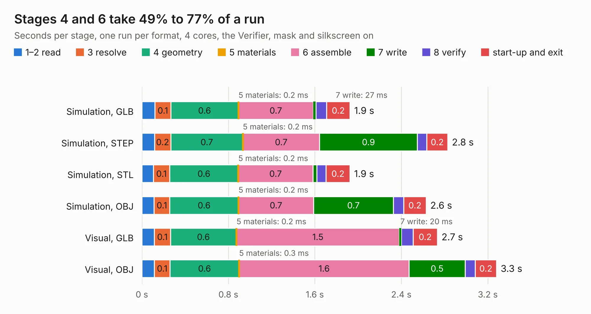

# 2780. ESP32_BluetoothModule_TerrapinRockets

Board 2,780 of the 3,139 of [Corpus Testing](../Corpus-Testing.md), on [Corpus Page 26](../CorpusTestingPages/Corpus-Testing-26.md#2780-esp32_bluetoothmodule_terrapinrockets).

| Mode and format | 1–2 read | 3 resolve | 4 geometry | 5 materials | 6 assemble | 7 write | 8 verify | start-up and exit | Total |
|---|---:|---:|---:|---:|---:|---:|---:|---:|---:|
| Simulation, GLB | 0.1 | 0.1 | 0.6 | 0.2&nbsp;ms | 0.7 | 27&nbsp;ms | 98&nbsp;ms | 0.2 | 1.9 |
| Simulation, STEP | 0.1 | 0.2 | 0.7 | 0.2&nbsp;ms | 0.7 | 0.9 | 87&nbsp;ms | 0.2 | 2.8 |
| Simulation, STL | 0.1 | 0.1 | 0.6 | 0.2&nbsp;ms | 0.7 | 35&nbsp;ms | 87&nbsp;ms | 0.2 | 1.9 |
| Simulation, OBJ | 0.1 | 0.1 | 0.6 | 0.2&nbsp;ms | 0.7 | 0.7 | 96&nbsp;ms | 0.2 | 2.6 |
| Visual, GLB | 0.1 | 0.1 | 0.6 | 0.2&nbsp;ms | 1.5 | 20&nbsp;ms | 0.1 | 0.2 | 2.7 |
| Visual, OBJ | 0.1 | 0.1 | 0.6 | 0.3&nbsp;ms | 1.6 | 0.5 | 94&nbsp;ms | 0.2 | 3.3 |

<table align="center"><tr><td valign="top">

| Board | Repo: [terrapin-rocket-team/srad-avionics](https://github.com/terrapin-rocket-team/srad-avionics) Board: `ESP32_BluetoothModule_TerrapinRockets.kicad_pcb` |
|---|---|
| Folder | Spaceport / PCBs / MCU Boards / ESP32_BluetoothModule_TerrapinRockets |
| Complexity | 163&nbsp;/&nbsp;1000 (size&nbsp;118, features&nbsp;45) |
| KESE&nbsp;features | through vias, rounded, trapezoid or chamfered pads, filled zones |
| Tested | 9th November 2026 |
| Copper&nbsp;layers | 2 |
| File&nbsp;format | KiCad 8 (20240108) |
| Parts,&nbsp;tracks,&nbsp;vias | 12, 68, 7 |
| Triangles,&nbsp;simulation | 138,894 in 54 parts |
| Verifier | PASS in all six runs |

</td><td valign="top">

<table>
<tr><th>File type</th><th>File size</th><th>Peak memory used</th></tr>
<tr><th colspan="3" align="left">Simulation</th></tr>
<tr><td>GLB</td><td align="right">4.8&nbsp;MB</td><td align="right">189&nbsp;MB</td></tr>
<tr><td>STEP</td><td align="right">20&nbsp;MB</td><td align="right">202&nbsp;MB</td></tr>
<tr><td>STL</td><td align="right">6.9&nbsp;MB</td><td align="right">197&nbsp;MB</td></tr>
<tr><td>OBJ</td><td align="right">13&nbsp;MB</td><td align="right">197&nbsp;MB</td></tr>
<tr><th colspan="3" align="left">Visual</th></tr>
<tr><td>GLB</td><td align="right">3.3&nbsp;MB</td><td align="right">157&nbsp;MB</td></tr>
<tr><td>OBJ</td><td align="right">9.3&nbsp;MB</td><td align="right">161&nbsp;MB</td></tr>
</table>

</td></tr></table>

| Previous | Next |
|:---|---:|
| [2779. low_power_module](b2779b_srad-avionics_low-power-module.md) | [2781. Main Board](b2781b_srad-avionics_Main-Board.md) |
