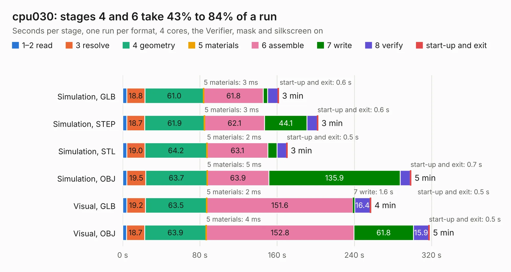

# 2782. cpu030

Board 2,782 of the 3,125 of [Corpus Testing](../Corpus-Testing.md), on [Corpus Page 26](../CorpusTestingPages/Corpus-Testing-26.md#2782-cpu030).

| Mode and format | 1–2 read | 3 resolve | 4 geometry | 5 materials | 6 assemble | 7 write | 8 verify | start-up and exit | Total |
|---|---:|---:|---:|---:|---:|---:|---:|---:|---:|
| Simulation, GLB | 4.2 | 18.8 | 61.0 | 3&nbsp;ms | 61.8 | 4.4 | 10.7 | 0.6 | 161.4 |
| Simulation, STEP | 4.1 | 18.7 | 61.9 | 3&nbsp;ms | 62.1 | 44.1 | 10.6 | 0.6 | 202.2 |
| Simulation, STL | 4.1 | 19.0 | 64.2 | 2&nbsp;ms | 63.1 | 9.3 | 10.0 | 0.5 | 170.4 |
| Simulation, OBJ | 4.3 | 19.5 | 63.7 | 5&nbsp;ms | 63.9 | 135.9 | 10.5 | 0.7 | 298.6 |
| Visual, GLB | 4.3 | 19.2 | 63.5 | 2&nbsp;ms | 151.6 | 1.6 | 16.4 | 0.5 | 257.1 |
| Visual, OBJ | 4.0 | 18.7 | 63.9 | 4&nbsp;ms | 152.8 | 61.8 | 15.9 | 0.5 | 317.6 |

<table align="center"><tr><td valign="top">

| Board | Repo: [thorpej/pg68k](https://github.com/thorpej/pg68k) Board: `cpu030.kicad_pcb` |
|---|---|
| Folder | cpu030 / design-files |
| Complexity | 403&nbsp;/&nbsp;1000 (size&nbsp;313, features&nbsp;90) |
| KESE&nbsp;features | through vias, rounded, trapezoid or chamfered pads, filled zones, TrueType text, stack-up, dielectric εr and tanδ |
| Tested | 9th November 2026 to 10th November 2026 |
| Copper&nbsp;layers | 6 |
| File&nbsp;format | KiCad 9 (20241229) |
| Parts,&nbsp;tracks,&nbsp;vias | 227, 9,174, 1,472 |
| Triangles,&nbsp;simulation | 18,435,500 in 555 parts |
| Verifier | PASS in all six runs |
| Run&nbsp;again | Simulation, OBJ: failed in the corpus run, run again with the memory cap raised from 11 GB to 14.5 GB, and passed |

</td><td valign="top">

<table>
<tr><th>File type</th><th>File size</th><th>Peak memory used</th></tr>
<tr><th colspan="3" align="left">Simulation</th></tr>
<tr><td>GLB</td><td align="right">616&nbsp;MB</td><td align="right">4.0&nbsp;GB</td></tr>
<tr><td>STEP</td><td align="right">2.1&nbsp;GB</td><td align="right">5.3&nbsp;GB</td></tr>
<tr><td>STL</td><td align="right">922&nbsp;MB</td><td align="right">3.8&nbsp;GB</td></tr>
<tr><td>OBJ</td><td align="right">2.0&nbsp;GB</td><td align="right">12&nbsp;GB</td></tr>
<tr><th colspan="3" align="left">Visual</th></tr>
<tr><td>GLB</td><td align="right">304&nbsp;MB</td><td align="right">5.0&nbsp;GB</td></tr>
<tr><td>OBJ</td><td align="right">994&nbsp;MB</td><td align="right">6.5&nbsp;GB</td></tr>
</table>

</td></tr></table>

| Previous | Next |
|:---|---:|
| [2781. CM4_MATX](b2781b_CM4-MATX_KiCad_CM4-MATX_2174.md) | [2783. nqvme_template](b2783b_pg68k_nqvme-template.md) |
