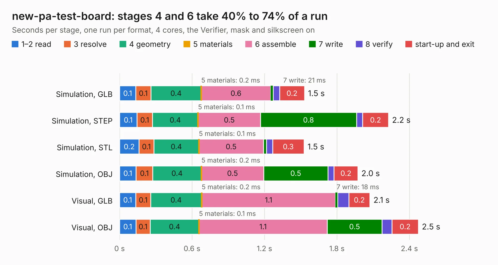

# 2782. new-pa-test-board

Board 2,782 of the 3,138 of [Corpus Testing](../Corpus-Testing.md), on [Corpus Page 26](../CorpusTestingPages/Corpus-Testing-26.md#2782-new-pa-test-board).

| Mode and format | 1–2 read | 3 resolve | 4 geometry | 5 materials | 6 assemble | 7 write | 8 verify | start-up and exit | Total |
|---|---:|---:|---:|---:|---:|---:|---:|---:|---:|
| Simulation, GLB | 0.1 | 0.1 | 0.4 | 0.2&nbsp;ms | 0.6 | 21&nbsp;ms | 52&nbsp;ms | 0.2 | 1.5 |
| Simulation, STEP | 0.1 | 0.1 | 0.4 | 0.1&nbsp;ms | 0.5 | 0.8 | 51&nbsp;ms | 0.2 | 2.2 |
| Simulation, STL | 0.2 | 0.1 | 0.4 | 0.1&nbsp;ms | 0.5 | 25&nbsp;ms | 51&nbsp;ms | 0.3 | 1.5 |
| Simulation, OBJ | 0.1 | 0.1 | 0.4 | 0.2&nbsp;ms | 0.5 | 0.5 | 50&nbsp;ms | 0.2 | 2.0 |
| Visual, GLB | 0.1 | 0.1 | 0.4 | 0.2&nbsp;ms | 1.1 | 18&nbsp;ms | 92&nbsp;ms | 0.2 | 2.1 |
| Visual, OBJ | 0.1 | 0.1 | 0.4 | 0.1&nbsp;ms | 1.1 | 0.5 | 82&nbsp;ms | 0.2 | 2.5 |

<table align="center"><tr><td valign="top">

| Board | Repo: [terrapin-rocket-team/srad-avionics](https://github.com/terrapin-rocket-team/srad-avionics) Board: `new-pa-test-board.kicad_pcb` |
|---|---|
| Folder | Spaceport / PCBs / new-pa-test-board |
| Complexity | 228&nbsp;/&nbsp;1000 (size&nbsp;118, features&nbsp;110) |
| KESE&nbsp;features | through vias, custom pads, rounded, trapezoid or chamfered pads, filled zones, copper drawings, curved board outline, stack-up, dielectric εr and tanδ |
| Tested | 9th November 2026 |
| Copper&nbsp;layers | 2 |
| File&nbsp;format | KiCad 9 (20241229) |
| Parts,&nbsp;tracks,&nbsp;vias | 15, 27, 16 |
| Triangles,&nbsp;simulation | 113,532 in 21 parts |
| Verifier | PASS in all six runs |

</td><td valign="top">

<table>
<tr><th>File type</th><th>File size</th><th>Peak memory used</th></tr>
<tr><th colspan="3" align="left">Simulation</th></tr>
<tr><td>GLB</td><td align="right">4.0&nbsp;MB</td><td align="right">185&nbsp;MB</td></tr>
<tr><td>STEP</td><td align="right">19&nbsp;MB</td><td align="right">192&nbsp;MB</td></tr>
<tr><td>STL</td><td align="right">5.7&nbsp;MB</td><td align="right">189&nbsp;MB</td></tr>
<tr><td>OBJ</td><td align="right">11&nbsp;MB</td><td align="right">182&nbsp;MB</td></tr>
<tr><th colspan="3" align="left">Visual</th></tr>
<tr><td>GLB</td><td align="right">3.0&nbsp;MB</td><td align="right">158&nbsp;MB</td></tr>
<tr><td>OBJ</td><td align="right">8.3&nbsp;MB</td><td align="right">158&nbsp;MB</td></tr>
</table>

</td></tr></table>

| Previous | Next |
|:---|---:|
| [2781. mcu-board](b2781b_srad-avionics_mcu-board.md) | [2783. pa-test-board](b2783b_srad-avionics_pa-test-board.md) |
