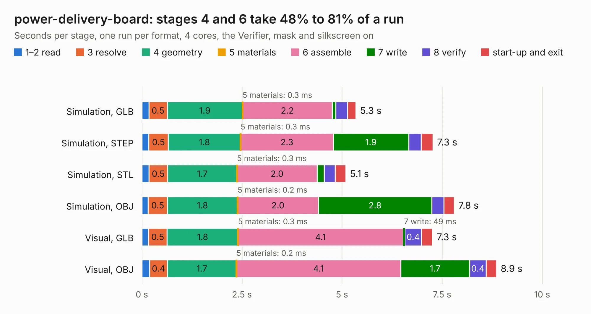

# 2784. power-delivery-board

Board 2,784 of the 3,138 of [Corpus Testing](../Corpus-Testing.md), on [Corpus Page 26](../CorpusTestingPages/Corpus-Testing-26.md#2784-power-delivery-board).

| Mode and format | 1–2 read | 3 resolve | 4 geometry | 5 materials | 6 assemble | 7 write | 8 verify | start-up and exit | Total |
|---|---:|---:|---:|---:|---:|---:|---:|---:|---:|
| Simulation, GLB | 0.2 | 0.5 | 1.9 | 0.3&nbsp;ms | 2.2 | 90&nbsp;ms | 0.3 | 0.2 | 5.3 |
| Simulation, STEP | 0.2 | 0.5 | 1.8 | 0.3&nbsp;ms | 2.3 | 1.9 | 0.3 | 0.3 | 7.3 |
| Simulation, STL | 0.2 | 0.5 | 1.7 | 0.3&nbsp;ms | 2.0 | 0.2 | 0.3 | 0.3 | 5.1 |
| Simulation, OBJ | 0.2 | 0.5 | 1.8 | 0.2&nbsp;ms | 2.0 | 2.8 | 0.3 | 0.3 | 7.8 |
| Visual, GLB | 0.2 | 0.5 | 1.8 | 0.3&nbsp;ms | 4.1 | 49&nbsp;ms | 0.4 | 0.3 | 7.3 |
| Visual, OBJ | 0.2 | 0.4 | 1.7 | 0.2&nbsp;ms | 4.1 | 1.7 | 0.4 | 0.3 | 8.9 |

<table align="center"><tr><td valign="top">

| Board | Repo: [terrapin-rocket-team/srad-avionics](https://github.com/terrapin-rocket-team/srad-avionics) Board: `power-delivery-board.kicad_pcb` |
|---|---|
| Folder | Spaceport / PCBs / power-delivery-board / power-delivery-board |
| Complexity | 273&nbsp;/&nbsp;1000 (size&nbsp;178, features&nbsp;95) |
| KESE&nbsp;features | through vias, slotted holes, rounded, trapezoid or chamfered pads, filled zones, curved board outline, stack-up, dielectric εr and tanδ |
| Tested | 9th November 2026 |
| Copper&nbsp;layers | 4 |
| File&nbsp;format | KiCad 8 (20240108) |
| Parts,&nbsp;tracks,&nbsp;vias | 60, 297, 51 |
| Triangles,&nbsp;simulation | 476,606 in 66 parts |
| Verifier | PASS in all six runs |

</td><td valign="top">

<table>
<tr><th>File type</th><th>File size</th><th>Peak memory used</th></tr>
<tr><th colspan="3" align="left">Simulation</th></tr>
<tr><td>GLB</td><td align="right">16&nbsp;MB</td><td align="right">268&nbsp;MB</td></tr>
<tr><td>STEP</td><td align="right">70&nbsp;MB</td><td align="right">313&nbsp;MB</td></tr>
<tr><td>STL</td><td align="right">24&nbsp;MB</td><td align="right">270&nbsp;MB</td></tr>
<tr><td>OBJ</td><td align="right">48&nbsp;MB</td><td align="right">321&nbsp;MB</td></tr>
<tr><th colspan="3" align="left">Visual</th></tr>
<tr><td>GLB</td><td align="right">9.7&nbsp;MB</td><td align="right">288&nbsp;MB</td></tr>
<tr><td>OBJ</td><td align="right">28&nbsp;MB</td><td align="right">290&nbsp;MB</td></tr>
</table>

</td></tr></table>

| Previous | Next |
|:---|---:|
| [2783. pa-test-board](b2783b_srad-avionics_pa-test-board.md) | [2785. RF4463F30-test-board](b2785b_srad-avionics_RF4463F30-test-board.md) |
