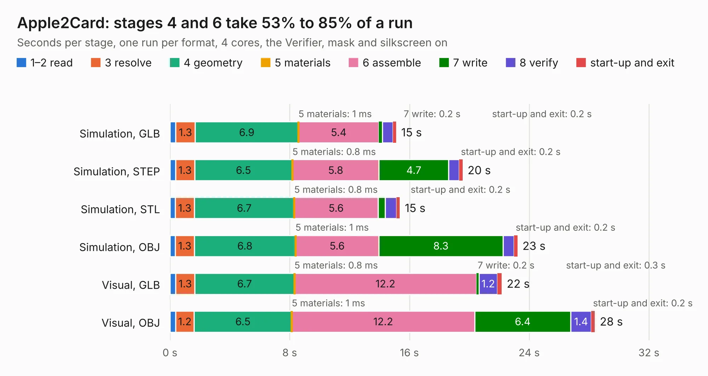

# 2788. Apple2Card

Board 2,788 of the 3,128 of [Corpus Testing](../Corpus-Testing.md), on [Corpus Page 26](../CorpusTestingPages/Corpus-Testing-26.md#2788-apple2card).

| Mode and format | 1–2 read | 3 resolve | 4 geometry | 5 materials | 6 assemble | 7 write | 8 verify | start-up and exit | Total |
|---|---:|---:|---:|---:|---:|---:|---:|---:|---:|
| Simulation, GLB | 0.4 | 1.3 | 6.9 | 1&nbsp;ms | 5.4 | 0.2 | 0.7 | 0.2 | 15.1 |
| Simulation, STEP | 0.4 | 1.3 | 6.5 | 0.8&nbsp;ms | 5.8 | 4.7 | 0.7 | 0.2 | 19.6 |
| Simulation, STL | 0.4 | 1.3 | 6.7 | 0.8&nbsp;ms | 5.6 | 0.5 | 0.8 | 0.2 | 15.4 |
| Simulation, OBJ | 0.4 | 1.3 | 6.8 | 1&nbsp;ms | 5.6 | 8.3 | 0.7 | 0.2 | 23.2 |
| Visual, GLB | 0.4 | 1.3 | 6.7 | 0.8&nbsp;ms | 12.2 | 0.2 | 1.2 | 0.3 | 22.2 |
| Visual, OBJ | 0.4 | 1.2 | 6.5 | 1&nbsp;ms | 12.2 | 6.4 | 1.4 | 0.2 | 28.4 |

<table align="center"><tr><td valign="top">

| Board | Repo: [ThorstenBr/Apple2Card](https://github.com/ThorstenBr/Apple2Card) Board: `Apple2Card.kicad_pcb` |
|---|---|
| Folder | Apple2Card_x44 |
| Complexity | 299&nbsp;/&nbsp;1000 (size&nbsp;224, features&nbsp;75) |
| KESE&nbsp;features | through vias, rounded, trapezoid or chamfered pads, filled zones, stack-up, dielectric εr and tanδ |
| Tested | 9th November 2026 |
| Copper&nbsp;layers | 2 |
| File&nbsp;format | KiCad 7 (20221018) |
| Parts,&nbsp;tracks,&nbsp;vias | 75, 977, 184 |
| Triangles,&nbsp;simulation | 1,599,832 in 148 parts |
| Verifier | PASS in all six runs |

</td><td valign="top">

<table>
<tr><th>File type</th><th>File size</th><th>Peak memory used</th></tr>
<tr><th colspan="3" align="left">Simulation</th></tr>
<tr><td>GLB</td><td align="right">54&nbsp;MB</td><td align="right">640&nbsp;MB</td></tr>
<tr><td>STEP</td><td align="right">256&nbsp;MB</td><td align="right">797&nbsp;MB</td></tr>
<tr><td>STL</td><td align="right">80&nbsp;MB</td><td align="right">612&nbsp;MB</td></tr>
<tr><td>OBJ</td><td align="right">164&nbsp;MB</td><td align="right">1.1&nbsp;GB</td></tr>
<tr><th colspan="3" align="left">Visual</th></tr>
<tr><td>GLB</td><td align="right">41&nbsp;MB</td><td align="right">923&nbsp;MB</td></tr>
<tr><td>OBJ</td><td align="right">126&nbsp;MB</td><td align="right">986&nbsp;MB</td></tr>
</table>

</td></tr></table>

| Previous | Next |
|:---|---:|
| [2787. Apple2Card](b2787b_Apple2Card_Apple2Card_Apple2Card.md) | [2789. TFGPS01](b2789b_TFGPS01_TFGPS01.md) |
