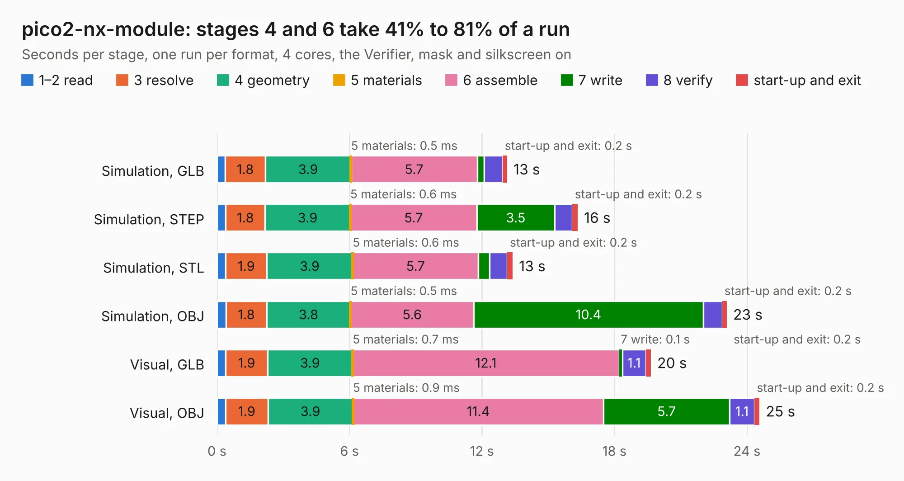

# 2790. pico2-nx-module

Board 2,790 of the 3,100 of [Corpus Testing](../Corpus-Testing.md), on [Corpus Page 26](../CorpusTestingPages/Corpus-Testing-26.md#2790-pico2-nx-module).

| Mode and format | 1–2 read | 3 resolve | 4 geometry | 5 materials | 6 assemble | 7 write | 8 verify | start-up and exit | Total |
|---|---:|---:|---:|---:|---:|---:|---:|---:|---:|
| Simulation, GLB | 0.4 | 1.8 | 3.9 | 0.5&nbsp;ms | 5.7 | 0.3 | 0.8 | 0.2 | 13.1 |
| Simulation, STEP | 0.4 | 1.8 | 3.9 | 0.6&nbsp;ms | 5.7 | 3.5 | 0.8 | 0.2 | 16.3 |
| Simulation, STL | 0.4 | 1.9 | 3.9 | 0.6&nbsp;ms | 5.7 | 0.5 | 0.8 | 0.2 | 13.4 |
| Simulation, OBJ | 0.4 | 1.8 | 3.8 | 0.5&nbsp;ms | 5.6 | 10.4 | 0.9 | 0.2 | 23.1 |
| Visual, GLB | 0.4 | 1.9 | 3.9 | 0.7&nbsp;ms | 12.1 | 0.1 | 1.1 | 0.2 | 19.6 |
| Visual, OBJ | 0.4 | 1.9 | 3.9 | 0.9&nbsp;ms | 11.4 | 5.7 | 1.1 | 0.2 | 24.6 |

<table align="center"><tr><td valign="top">

| Board | Repo: [tinyvision-ai-inc/pico2-nx](https://github.com/tinyvision-ai-inc/pico2-nx) Board: `pico2-nx-module.kicad_pcb` |
|---|---|
| Folder | board / Rev0 / pico2-nx-module |
| Complexity | 347&nbsp;/&nbsp;1000 (size&nbsp;272, features&nbsp;75) |
| KESE&nbsp;features | through vias, rounded, trapezoid or chamfered pads, filled zones, stack-up, dielectric εr and tanδ |
| Tested | 9th November 2026 |
| Copper&nbsp;layers | 6 |
| File&nbsp;format | KiCad 9 (20241229) |
| Parts,&nbsp;tracks,&nbsp;vias | 71, 1,994, 270 |
| Triangles,&nbsp;simulation | 1,969,336 in 138 parts |
| Verifier | PASS in all six runs |

</td><td valign="top">

<table>
<tr><th>File type</th><th>File size</th><th>Peak memory used</th></tr>
<tr><th colspan="3" align="left">Simulation</th></tr>
<tr><td>GLB</td><td align="right">66&nbsp;MB</td><td align="right">642&nbsp;MB</td></tr>
<tr><td>STEP</td><td align="right">223&nbsp;MB</td><td align="right">774&nbsp;MB</td></tr>
<tr><td>STL</td><td align="right">98&nbsp;MB</td><td align="right">655&nbsp;MB</td></tr>
<tr><td>OBJ</td><td align="right">204&nbsp;MB</td><td align="right">1.3&nbsp;GB</td></tr>
<tr><th colspan="3" align="left">Visual</th></tr>
<tr><td>GLB</td><td align="right">36&nbsp;MB</td><td align="right">738&nbsp;MB</td></tr>
<tr><td>OBJ</td><td align="right">112&nbsp;MB</td><td align="right">801&nbsp;MB</td></tr>
</table>

</td></tr></table>

| Previous | Next |
|:---|---:|
| [2789. pico2-ice](b2789b_pico2-ice_Board-Rev2_pico2-ice.md) | [2791. pico2-nx](b2791b_pico2-nx_pico2-nx.md) |
