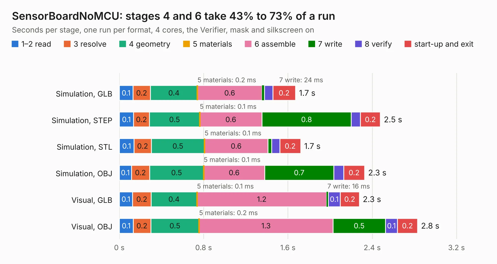

# 2790. SensorBoardNoMCU

Board 2,790 of the 3,139 of [Corpus Testing](../Corpus-Testing.md), on [Corpus Page 26](../CorpusTestingPages/Corpus-Testing-26.md#2790-sensorboardnomcu).

| Mode and format | 1–2 read | 3 resolve | 4 geometry | 5 materials | 6 assemble | 7 write | 8 verify | start-up and exit | Total |
|---|---:|---:|---:|---:|---:|---:|---:|---:|---:|
| Simulation, GLB | 0.1 | 0.2 | 0.4 | 0.2&nbsp;ms | 0.6 | 24&nbsp;ms | 79&nbsp;ms | 0.2 | 1.7 |
| Simulation, STEP | 0.1 | 0.2 | 0.5 | 0.1&nbsp;ms | 0.6 | 0.8 | 88&nbsp;ms | 0.2 | 2.5 |
| Simulation, STL | 0.1 | 0.2 | 0.5 | 0.1&nbsp;ms | 0.6 | 38&nbsp;ms | 76&nbsp;ms | 0.2 | 1.7 |
| Simulation, OBJ | 0.1 | 0.2 | 0.5 | 0.1&nbsp;ms | 0.6 | 0.7 | 93&nbsp;ms | 0.2 | 2.3 |
| Visual, GLB | 0.1 | 0.2 | 0.4 | 0.1&nbsp;ms | 1.2 | 16&nbsp;ms | 0.1 | 0.2 | 2.3 |
| Visual, OBJ | 0.1 | 0.2 | 0.5 | 0.2&nbsp;ms | 1.3 | 0.5 | 0.1 | 0.2 | 2.8 |

<table align="center"><tr><td valign="top">

| Board | Repo: [terrapin-rocket-team/srad-avionics](https://github.com/terrapin-rocket-team/srad-avionics) Board: `SensorBoardNoMCU.kicad_pcb` |
|---|---|
| Folder | Spaceport / PCBs / Sensor Boards / SensorBoardAirbrake |
| Complexity | 255&nbsp;/&nbsp;1000 (size&nbsp;140, features&nbsp;115) |
| KESE&nbsp;features | through vias, rounded, trapezoid or chamfered pads, filled zones, curved board outline, knockout text, TrueType text, stack-up, dielectric εr and tanδ |
| Tested | 9th November 2026 |
| Copper&nbsp;layers | 4 |
| File&nbsp;format | KiCad 10 (20260206) |
| Parts,&nbsp;tracks,&nbsp;vias | 12, 92, 11 |
| Triangles,&nbsp;simulation | 138,354 in 23 parts |
| Verifier | PASS in all six runs |

</td><td valign="top">

<table>
<tr><th>File type</th><th>File size</th><th>Peak memory used</th></tr>
<tr><th colspan="3" align="left">Simulation</th></tr>
<tr><td>GLB</td><td align="right">4.9&nbsp;MB</td><td align="right">205&nbsp;MB</td></tr>
<tr><td>STEP</td><td align="right">22&nbsp;MB</td><td align="right">213&nbsp;MB</td></tr>
<tr><td>STL</td><td align="right">6.9&nbsp;MB</td><td align="right">203&nbsp;MB</td></tr>
<tr><td>OBJ</td><td align="right">14&nbsp;MB</td><td align="right">206&nbsp;MB</td></tr>
<tr><th colspan="3" align="left">Visual</th></tr>
<tr><td>GLB</td><td align="right">3.5&nbsp;MB</td><td align="right">166&nbsp;MB</td></tr>
<tr><td>OBJ</td><td align="right">9.9&nbsp;MB</td><td align="right">164&nbsp;MB</td></tr>
</table>

</td></tr></table>

| Previous | Next |
|:---|---:|
| [2789. PatchAntennaBreakout](b2789b_srad-avionics_PatchAntennaBreakout.md) | [2791. SensorBoardNoMCU](b2791b_srad-avionics_Spaceport-PCBs-Sensor-Boards-SensorBoardPatch_SensorBoardNoMCU.md) |
