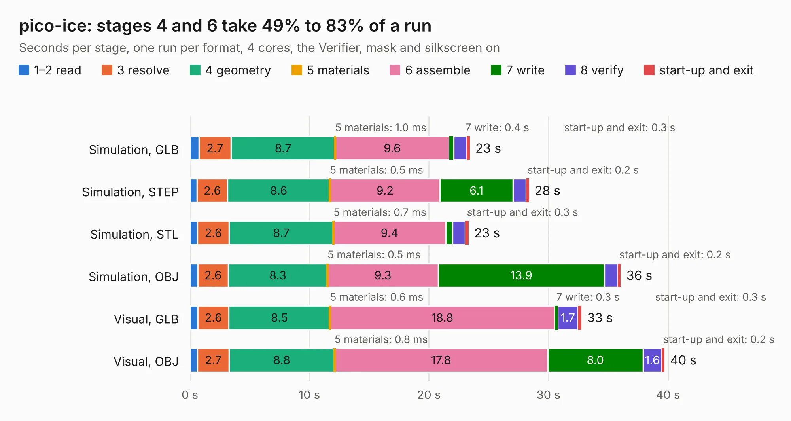

# 2791. pico-ice

Board 2,791 of the 3,107 of [Corpus Testing](../Corpus-Testing.md), on [Corpus Page 26](../CorpusTestingPages/Corpus-Testing-26.md#2791-pico-ice).

| Mode and format | 1–2 read | 3 resolve | 4 geometry | 5 materials | 6 assemble | 7 write | 8 verify | start-up and exit | Total |
|---|---:|---:|---:|---:|---:|---:|---:|---:|---:|
| Simulation, GLB | 0.7 | 2.7 | 8.7 | 1.0&nbsp;ms | 9.6 | 0.4 | 1.1 | 0.3 | 23.4 |
| Simulation, STEP | 0.6 | 2.6 | 8.6 | 0.5&nbsp;ms | 9.2 | 6.1 | 1.1 | 0.2 | 28.4 |
| Simulation, STL | 0.6 | 2.6 | 8.7 | 0.7&nbsp;ms | 9.4 | 0.6 | 1.1 | 0.3 | 23.3 |
| Simulation, OBJ | 0.7 | 2.6 | 8.3 | 0.5&nbsp;ms | 9.3 | 13.9 | 1.1 | 0.2 | 36.0 |
| Visual, GLB | 0.7 | 2.6 | 8.5 | 0.6&nbsp;ms | 18.8 | 0.3 | 1.7 | 0.3 | 32.8 |
| Visual, OBJ | 0.6 | 2.7 | 8.8 | 0.8&nbsp;ms | 17.8 | 8.0 | 1.6 | 0.2 | 39.7 |

<table align="center"><tr><td valign="top">

| Board | Repo: [tinyvision-ai-inc/pico-ice](https://github.com/tinyvision-ai-inc/pico-ice) Board: `pico-ice.kicad_pcb` |
|---|---|
| Folder | Board / Rev1 |
| Complexity | 375&nbsp;/&nbsp;1000 (size&nbsp;255, features&nbsp;120) |
| KESE&nbsp;features | through vias, slotted holes, custom pads, rounded, trapezoid or chamfered pads, filled zones, copper drawings, curved board outline, stack-up, dielectric εr and tanδ |
| Tested | 9th November 2026 |
| Copper&nbsp;layers | 4 |
| File&nbsp;format | KiCad 6 (20211014) |
| Parts,&nbsp;tracks,&nbsp;vias | 86, 1,748, 182 |
| Triangles,&nbsp;simulation | 2,332,170 in 113 parts |
| Verifier | PASS in all six runs |

</td><td valign="top">

<table>
<tr><th>File type</th><th>File size</th><th>Peak memory used</th></tr>
<tr><th colspan="3" align="left">Simulation</th></tr>
<tr><td>GLB</td><td align="right">81&nbsp;MB</td><td align="right">752&nbsp;MB</td></tr>
<tr><td>STEP</td><td align="right">423&nbsp;MB</td><td align="right">912&nbsp;MB</td></tr>
<tr><td>STL</td><td align="right">117&nbsp;MB</td><td align="right">793&nbsp;MB</td></tr>
<tr><td>OBJ</td><td align="right">253&nbsp;MB</td><td align="right">1.6&nbsp;GB</td></tr>
<tr><th colspan="3" align="left">Visual</th></tr>
<tr><td>GLB</td><td align="right">51&nbsp;MB</td><td align="right">937&nbsp;MB</td></tr>
<tr><td>OBJ</td><td align="right">157&nbsp;MB</td><td align="right">1.1&nbsp;GB</td></tr>
</table>

</td></tr></table>

| Previous | Next |
|:---|---:|
| [2790. pico-ice](b2790b_pico-ice_Board-Rev0_pico-ice.md) | [2792. pico-ice](b2792b_pico-ice_Board-Rev2_pico-ice.md) |
