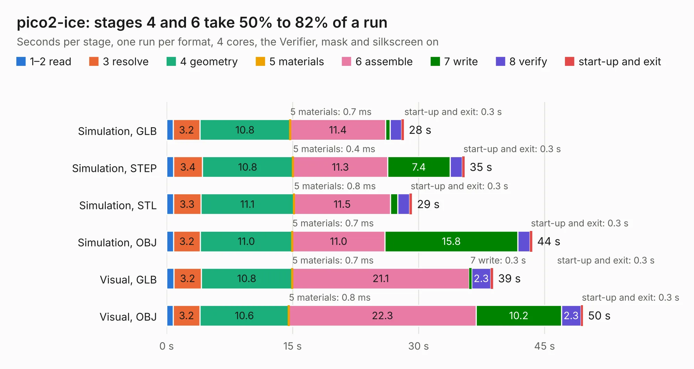

# 2791. pico2-ice

Board 2,791 of the 3,102 of [Corpus Testing](../Corpus-Testing.md), on [Corpus Page 26](../CorpusTestingPages/Corpus-Testing-26.md#2791-pico2-ice).

| Mode and format | 1–2 read | 3 resolve | 4 geometry | 5 materials | 6 assemble | 7 write | 8 verify | start-up and exit | Total |
|---|---:|---:|---:|---:|---:|---:|---:|---:|---:|
| Simulation, GLB | 0.8 | 3.2 | 10.8 | 0.7&nbsp;ms | 11.4 | 0.5 | 1.4 | 0.3 | 28.2 |
| Simulation, STEP | 0.8 | 3.4 | 10.8 | 0.4&nbsp;ms | 11.3 | 7.4 | 1.4 | 0.3 | 35.5 |
| Simulation, STL | 0.8 | 3.3 | 11.1 | 0.8&nbsp;ms | 11.5 | 0.9 | 1.4 | 0.3 | 29.2 |
| Simulation, OBJ | 0.8 | 3.2 | 11.0 | 0.7&nbsp;ms | 11.0 | 15.8 | 1.4 | 0.3 | 43.5 |
| Visual, GLB | 0.9 | 3.2 | 10.8 | 0.7&nbsp;ms | 21.1 | 0.3 | 2.3 | 0.3 | 38.9 |
| Visual, OBJ | 0.8 | 3.2 | 10.6 | 0.8&nbsp;ms | 22.3 | 10.2 | 2.3 | 0.3 | 49.6 |

<table align="center"><tr><td valign="top">

| Board | Repo: [tinyvision-ai-inc/pico2-ice](https://github.com/tinyvision-ai-inc/pico2-ice) Board: `pico2-ice.kicad_pcb` |
|---|---|
| Folder | Board / Rev2 |
| Complexity | 382&nbsp;/&nbsp;1000 (size&nbsp;262, features&nbsp;120) |
| KESE&nbsp;features | through vias, slotted holes, custom pads, rounded, trapezoid or chamfered pads, filled zones, copper drawings, curved board outline, stack-up, dielectric εr and tanδ |
| Tested | 9th November 2026 |
| Copper&nbsp;layers | 4 |
| File&nbsp;format | KiCad 9 (20241229) |
| Parts,&nbsp;tracks,&nbsp;vias | 110, 2,189, 270 |
| Triangles,&nbsp;simulation | 2,736,022 in 139 parts |
| Verifier | PASS in all six runs |

</td><td valign="top">

<table>
<tr><th>File type</th><th>File size</th><th>Peak memory used</th></tr>
<tr><th colspan="3" align="left">Simulation</th></tr>
<tr><td>GLB</td><td align="right">95&nbsp;MB</td><td align="right">980&nbsp;MB</td></tr>
<tr><td>STEP</td><td align="right">463&nbsp;MB</td><td align="right">1.1&nbsp;GB</td></tr>
<tr><td>STL</td><td align="right">137&nbsp;MB</td><td align="right">900&nbsp;MB</td></tr>
<tr><td>OBJ</td><td align="right">298&nbsp;MB</td><td align="right">1.8&nbsp;GB</td></tr>
<tr><th colspan="3" align="left">Visual</th></tr>
<tr><td>GLB</td><td align="right">60&nbsp;MB</td><td align="right">1.1&nbsp;GB</td></tr>
<tr><td>OBJ</td><td align="right">189&nbsp;MB</td><td align="right">1.3&nbsp;GB</td></tr>
</table>

</td></tr></table>

| Previous | Next |
|:---|---:|
| [2790. pico2-ice](b2790b_pico2-ice_Board-Rev1_pico2-ice.md) | [2792. pico2-nx-module](b2792b_pico2-nx_board-Rev0-pico2-nx-module_pico2-nx-module.md) |
