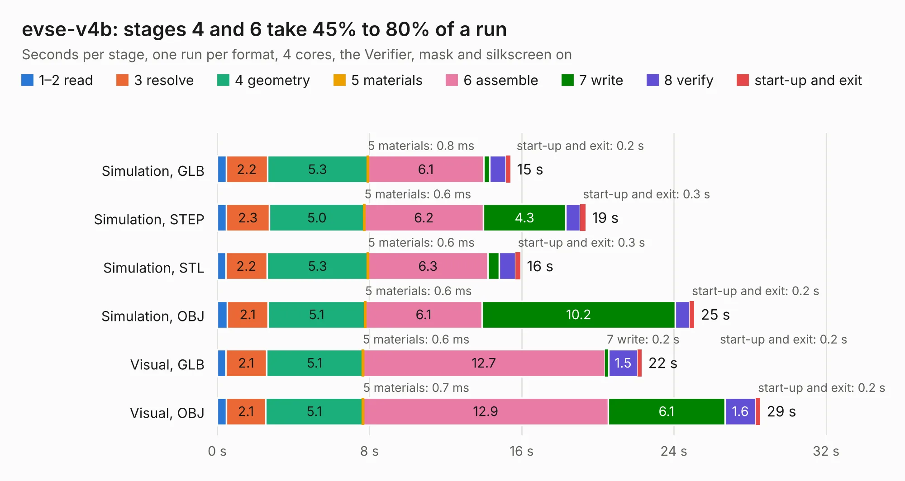

# 2792. evse-v4b

Board 2,792 of the 3,125 of [Corpus Testing](../Corpus-Testing.md), on [Corpus Page 26](../CorpusTestingPages/Corpus-Testing-26.md#2792-evse-v4b).

| Mode and format | 1–2 read | 3 resolve | 4 geometry | 5 materials | 6 assemble | 7 write | 8 verify | start-up and exit | Total |
|---|---:|---:|---:|---:|---:|---:|---:|---:|---:|
| Simulation, GLB | 0.5 | 2.2 | 5.3 | 0.8&nbsp;ms | 6.1 | 0.3 | 0.9 | 0.2 | 15.4 |
| Simulation, STEP | 0.5 | 2.3 | 5.0 | 0.6&nbsp;ms | 6.2 | 4.3 | 0.8 | 0.3 | 19.4 |
| Simulation, STL | 0.4 | 2.2 | 5.3 | 0.6&nbsp;ms | 6.3 | 0.6 | 0.9 | 0.3 | 15.9 |
| Simulation, OBJ | 0.5 | 2.1 | 5.1 | 0.6&nbsp;ms | 6.1 | 10.2 | 0.8 | 0.2 | 25.1 |
| Visual, GLB | 0.5 | 2.1 | 5.1 | 0.6&nbsp;ms | 12.7 | 0.2 | 1.5 | 0.2 | 22.3 |
| Visual, OBJ | 0.5 | 2.1 | 5.1 | 0.7&nbsp;ms | 12.9 | 6.1 | 1.6 | 0.2 | 28.5 |

<table align="center"><tr><td valign="top">

| Board | Repo: [tinkerforge/evse-v4-bricklet](https://github.com/tinkerforge/evse-v4-bricklet) Board: `evse-v4b.kicad_pcb` |
|---|---|
| Folder | hardware / variant-b / evse-v4b |
| Complexity | 343&nbsp;/&nbsp;1000 (size&nbsp;258, features&nbsp;85) |
| KESE&nbsp;features | through vias, rounded, trapezoid or chamfered pads, filled zones, curved board outline, stack-up, dielectric εr and tanδ |
| Tested | 9th November 2026 |
| Copper&nbsp;layers | 4 |
| File&nbsp;format | KiCad 9 (20241229) |
| Parts,&nbsp;tracks,&nbsp;vias | 167, 1,682, 308 |
| Triangles,&nbsp;simulation | 1,941,680 in 137 parts |
| Verifier | PASS in all six runs |

</td><td valign="top">

<table>
<tr><th>File type</th><th>File size</th><th>Peak memory used</th></tr>
<tr><th colspan="3" align="left">Simulation</th></tr>
<tr><td>GLB</td><td align="right">65&nbsp;MB</td><td align="right">691&nbsp;MB</td></tr>
<tr><td>STEP</td><td align="right">220&nbsp;MB</td><td align="right">858&nbsp;MB</td></tr>
<tr><td>STL</td><td align="right">97&nbsp;MB</td><td align="right">690&nbsp;MB</td></tr>
<tr><td>OBJ</td><td align="right">202&nbsp;MB</td><td align="right">1.3&nbsp;GB</td></tr>
<tr><th colspan="3" align="left">Visual</th></tr>
<tr><td>GLB</td><td align="right">38&nbsp;MB</td><td align="right">782&nbsp;MB</td></tr>
<tr><td>OBJ</td><td align="right">119&nbsp;MB</td><td align="right">916&nbsp;MB</td></tr>
</table>

</td></tr></table>

| Previous | Next |
|:---|---:|
| [2791. evse-v4](b2791b_evse-v4-bricklet_evse-v4.md) | [2793. red](b2793b_red-brick_red.md) |
