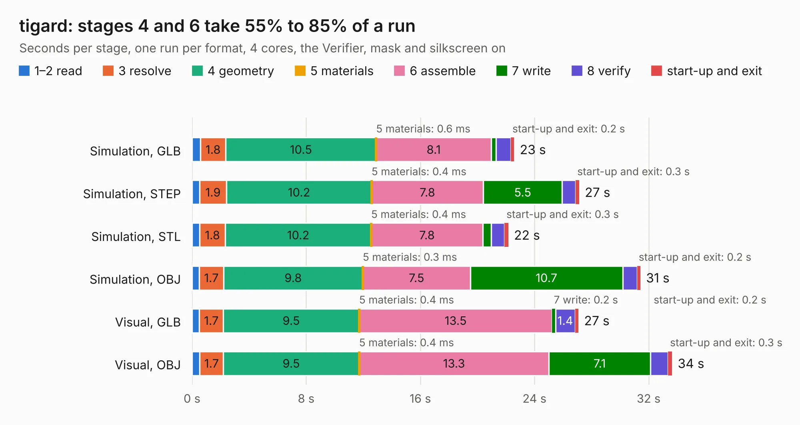

# 2792. tigard

Board 2,792 of the 3,130 of [Corpus Testing](../Corpus-Testing.md), on [Corpus Page 26](../CorpusTestingPages/Corpus-Testing-26.md#2792-tigard).

| Mode and format | 1–2 read | 3 resolve | 4 geometry | 5 materials | 6 assemble | 7 write | 8 verify | start-up and exit | Total |
|---|---:|---:|---:|---:|---:|---:|---:|---:|---:|
| Simulation, GLB | 0.6 | 1.8 | 10.5 | 0.6&nbsp;ms | 8.1 | 0.3 | 1.0 | 0.2 | 22.6 |
| Simulation, STEP | 0.5 | 1.9 | 10.2 | 0.4&nbsp;ms | 7.8 | 5.5 | 0.9 | 0.3 | 27.1 |
| Simulation, STL | 0.5 | 1.8 | 10.2 | 0.4&nbsp;ms | 7.8 | 0.6 | 0.9 | 0.3 | 22.2 |
| Simulation, OBJ | 0.5 | 1.7 | 9.8 | 0.3&nbsp;ms | 7.5 | 10.7 | 1.0 | 0.2 | 31.4 |
| Visual, GLB | 0.5 | 1.7 | 9.5 | 0.4&nbsp;ms | 13.5 | 0.2 | 1.4 | 0.2 | 27.1 |
| Visual, OBJ | 0.5 | 1.7 | 9.5 | 0.4&nbsp;ms | 13.3 | 7.1 | 1.2 | 0.3 | 33.6 |

<table align="center"><tr><td valign="top">

| Board | Repo: [tigard-tools/tigard](https://github.com/tigard-tools/tigard) Board: `tigard.kicad_pcb` |
|---|---|
| Complexity | 329&nbsp;/&nbsp;1000 (size&nbsp;239, features&nbsp;90) |
| KESE&nbsp;features | through vias, slotted holes, custom pads, rounded, trapezoid or chamfered pads, filled zones, copper drawings, curved board outline |
| Tested | 9th November 2026 |
| Copper&nbsp;layers | 4 |
| File&nbsp;format | KiCad 5 (20171130) |
| Parts,&nbsp;tracks,&nbsp;vias | 84, 823, 148 |
| Triangles,&nbsp;simulation | 2,056,614 in 99 parts |
| Verifier | PASS in all six runs |

</td><td valign="top">

<table>
<tr><th>File type</th><th>File size</th><th>Peak memory used</th></tr>
<tr><th colspan="3" align="left">Simulation</th></tr>
<tr><td>GLB</td><td align="right">72&nbsp;MB</td><td align="right">834&nbsp;MB</td></tr>
<tr><td>STEP</td><td align="right">349&nbsp;MB</td><td align="right">895&nbsp;MB</td></tr>
<tr><td>STL</td><td align="right">103&nbsp;MB</td><td align="right">744&nbsp;MB</td></tr>
<tr><td>OBJ</td><td align="right">218&nbsp;MB</td><td align="right">1.4&nbsp;GB</td></tr>
<tr><th colspan="3" align="left">Visual</th></tr>
<tr><td>GLB</td><td align="right">48&nbsp;MB</td><td align="right">963&nbsp;MB</td></tr>
<tr><td>OBJ</td><td align="right">145&nbsp;MB</td><td align="right">1.0&nbsp;GB</td></tr>
</table>

</td></tr></table>

| Previous | Next |
|:---|---:|
| [2791. TFGPS01](b2791b_TFGPS01_TFGPS01.md) | [2793. HDMI2USB](b2793b_HDMI2USB-numato-opsis-hardware_HDMI2USB.md) |
