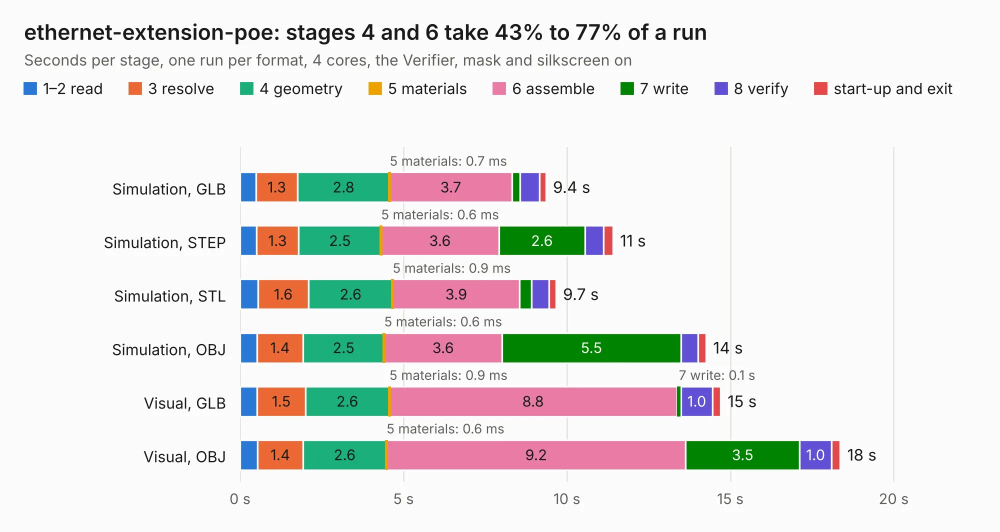

# 2794. ethernet-extension-poe

Board 2,794 of the 3,130 of [Corpus Testing](../Corpus-Testing.md), on [Corpus Page 26](../CorpusTestingPages/Corpus-Testing-26.md#2794-ethernet-extension-poe).

| Mode and format | 1–2 read | 3 resolve | 4 geometry | 5 materials | 6 assemble | 7 write | 8 verify | start-up and exit | Total |
|---|---:|---:|---:|---:|---:|---:|---:|---:|---:|
| Simulation, GLB | 0.5 | 1.3 | 2.8 | 0.7&nbsp;ms | 3.7 | 0.3 | 0.6 | 0.2 | 9.4 |
| Simulation, STEP | 0.5 | 1.3 | 2.5 | 0.6&nbsp;ms | 3.6 | 2.6 | 0.6 | 0.3 | 11.4 |
| Simulation, STL | 0.5 | 1.6 | 2.6 | 0.9&nbsp;ms | 3.9 | 0.4 | 0.5 | 0.2 | 9.7 |
| Simulation, OBJ | 0.5 | 1.4 | 2.5 | 0.6&nbsp;ms | 3.6 | 5.5 | 0.5 | 0.2 | 14.3 |
| Visual, GLB | 0.5 | 1.5 | 2.6 | 0.9&nbsp;ms | 8.8 | 0.1 | 1.0 | 0.2 | 14.7 |
| Visual, OBJ | 0.5 | 1.4 | 2.6 | 0.6&nbsp;ms | 9.2 | 3.5 | 1.0 | 0.3 | 18.4 |

<table align="center"><tr><td valign="top">

| Board | Repo: [Tinkerforge/ethernet-extension](https://github.com/Tinkerforge/ethernet-extension) Board: `ethernet-extension-poe.kicad_pcb` |
|---|---|
| Folder | hardware / poe |
| Complexity | 300&nbsp;/&nbsp;1000 (size&nbsp;255, features&nbsp;45) |
| KESE&nbsp;features | through vias, filled zones, curved board outline |
| Tested | 9th November 2026 |
| Copper&nbsp;layers | 4 |
| File&nbsp;format | KiCad 4 (4) |
| Parts,&nbsp;tracks,&nbsp;vias | 106, 1,924, 345 |
| Triangles,&nbsp;simulation | 1,240,232 in 142 parts |
| Verifier | PASS in all six runs |

</td><td valign="top">

<table>
<tr><th>File type</th><th>File size</th><th>Peak memory used</th></tr>
<tr><th colspan="3" align="left">Simulation</th></tr>
<tr><td>GLB</td><td align="right">42&nbsp;MB</td><td align="right">537&nbsp;MB</td></tr>
<tr><td>STEP</td><td align="right">137&nbsp;MB</td><td align="right">599&nbsp;MB</td></tr>
<tr><td>STL</td><td align="right">62&nbsp;MB</td><td align="right">537&nbsp;MB</td></tr>
<tr><td>OBJ</td><td align="right">130&nbsp;MB</td><td align="right">852&nbsp;MB</td></tr>
<tr><th colspan="3" align="left">Visual</th></tr>
<tr><td>GLB</td><td align="right">27&nbsp;MB</td><td align="right">666&nbsp;MB</td></tr>
<tr><td>OBJ</td><td align="right">86&nbsp;MB</td><td align="right">721&nbsp;MB</td></tr>
</table>

</td></tr></table>

| Previous | Next |
|:---|---:|
| [2793. HDMI2USB](b2793b_HDMI2USB-numato-opsis-hardware_HDMI2USB.md) | [2795. ethernet-extension-wopoe](b2795b_ethernet-extension_ethernet-extension-wopoe.md) |
